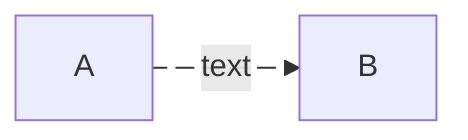

# Diagrams

## Format

- Always use `mermaid`, and no external images.
- Make each diagram render on GitHub and GitLab.
- Use no `%%{init}%%` config directives or custom themes — portability is not
  guaranteed across both.
- Use ASCII in a fenced block only for what mermaid does not support, such as
  directory structures.

## Animate every dotted or dashed link

A dotted link (`-. text .->`) marks a loop-back, an alternative, or a deferred
edge. Give the edge an id, and turn animation on. This uses the Mermaid ≥ 11.3
edge-id syntax. Renderers that sanitize CSS fall back to a static dotted link.

## Type by purpose

Pick the type by purpose. Do not default everything to a flowchart.

| Purpose                                 | Type                  |
| --------------------------------------- | --------------------- |
| Process, topology, dependencies         | `flowchart` (`graph`) |
| Interactions over time, API or messages | `sequenceDiagram`     |
| Data model, entities and relations      | `erDiagram`           |
| Lifecycle, status machine               | `stateDiagram-v2`     |

## Content

- Quote any label with special characters: `A["pay (USD)"]`, not `A[pay (USD)]`.
  Unquoted parens, brackets and colons are the top cause of a diagram that does
  not render.
- Show one concept per diagram. Split a diagram rather than cram it.
- Keep node IDs short and alphanumeric, and put the prose in the label.
- Use `%%` comments to explain complex parts.
