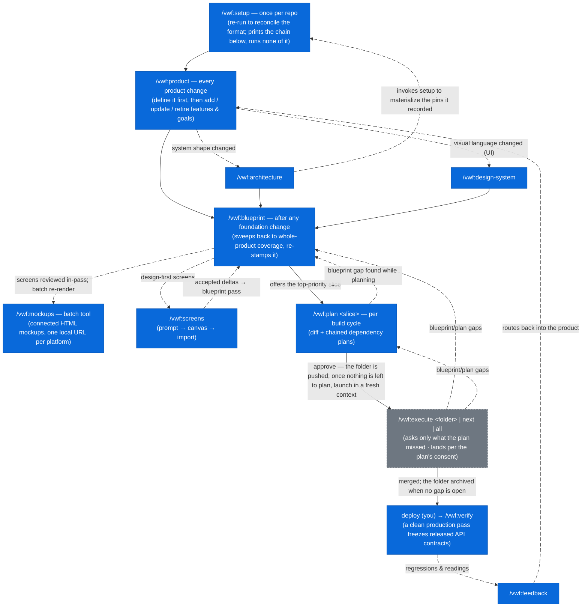
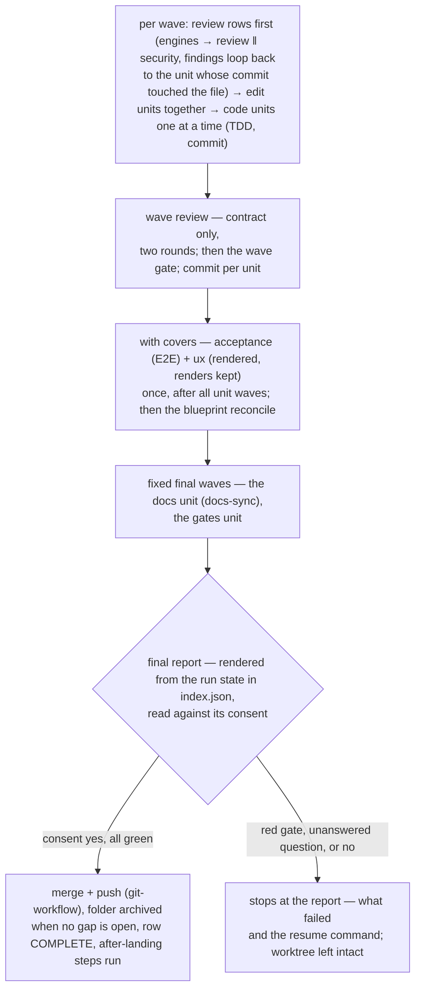

The flagship plugin of the `virajp-plugins` marketplace — an opinionated
workflow that turns a vague idea into a shipped, reviewed product through four
disciplined phases: **Product → Blueprint → Plan → Execute**, with post-deploy
verification and a production-feedback intake closing the loop.

This is the full manual. For the short pitch and the rest of the marketplace,
see [readme.md](https://github.com/virajp/claude-plugins/blob/main/readme.md).

This page is the reference, command by command. If you would rather follow one
product's whole walk through the workflow, the journey-shaped guides are in
[docs/how-to](../how-to/index.md), organized by the situation you are in.

## Install

```sh
# Once
claude plugin marketplace add virajp/claude-plugins

# Installs vwf and its one dependency, stackgen
claude plugin install vwf@virajp-plugins
```

Add `--scope project` to either command to keep it to one repo. Restart the
agent afterwards, then run **`/vwf:doctor`** — nothing is verified at install
time, and doctor is what reports a missing required binary.

The `pnpx @virajp.dev/claude-plugins` installer installs plugins and nothing
else.

A repo shaped by [`/vwf:init`](#vwfinit) keeps its plugins current with
bootstrap's `setup:ai` task. See
[the repo baseline](./stackgen.md#the-repo-baseline--bootstrap).

Separately, `brew install virajp/tap/claude-status` installs the statusline —
and with it the caps hook that delivers `/vwf:execute`'s resource-cap pause.
Nothing in the toolkit installs it. See [/vwf:execute](#vwfexecute).

Restart Claude Code afterward so the commands, hooks, and dependencies load.

## Prerequisites

`vwf` shells out to a few external tools. Install them first — nothing checks
them at install time, and the table below gives the command for each.

| Tool            | Required?    | Why                                                                                              | Install                                                                  |
| --------------- | ------------ | ------------------------------------------------------------------------------------------------ | ------------------------------------------------------------------------ |
| mise            | **required** | task runner + resolves the toolchain                                                             | `brew install mise`                                                      |
| node            | **required** | runs vwf's own scripts, the mockup scripts among them, and the context7 tool when picked         | `node` in your global mise config, then `mise install`                   |
| pnpm            | when picked  | the default runner of the context7 tool, when a product picks it; `CONTEXT7_RUNNER` overrides it | `pnpm` in your global mise config, then `mise install`                   |
| Claude Code CLI | **required** | hosts the commands                                                                               | `claude-code` in your global mise config, then `mise install`            |
| gh              | recommended  | reads and writes the backlog project (`/vwf:backlog`)                                            | `brew install gh`, then `gh auth login` and `gh auth refresh -s project` |

Your global mise config is `~/.config/mise/config.toml`: add each tool to its
`[tools]` table at an exact version, then run `mise install`. Never a bare
`mise use` — it writes a pin nobody reviewed.

**Nothing checks these at install time.** `claude plugin install vwf` succeeds
regardless, so the first thing to run afterwards is **`/vwf:doctor`** — it
reports a missing required one as a **blocking** finding, and both `/vwf:setup`
and `/vwf:execute` halt on one — with one condition on `mise` since
`config_format` 16: with no stack axis pinned anywhere and no harness capability
claimed there is nothing for it to resolve, so its absence degrades rather than
blocks until one is. An earlier installer refused the install outright and
printed the command to fix each; that gate did not come back when the
installer's plugin flags did, so the failure now arrives at first use rather
than at install. `gh` is the exception: [`/vwf:backlog`](#vwfbacklog) and the
planners' recall of it need the GitHub CLI, and so do [`/vwf:init`](#vwfinit)'s
**forge pass** — the default branch, the protection on `develop` and `main`, the
backlog project; `glab` on a GitLab remote — and the `/vwf:doctor` predicate
that reads that forge state back. Doctor reports a CLI that is absent, not
logged in, or without the `project` scope as a **degradation** with the remedy,
every run, and skips the forge-state predicate with a note; init prints the
by-hand list and carries on.

**Memory needs nothing installed.** vwf's cross-session memory is a markdown
tree under `docs/memory/` in the repo — no server, no daemon, no tool to
install. See [Memory](#memory). The hooks `vwf` ships are the five
[`/vwf:execute` action-log hooks](#the-action-log) and one hooks module, the
[`/vwf:execute` progress pane](#the-progress-pane).

`vwf` also depends on one plugin — `stackgen` — resolved from the same
`virajp-plugins` marketplace. Claude Code **auto-installs and auto-enables** it
when you enable `vwf` (requires Claude Code ≥ 2.1.143). `devtools` was a second
dependency until it dissolved into `stackgen`; if your machine still has it,
`claude plugin uninstall devtools` — an upgrade stops listing it but leaves it
enabled, shadowing the stackgen packs its skills moved into.

`stackgen` is a dependency because vwf's stack menu is the union of what the
installed stack plugins declare, and the eight axes carry no *other (describe)*
option — so with no stack plugin present, `/vwf:architecture` asks a question
you cannot answer. Having it installed costs nothing if you are not ready to
choose a stack: stackgen acts only when an axis is pinned.

The Markdown/documentation skills used to be another dependency. They are **part
of `vwf` now**: `documentation-standards` and `/vwf:readme` are vwf skills.
Context7 was one too, then part of vwf, and is now an
[optional tool](#mcp-servers) you pick, since nothing in vwf calls it. The
Karpathy coding guidelines were a third, and are now a **vendored** skill —
`karpathy-guidelines` — because as a url-sourced
dependency it was silently absent for most installs, and vendoring puts the
provenance beside the code it governs.

**No CI plugin is among them.** vwf states the delivery-pipeline *contract* —
what a deploy must guarantee, never how it is spelled — and the CI system pinned
on a project's `cicd` axis implements it. Since the `cicd` plugin dissolved,
that system arrives as a [`stackgen`](./stackgen.md) `ci-system` bundle, which
installs with vwf as its dependency.

**A design tool is not among them.** vwf is decoupled from any particular one,
and since Wave D it names none at all. It delegates screen, design-system and
review-conversation imports to three of its own fixed skills, which in turn
delegate to three more fixed names in **the repo's own `.claude/`** —
`design-import-screens`, `design-import-design-system` and
`design-import-conversations`. Those are what the project's `design:` pin
materializes from a stack `design-tool` pack, resolved **per project**, so a
product can design its website with one tool and its app with another. vwf's own
three — `import-design-system`, `import-screens`, `import-conversations` — are
**skill-invoked**: hidden from the `/` menu, reached only from
`/vwf:design-system`, `/vwf:screens import` and `/vwf:feedback canvas`. They
answer in a payload shape no user reads, so there is nothing to type.

Adding a tool is a pack and a menu entry in the stack plugin, never a vwf
change. Export needs no adapter at all, since `/vwf:screens prompt` just writes
design briefs as files.

## Caveats

`vwf` is deliberately heavyweight. Know what you're signing up for before
adopting it.

**Model & cost**

- **Built for a large context window.** The orchestrator holds a lot at once:
  the blueprint, the plan, the registry, and each subagent's output. Run Claude
  Code with the **1-million-token** context; the standard window will degrade or
  overflow on a real cycle.
- **Model and effort are tiered per surface, not uniform.** `opus` runs where
  judgment decides the outcome (`product`, `blueprint`, `plan`, the
  `blueprint-reviewer` and `blueprint-coherence-reviewer` gates) or where nobody
  reviews each step — `execute` is the run command, and its `execute-runner`
  (one per plan under `/vwf:execute all`), its `execute-coder`, the code-review
  and security-review subagents that run at the plan's review rows, and the ux
  subagent are all `opus` too. `sonnet` runs the remaining commands and the
  writer/surveyor subagents, `plan-management` among them — its bookkeeping is
  mechanical, but it reads a queue across repos; `haiku` runs the one purely
  mechanical command (`recall`). Effort follows the same logic rather than
  sitting at maximum everywhere: a stronger model reaches the same answer in
  fewer reasoning tokens, so capability and effort are traded against each other
  per surface instead of both being maxed. No gate is weakened — the review runs
  at the plan's review rows, and config can never disable one.
- **Read-heavy work is delegated to keep the orchestrator fast.** Coverage
  scans, the desired-vs-actual codebase survey, and the bulk doc writing run in
  subagents (`blueprint-surveyor`, `plan-surveyor`, `flow-writer`,
  `entity-writer`) that return conclusions rather than file contents. Anything
  the orchestrator loads is re-processed on every later turn of the pass, so
  keeping scans out of its context compounds across a sweep.
- **High token cost.** An `execute` cycle runs several subagents — the coder per
  step, code review and security review per review row, all on `opus`, plus E2E
  acceptance and UX conformance when the slice warrants them — with fix
  loop-backs. The coder is the dominant consumer: it runs per step and per fix
  round, so `opus` there is the single largest cost in the workflow. The wager
  is that better code means fewer `code → review` rounds, and round count drives
  a cycle's length more than per-token latency does. Independent stages also run
  concurrently — review ‖ security per review row, all per-doc blueprint
  reviewers in one round — which cuts wall-clock but not spend. Expect a
  meaningful cost per slice; this is not a cheap workflow.

**Dependencies**

- **External prerequisites, checked at run time rather than install time.**
  `mise` and `node` must be on your `PATH`, and `pnpm` too when a product picks
  the `context7` tool. Nothing refuses the install any
  more; `/vwf:setup` and `/vwf:execute` halt on a missing `mise` once a stack is
  pinned, and `pnpm` fails later in its own way. `gh`, logged in, is needed by
  [`/vwf:backlog`](#vwfbacklog) (the `project` scope), by
  [`/vwf:init`](#vwfinit)'s forge pass (the `repo` scope — `project` only for
  its backlog step; `glab` on GitLab) and by the doctor predicate that reads the
  forge state back; its absence is a **degradation** too, and init falls back to
  a by-hand list. Dependency auto-install/enable needs Claude Code ≥ 2.1.143.
  See [Prerequisites](#prerequisites).
- **Memory is plain files.** Every memory write is a markdown file under
  `docs/memory/` — `decisions/`, `gaps/` and `problems/` committed, `handoff/`
  gitignored, being one developer's state rather than the team's. Recall lists
  the file names and reads the ones matching the topic at hand. See
  [Memory](#memory).
- **Leans on review engines.** `execute` runs the `/code-review` and
  `/security-review` engines itself at each review row the plan places, over the
  branch delta since the previous one, and hands their findings to the code- and
  security-review stages; a reviewer falls back to its own manual review
  dimensions when its engine is unavailable.

**Fit**

- **High-touch where it matters, hands-off where the plan already decided.** The
  authoring phases (product, architecture, design-system, blueprint, plan) ask
  one question at a time and gate on your approval — plan for interactive
  sessions. `/vwf:execute` then runs the approved plan folder in a fresh
  session: code per unit, code review and security review at the review rows the
  plan places, and one acceptance and ux pass after all units, deciding from a
  fixed rule set. It **asks you only what the plan missed** — one question at a
  time, the recommendation first, the answer recorded in the folder — and stops
  only on a hard halt, a resource cap, or the **final report**, where it lands
  per the consent the plan recorded, and stops for you only when a gate is red,
  a question goes unanswered, or consent said no.
- **Released APIs are frozen.** Once `/vwf:verify` records a production release,
  breaking a released API contract is blocked like a security finding —
  reviewers loop it until fixed, and the only way out is a conscious
  major-version bump. If you want to move fast and break contracts, this will
  fight you.
- **Requires a testable project.** `execute` enforces non-negotiable TDD and a
  coverage gate. A project without a test runner won't fit the execute stage;
  missing coverage tooling is tolerated (the coder reports `coverage: n/a` and
  the gate decides). The verification harness (dev server, E2E suites, staging
  mode) is self-healing: `setup` detects and stamps what exists, and `plan`
  injects bootstrap steps for whatever a slice's gates need — so harness gaps
  surface at plan time with their fix attached, not as surprises at a gate.
- **Assumes a registry-described workspace.** `plan` and `execute` map each
  slice to a project in the architecture registry and read its code (submodules
  included). You model the codebase with `/vwf:architecture` first; it won't
  operate on an ad-hoc folder. Work that has no slice behind it goes to
  `/vwf:change-plan` instead, which reads no registry and no blueprint, and
  `/vwf:execute` runs the folder it writes without reading either.
- **Structure and stacks are both menus.** `vwf` ships three topology templates
  (`repo` / `monorepo` / `multi-repo`) and `/vwf:architecture` presents stack
  templates per axis — you pick, and the choice plus its reason is recorded so
  it is never re-litigated. A multi-repo product picks a **linkage** too:
  `submodule` (recommended) or `siblings`, so a product whose repos are ordinary
  clones needs no restructuring to be onboarded.
- **Solo / small-team focus.** It is highly opinionated — one workflow, one set
  of conventions. Great for a solo dev or small team; not a configurable
  framework for a large org.

## The mental model

Each phase answers one question:

- **Product** answers *is this worth building, and what does "good" mean?* — the
  problem, the users, measurable goals, and the order to build in. Every flow in
  the blueprint must trace to a goal here.
- **Blueprint** answers *what should the whole product be?* — permanent,
  product-wide, organized by **flow** (the user/system journeys, grouped by the
  registry project that owns each journey and numbered in execution order —
  mobile-app flows live apart from website and console flows), with entities as
  the supporting data contracts. It is a **code-independent technical
  contract**: it pins every decision that has more than one reasonable answer
  *and* is true regardless of how the code is written — flows (each with
  acceptance criteria and a sequence diagram, carrying the screens and jobs they
  need), data models as JSON-Schema `schema.yaml` files, API surfaces as
  per-service OpenAPI contracts, relationships, concurrency, and UI/UX — so
  `plan` and `execute` never have to ask or assume. A whole-product coherence
  review walks every flow across the entities and contracts before coverage
  counts as complete. Reuse-vs-build, file placement, ordering, and library
  choices are `plan`'s job, not the blueprint's.
- **Plan** answers *what changes for this one slice, and in what order?* — a
  diff, not a re-blueprint, scoped to a single flow or entity. Unbuilt
  dependencies are not swallowed into the plan: each becomes **its own plan**,
  chained (`covers`/`requires`) and executed in order.
- **Execute** answers *is it built, correct, safe, and does it do what the
  blueprint promises?* — TDD per unit, code/security review at the review rows
  the plan places, then E2E acceptance and rendered-UI conformance. When the run
  lands, it stamps each covered blueprint doc's `implementation:` state — the
  blueprint stays the source of truth, and it now knows what's built.
- **Verify & feedback** answer *does it hold in production, and what next?* —
  post-deploy checks against the same acceptance criteria, and a routed intake
  for what production teaches you. A clean production run offers to record a
  **release**, freezing each service's API contract — from then on, breaking a
  released API is blocked like a security finding unless you consciously cut a
  new major version.

Each command has its own cadence — `setup` once, `product` on every product
change, `plan` per build cycle — and the transitions chain from gate offers.
**Blue** nodes are commands you prompt; **gray dashed** nodes run without you
typing them (you only approve at their gates):



(`setup` **prints** the chain `product` → `architecture` → `design-system` →
`blueprint` and offers to start the first one; it runs none of them, because
each resolves its own mode and reports what it did. The one arrow back into
`setup` is `architecture`'s own: having recorded the stack pins and materialized
nothing, it invokes setup in-session so
[the materialize pass](#the-materialize-pass) lands them. Blue marks who prompts
them. Fully internal machinery never appears in the flow: `/vwf:git-workflow` is
invoked by the other commands for every git action, `/vwf:docs-sync` closes
every run that changes reality (and is yours to run after ad-hoc work), the five
execute subagents and the reviewer subagents run inside their commands, and
`handoff`/`recall` are session utilities you reach for only when a session runs
long.)

`/vwf:setup` runs once per repo (re-run to reconcile the format), and hands you
the chain rather than walking it. From there on, **`/vwf:product` is the front
door for every product change** — adding, updating, or retiring features and
goals — with `architecture` following when the system's shape changes and
`design-system` when the visual language does. Any foundation change ends in a
`/vwf:blueprint` sweep, which loops flow by flow (deriving the entities,
schemas, and API operations each flow stands on) until the **whole product** is
covered again — including a whole-product coherence review — and re-stamps that
coverage (`plan` refuses to run without it), then offers to plan the top slice.
Building is **one command per cycle**: `/vwf:plan <slice>` resolves the slice's
unbuilt dependencies into a **chain of small plans** (each behind its own gate,
executed in order — never one plan swallowing its dependencies), each approved
folder is committed and pushed, the launch line follows once nothing at the
backlog's priority is left to plan, `execute` runs it in a fresh context, asking
you only what the plan missed, and a dedicated worktree — or `execute all` runs
the whole queue, one runner per plan — and lands per the consent the folder
recorded — stamping the covered blueprint docs' `implementation:` state as it
lands — and archives the folder itself when no gap is open; one left live is
archived when you ask. After you deploy, `verify` checks the environment (and,
on a clean production pass, offers to freeze the released API contracts) and
`feedback` routes what production says back into the product. When execution
exposes a hole in the blueprint or plan, `vwf` captures it and loops back to fix
the source — never silently working around it.

Work with **no blueprint slice behind it** — tooling, CI, a docs tree, a
refactor, a repo the blueprint does not describe — never enters this chain at
all: it goes to [`/vwf:change-plan`](#vwfchange-plan), which sits beside the
chain and reads no blueprint, and then, in a fresh context, to the same
[`/vwf:execute`](#vwfexecute), which reads the blueprint only for a plan that
covers one.

## The documents it maintains

`vwf` keeps everything in version-controlled Markdown under `docs/`. The
blueprint is the desired state; the plans are the changes you apply to reach it.

```text
.config/
└── vwf.yaml                     # the vwf config — how vwf operates here (stamp,
                                 # harness, enforcement opt-outs, knobs, environments)
docs/
├── blueprint/                   # the always-current blueprint (desired state)
│   ├── product.md               # problem, users, measurable goals, slice priority
│   ├── registry.yaml            # machine-readable Project Registry (what every command parses)
│   ├── architecture.md          # system shape, in prose + a diagram (its human view)
│   ├── design-system.md         # product-wide UX/visual contract (if UI)
│   ├── conventions.md           # cross-cutting decisions (auth, errors, …)
│   ├── environment.md           # per-project env-var/secret catalog (names, never values)
│   ├── flows/                   # the PRIMARY unit — grouped by project, numbered
│   │   ├── index.md             # flow catalog (per-project sections) + inter-service contracts
│   │   └── <project>/           # one group per registry project owning the journeys
│   │       └── <NNN>-<flow>/    # NNN designated: 100 = home, 010/020/030/040 entry,
│   │           │                #   110–890 product, 910–950 account and audit screens
│   │           ├── index.md     # the PLATFORM-AGNOSTIC contract: trigger, actors,
│   │           │                #   steps, jobs, sequence diagram, acceptance
│   │           └── <platform>.md # one per implemented platform (mobile, tablet,
│   │                            #   desktop, site, webapp, auto, watch, tv,
│   │                            #   spatial) — screens (coded rows +
│   │                            #   per-screen components blocks), plus a
│   │                            #   per-screen Metadata block on site/webapp
│   ├── entities/                # the supporting data contracts
│   │   ├── index.md             # entity catalog + product-wide ER diagram
│   │   └── <entity>/            # index.md (lifecycle, relationships, invariants)
│   │       ├── index.md         #   + schema.yaml (the data model, JSON Schema)
│   │       └── schema.yaml
│   └── apis/                    # authoritative API contracts (OpenAPI 3.1)
│       ├── <project>.openapi.yaml  # one per API-publishing project
│       │                           # (a project declaring `service`)
│       └── released/            # frozen production snapshots — the release
│           │                    # record backward compatibility is enforced against
│           └── entities/        # every entity's schema.yaml, frozen at the same
│                                # release moment — <entity>@<date>.schema.yaml
├── plans/                       # plan folders, cycle and change alike
│   ├── index.json               # the plan index — base repo only, one per product
│   ├── <date>-<HHMM>-<slice>/   # a cycle plan: index.json (covers/requires/
│   │                            #   backlog, consent, unit state, gaps) + a prose
│   │                            #   index.md + a file per unit
│   ├── <date>-<name>/           # a change plan, the same shape
│   └── archived/                # retired folders, whole
│                                # (the backlog is not here — it is a project on
│                                #   the repo's forge, /vwf:backlog's alone)
├── prompts/                     # canvas design briefs (committed intent)
│   └── <type>/                  # prompt type (e.g. screens)
│       └── <project>/           # registry project
│           ├── CLAUDE--<platform>.md # the platform canvas project's conventions
│           │                         # CLAUDE.md source (one per pinned design
│           │                         # project; canvas-owned section preserved
│           │                         # on regeneration)
│           └── <NNN>-<flow>/    # the flow the briefs commission
│               └── <platform>.md # ONE brief per platform (mobile.md, tablet.md,
│                                 # desktop.md, site.md, webapp.md, auto.md,
│                                 # watch.md, tv.md, spatial.md) — mirrors the
│                                 # flow folder's platform files; always the
│                                 # flow's full blueprint, regenerated in place
└── runbooks/                    # operational runbooks (incident-response foundation)
    └── postmortems.md           # postmortem stubs /vwf:feedback incident appends
```

Each flow doc holds one journey end to end — who triggers it, the steps across
entities and services, the screens and jobs it needs, and the acceptance
criteria that prove it. Each entity doc is the data contract under those flows
(`Used by:` links them), with its authoritative shape in `schema.yaml`. Flow and
entity docs carry an `implementation:` frontmatter stamp the pipeline maintains
— the blueprint always knows what's built. The **Project Registry** is its own
file, `registry.yaml`, which `blueprint` and `plan` parse to map a flow's
sections to the right project by `type`; `architecture.md` is the prose view of
the same facts and no command reads it.

The registry carries **no stack**. Which technology each project is built with
lives in `.config/vwf.yaml`, as a structured block naming the template you
picked plus its languages, frameworks and key dependencies. That split is not
bookkeeping: it means no blueprint-authoring or reviewing surface can see a
technology name, so a blueprint that mentions your database, cloud, or payment
vendor fails review by construction. Docs say "the datastore" and "the payment
provider", and stay true when you swap either.

## Structure

Structure is a **menu**, like stacks. `vwf` ships three topology templates and
`/vwf:setup` presents the one it detects for confirmation; the choice and its
reason land in `.config/vwf.yaml` and are never re-litigated.

| Topology     | What it is                                             | `docs/blueprint/` lives |
| ------------ | ------------------------------------------------------ | ----------------------- |
| `repo`       | One codebase, deployed as a whole                      | the repo root           |
| `monorepo`   | One VCS repo, several independently-buildable projects | the repo root           |
| `multi-repo` | A group of repos coordinated by a **base** repo        | the base repo           |

The deciding question isn't project count — it's whether the product's code can
share **one dependency graph and one release cadence**. Yes → `monorepo`. No →
`multi-repo`. A Flutter app beside a TypeScript backend is the classic no: store
review can't sync with continuous deploy, and Dart can't share a dependency
graph with TypeScript.

A multi-repo product has a **base repo** holding the blueprint, the config and
the plan index — and no product code — plus one or more **members** holding the
code. How the members are wired is the `linkage:` choice:

**`linkage: submodule`** (recommended) — the members are git submodules, so one
`clone --recurse-submodules` reproduces the product at a known-good set of
commits, and the pointer commits record which member versions were ever
consistent together:

```text
my-product/           # base repo — vwf lives here
├── .gitmodules
├── docs/blueprint/   # the vwf bundle (one per product)
├── docs/plans/index.json
├── backend/          # submodule — a monorepo
│   ├── projects/     # api · worker · web · ops
│   └── packages/
│       └── common/   # the shared kernel
└── app/              # submodule — a single repo (Flutter)
```

**`linkage: siblings`** — the members are ordinary repos cloned next to the
base. Nothing wires them in git, so vwf does it: the base's `members:` list
names each one (with the git URL to clone it from), and each member carries
`.config/vwf-membership.yaml` pointing back. That back-link is load-bearing —
without it, running `/vwf:plan` from inside a member would find no config and
report a perfectly onboarded repo as un-onboarded.

```text
~/Projects/acme/
├── acme-product/     # base repo — docs only
│   ├── docs/blueprint/
│   └── .config/vwf.yaml     # members: [...]
├── acme-api/         # plain repo
│   └── .config/vwf-membership.yaml
└── acme-app/
    └── .config/vwf-membership.yaml
```

**Not every member has to be on your machine.** A twenty-repo product doesn't
fit on one laptop, and vwf detects what's present on every run rather than
recording it — presence is per-developer state, not a property of the product.
When a command needs a repo you don't have, it offers to clone it; decline and
it proceeds with that project excluded and **says which projects it couldn't
inspect**. `/vwf:execute` is the exception: it offers nothing and stops, naming
the missing repo and its clone command, since it can't write code into a repo
you don't have.

**Where plans live:** a plan lives in the repo whose code it changes, and the
base repo keeps a thin `docs/plans/index.json` — one row per plan folder of
either kind, the queue `/vwf:execute next` reads — one file for the
whole product. In a `repo` or `monorepo` product that's the one checkout, so the
rule costs nothing.

Existing repos whose layout differs from their topology's suggested grouping get
a **written recommendation** from `/vwf:setup` — never a move. setup writes and
moves documentation only; every source-layout change, in-repo or across a repo
boundary, is named in the report with its target layout and left to you.
Recording a decline under `enforcement:` stops the proposal recurring, not the
finding: `/vwf:doctor` keeps reporting it. Adding or removing a repo later is
incremental, and removing one **archives** its blueprint docs rather than
deleting them.

### Stack templates

The stack is **not** enforced — and **vwf itself ships no stack templates at
all**. It defines the axes, the `role` vocabulary and the template shape; every
actual option lives in a **stack plugin**, under whatever layout that plugin
keeps — vwf never reads one by path, only through two fixed adapter skill names.
`/vwf:architecture` presents the union across your installed plugins as a menu —
one round per project. The menu is the **whole** answer: there is no *other
(describe)* option, so an axis nothing on it fits is never recorded as a
free-text pin (see below). Each project carries exactly one role, so it picks
exactly one project template and there is nothing to merge. Install no stack
plugin and the menu is empty — since `config_format` **16** that is a
postponement rather than a dead end: vwf names the three ways forward (install
the plugin that has one, write it, or **defer the axis** as `unresolved`) rather
than coming back quietly short.

A stack is composed from **eight independent axes** — you answer each one, and
they never merge because they never overlap. `project` and `repo` take a single
template; `backing` and `deploy` take a **list**, one entry per capability and
one per delivery mechanism (`deploy_template` became a list in `config_format`
**16**, because a project routinely publishes to a package registry *and* ships
a container image):

| Axis           | Scope       | Takes                                                                                                          |
| -------------- | ----------- | -------------------------------------------------------------------------------------------------------------- |
| **project**    | per project | one template, filtered by the platforms the project declares — see below                                       |
| **backing**    | per project | a list — one entry per capability the project talks to (datastore, identity, telemetry, …)                     |
| **deploy**     | per project | a list — one entry per delivery mechanism the project ships through                                            |
| **repo**       | per repo    | one template describing the checkout — its package manager and workspace layout                                |
| **design**     | per project | one design tool — the slug *is* the config value                                                               |
| **cicd**       | per project | one CI system — the slug *is* the config value                                                                 |
| **stylesheet** | per project | one stylesheet approach — the slug *is* the config value; asked only of a project declaring `site` or `webapp` |
| **addon**      | per product | a list — the optional tools the product picks, written as the top-level `addons:`; nothing preselected         |

**No slug appears in that table on purpose.** The roster is not vwf's to state:
the menu is the union of what your **installed** stack plugins declare, so it
changes with what you install, and `/vwf:architecture` is what enumerates it for
your repo. Today [stackgen](./stackgen.md) is the only stack plugin, and it
carries all eight axes — the general-purpose set, the managed backing and deploy
services of each cloud it packs, and a generator for whatever no pack covers.

Since `config_format` **13** every technology and tool axis but `repo` is pinned
**per project**, so
a product can host its site on Cloudflare, its API on GCP and its worker
somewhere else again — and design its app in one tool while its website is
designed in another. On the `design`, `cicd` and `stylesheet` axes — the three
**tool axes** — the slug **is** the config value, so the menu pick and the
config key are one value rather than two that can disagree. Only `repo` stays
per repo; it describes the checkout, not a project.

**vwf ships no default, but it honours one the plugin declares.** A menu entry
may arrive flagged `default: true` — set in the stack plugin's own bundle, never
inferred by vwf — and that entry is what the round **preselects**: highlighted,
never assumed, with every other entry still offered and the user still picking.
At most one entry per axis **per platform** carries it — two flagged entries on
one axis are the plugin's defect when either serves every platform or their
platform lists overlap — and the round preselects the one flagged entry among
the entries it offers, after filtering by the project's platforms, so a flag on
an entry the round does not offer highlights nothing there. Where none does, the
round preselects the previous project's answer on that axis, and nothing before
that. The flag is menu state only — it reaches no config key, and a pin made by
accepting it is indistinguishable from one made by picking the same entry. Today
two entries are flagged: stackgen's terminal design tool on the `design` axis,
and its static Astro bundle on the `project` axis for `site` projects alone —
highlighted above the other three Astro bundles and the plain `html` one.

**The `stylesheet` axis is conditional.** Added in `config_format` **19**, it is
asked only of a project whose registry entry declares a `site` or a `webapp`
platform, and it is asked **after** that project's design round: the design
system's semantic tokens are the contract and the stylesheet is how they are
realized, so the order is the dependency rather than a preference. A project
declaring neither platform is never asked and records no key at all.

**The `addon` axis is the optional tools, and it follows its own rules.** Added
in `config_format` **25**, it is one multi-select round per product, the **tools
round**, shown after the last other round, with **nothing preselected**: only
what you pick is ever installed. The answer is the top-level `addons:` list in
`.config/vwf.yaml`, always a list, `[]` when none, and `[]` is a completed
answer
rather than a pending decision. A re-run shows the current pick and asks only
whether to change it. `/vwf:setup` materializes each slug in the base repo
alone,
on every run, and removes a dropped one; a difference from what is installed is
drift `/vwf:doctor` reports, never blocking, since whatever needs a tool halts
on
its own. Today's tools, and what needs each, are
[stackgen's](./stackgen.md#optional-tools--the-addon-kind).

**An axis can also be left unanswered.** Since `config_format` **16** any axis
but `addon` may read `unresolved` — deferred, not decided — which is the line
between
*defining* a product and *building* one. `/vwf:product`, `/vwf:architecture`,
`/vwf:blueprint`, `/vwf:design-system` and every other doc surface run to
completion with no stack chosen at all; `/vwf:doctor` reports the deferral as a
**degradation** every run and its stack-dependent checks report
`not checked — no stack resolved`; and `/vwf:plan` and `/vwf:execute` **halt**,
naming the axis and pointing at `/vwf:architecture`, because both size their
work against the pinned templates' conventions and an unresolved axis has none.
`unresolved` is not `template: custom` returning: `custom` asserted a stack that
did not exist and let the pipeline run on silently, while `unresolved` says out
loud that nobody has chosen — which is exactly why plan and execute refuse. `[]`
on the two list axes is its opposite: a decision that this project ships through
nothing, or talks to no backing service.

**Project-axis templates.** A template declares **which platforms it serves**,
and that list is what the menu filters on. One template routinely covers
several: an app framework can build four surfaces from one codebase, and a
full-stack template serves an API and its own UI — what the retired `fullstack`
role meant. **Your pin must cover every platform your project declares**, which
`/vwf:doctor` checks. Which templates exist, and what each is made of, is the
stack plugin's answer — [stackgen](./stackgen.md) states the set it ships.

**Templates ship in a stack plugin, never in vwf.** vwf has no `stacks/` tree at
all: it owns the eight axes, the platform vocabulary a template declares
against, and the two adapter skill names it reaches a plugin through. So a
product gets whichever menu its installed plugins add up to, and one that
installs nothing sees an empty one.

**Why the split matters.** The same Hono + Effect service runs against Firebase
or Postgres, on Cloud Run or any container host. Before `blueprint_format` 19
all three were welded into one document, so picking `service` because you wanted
Hono silently also bought you Firestore, Firebase Auth, Temporal and Cloud Run —
none of it declared. Now a project template names no vendor and a backing
template names no framework — and a backing template is now one capability
rather than a vendor bundle, so `postgres` + `oidc` + `otel-lgtm` + `temporal` +
`audit-store-postgres`, each a stackgen bundle, is a completely vendor-free path
through vwf. That last one is the shape to notice: an audit store is its own
capability (`audit-store`), pinned beside the datastore rather than folded into
it or into the telemetry sink.

An operator back-office is `backend` / `platforms: [service, webapp]` plus the
`operator-rbac` capability (`webapp` sits under `backend` as well as `frontend`
for exactly this shape), and picks whichever project template serves both of
those platforms at once. A project shipping through a store rather than to a
deploy target (`mobile`, `tablet`, `desktop`, `auto`, `watch`, `tv`, `spatial`)
records `[]` on the deploy axis, as does an `iac` project — it *is* the deploy
path. A `cli` project pins one, because a package registry is its target;
**which** template that is is the stack plugin's answer, and vwf names no slug
on this axis or any other.

**`iac` is the one platform vwf constrains structurally.** A project declaring
`iac` must live in **its own repo** — independent, or a member of the product's
base repo — under every topology, monorepo included. Blast radius, credentials,
lifecycle and cadence all differ in kind from application code, and one repo
cannot separate them. `/vwf:doctor` raises a violation as a **blocking** finding
and `/vwf:setup` writes the extraction up as a recommendation — it moves
nothing. Recording the decline under `enforcement:` drops the finding to a
warning reported every run, and neither `setup` nor `execute` halts on it after
that. Nothing else about repo shape is enforced.

A template reaches vwf as a **payload**, never as a file: its stack facts
(**languages**, **frameworks**, **dependencies**, plus the optional languages a
template admits — Flutter's Kotlin and Swift) and its **conventions** prose,
carrying the layout, testing and deployment rules. How a stack plugin stores
that template is its own business. Picking one fills those facts into
`.config/vwf.yaml`; you can then customize any of them. **Picking is
`/vwf:architecture`'s and landing is `/vwf:setup`'s** — architecture records the
slug and materializes nothing, then invokes setup, whose materialize pass asks
the plugin for the template once per (repo, slug) and lands it in the repo that
project belongs to.

Only the axes land in the config — the conventions prose stays with the plugin,
and `/vwf:plan` and `/vwf:execute` fetch it when they run: deduped by template
slug, once per run, before any work starts. That is what they size steps and
write code against, so a fetch that fails halts rather than degrading — code
written to conventions nobody read is indistinguishable from code written to
conventions that said nothing. The prose reaches `docs/plans/` and your source,
and never `docs/blueprint/`: it names technology, which is exactly what a
blueprint doc may not.

**vwf names no language, but the menu is closed.** A language token is whatever
a template declares, and the facts the tooling acts on — which LSP server covers
it, which manifest identifies it, which mise tool installs it — come from the
**language plugin** that owns it. vwf holds no table of its own; the union of
what the installed plugins declare **is** the vocabulary. `/vwf:doctor` reads
the block back and checks the repo agrees: an LSP server and toolchain per
declared language, every binary a materialized template's `binaries` fact names
resolving on `PATH` — or, where the entry carries a `probe`, that command
exiting 0, run only while the template entry matches its lockfile hash (blocking
once the project's template is pinned, a degradation while it reads
`unresolved`), every framework and dependency present in the project's manifest,
the repo's package manager and tooling — its lockfile found at one of the paths
the package-manager pack's `lockfile` fact names — harness task names, health
paths. It reports drift in both directions, including a framework doing obvious
structural work that your config never mentions.

A language no installed plugin claims is reported as *unknown*, and since
`config_format` **14** that is a **blocking** finding: `/vwf:setup` and
`/vwf:execute` both halt on it. Since **16** the severity follows the pin: while
the project's `template` reads `unresolved` an unclaimed token is only a
**degradation** — the plugin that would claim it is exactly what has not been
chosen yet — and such a project legally records `languages: []`. The moment the
axis is pinned, unknown is blocking again. There is likewise no *other
(describe)* option and no `template: custom` — an axis nothing on the menu fits
has three ways forward, none of them a free-text pin. vwf is an opinionated
workflow that plans against a template's conventions, builds against its harness
and gates a UI slice on its UX contract; a stack no plugin defines supplies none
of those, so a run against it would lose every guarantee *while reporting itself
healthy*. Many stacks are supported — every one of them defined by a plugin.

The one second door is the **materialized escape**: a materializing adapter (the
[`stackgen`](./stackgen.md) plugin) can land a template directly in the repo's
committed `.claude/` tree through consent-gated, reviewer-gated generation, and
a language whose pin carries that template's emitted `language_facts` (LSP
provision, mise tool, manifest, and an optional `binaries` list — executables
mise does not manage, each a name looked up on `PATH` or a name with a `probe`
command) is *known* — doctor verifies against the facts instead of a language
plugin. A token with neither stays blocking; nothing about the escape re-opens
free text.

That landing happens in **`/vwf:setup`'s materialize pass**, once per (repo,
slug), never at the moment the pin is made — so a freshly recorded pin is
expected to sit unmaterialized until setup runs, which is the handoff working
rather than a gap. A pin whose landing you **declined**, or a repo setup has not
re-run on since, is doctor's own finding: **pinned, not materialized —
`/vwf:setup` materializes it**, blocking while the pin stands, one row per
project rather than one per language, and never confused with `unresolved`. The
axis was answered; what is missing is the artifact.

Adding a stack option means adding a template file **to a plugin**, never to
vwf. One entry per type today is a starting point, not a default.

Two placement rules ride along with the shape — seeded into each repo's
`conventions.md` and enforced by the execute reviewers:

1. **All shared schemas live in `packages/common`** — Effect Schemas, one export
   subpath per entity; no other project defines a shared data schema.
2. **All third-party integrations go via `packages/common`** — Firebase and
   every other external service are wrapped once as Effect layers; no other
   project imports a third-party SDK directly (client-side sign-in is the one
   exception).

They are joined by the **engineering baseline** — 16 centralized technical rules
seeded into `conventions.md#baseline` on the blueprint's first touch and
followed by default everywhere; only exceptions are documented. The set:
optimistic **write versioning** on every mutating write (entity docs stop
re-deciding concurrency — the default is the contract), atomic multi-document
writes, server-authoritative UTC timestamps, soft-delete by default, strict
**boundary validation** (malformed input/output rejected, never coerced — the
one rule that can never be waived product-wide), business/technical code
separation with backing services as attached resources (injected config only),
idempotency keys on every mutating operation, one error envelope, cursor
pagination, retry-only-idempotent with backoff + jitter, tolerant-reader event
consumers, **stateless processes** (every service/worker safe at N replicas),
**graceful shutdown** (acknowledged work never lost to a termination),
structured logs with no PII (logs/traces/metrics through one vendor-neutral
telemetry pipeline), integer minor units for money, and **expand → migrate →
contract** for non-additive stored-schema changes (expand and contract never
share a release, so every release stays compatible with the one before it). A
deviation lives in **two places, always**: stated on the doc it applies to and
waived under `enforcement.rules` (`baseline/<rule>[/<unit>]`) — the blueprint
reviewers flag either half missing, and the execute reviewers enforce the rules
against the code itself.

Beside the baseline sits the **principles catalog** (`assets/principles/` —
thirteen entries: KISS, YAGNI, DRY and its limits, the five SOLID principles,
information hiding, design by contract, idempotency, explicit error semantics,
least privilege). The baseline is enforced contract; the catalog is the
**judgment** applied where the baseline is silent. Every entry has the same
fixed shape — definition, smells, how a reviewer verifies it, application
patterns, and **when not to apply it**, the last section being the
anti-rubber-stamp defense: a principle recited without its limits is a slogan.
Reviewers may cite an entry to make a judgment-call finding contestable rather
than taste, and the catalog is what the `stackgen` plugin instantiates when it
generates stack skills for a technology no curated pack covers.

Alongside it sits the **delivery-pipeline contract**
(`conventions.md#pipeline`): three canonical environments — `development` (the
developer's machine, any branch, never deployed), `staging` (testers only) and
`production` (customers) — with `dev`/`test`/`prod`-style synonyms treated as
drift. Each deployed environment releases from **exactly one branch**; which
branch is the product's to choose and record there, `develop` and `main` being
the default pair. A deploy is **deliberate** — an explicit act naming one
project and one environment, never a side effect of a branch push, and
re-validated by the pipeline rather than trusted from its trigger — the pipeline
**proves the commit is reachable** from that environment's branch, and **no
deploy step runs before the released project's and its dependents' tests pass in
the same run**. A staging deploy is never a release; production releases are
recorded only by `/vwf:verify`. Three further rules bind the release itself: a
flow whose declared peak rate meets the load threshold gets a staging load run
before its first production release, every production deploy states the release
it rolls back to (or records that it is irreversible), and every release-capable
run audits the lockfile — a known-critical advisory fails it, waivable only per
advisory and with a date. The contract names no mechanism on purpose: the tag
grammar `<project>-<env>-v<semver>`, the trigger globs and the reachability
check are the recommended default, owned by the CI system pinned on the
project's `cicd` axis — [`stackgen`](./stackgen.md)'s
`contracts/release-trigger.md` and its `ci-system` pack.

The **operator back-office** deserves a note. Since format 22 it is not its own
role: it is `backend` / `platforms: [service, webapp]` plus the `operator-rbac`
capability — a single app serving both the operator API and an embedded UI, and
the **sole holder of admin capabilities** (the public `service` exposes no admin
routes). The capability, not a type name, is what marks it. It is also where the
**audit store** lands: accepting the audit foundation adds `audit-store` to this
project's capabilities, because the console is the only thing that reads audit
records.

The full stack docs ship inside each **stack plugin** under its own `stacks/`
tree — never in vwf — and drive what `/vwf:setup` and `/vwf:architecture`
record.

## Commands

| Command                                 | What it does                                                                                                                                                                                                                                                                                                                                                                                                                                                         |
| --------------------------------------- | -------------------------------------------------------------------------------------------------------------------------------------------------------------------------------------------------------------------------------------------------------------------------------------------------------------------------------------------------------------------------------------------------------------------------------------------------------------------- |
| `/vwf:init`                             | Internal — shape the base repo **and every member repo** (config layout, task library, gates, hygiene files, a licence on a public repo, the forge's default branch and branch protection), each in the mode its tree decides — `blank`, `source`, `shaped` or `old layout`; the shape comes from bootstrap, reached through its readme prompt; reached only through `/vwf:setup`                                                                                    |
| `/vwf:setup [reshape]`                  | Onboard/migrate a repo into vwf's format; `reshape` runs the repo-shape pass alone, across every member (re-runnable)                                                                                                                                                                                                                                                                                                                                                |
| `/vwf:product [note]`                   | The Phase −1 outcome contract — problem, users, goals, slice priority; an optional feedback note seeds the update questions                                                                                                                                                                                                                                                                                                                                          |
| `/vwf:architecture`                     | Bootstrap or update the system shape + Project Registry                                                                                                                                                                                                                                                                                                                                                                                                              |
| `/vwf:design-system`                    | Import the product's design system from its design tool into the contract (mandatory once UI exists)                                                                                                                                                                                                                                                                                                                                                                 |
| `/vwf:blueprint [flow]`                 | Sweep the full-product blueprint flow by flow to complete, coherent coverage                                                                                                                                                                                                                                                                                                                                                                                         |
| `/vwf:mockups [flow]`                   | Batch re-render of screen mockups on the production routes, served at one local URL per platform (blueprint passes render in-pass); `renders` serves execute's renders of the built app beside them                                                                                                                                                                                                                                                                  |
| `/vwf:screens <mode>`                   | Two-way screen sync — `prompt <flow>` briefs the canvas, `import` folds designs back via blueprint                                                                                                                                                                                                                                                                                                                                                                   |
| `/vwf:plan [slice]`                     | Write a reviewable cycle-plan folder — a diff of blueprint vs code, deps chained as plans; interviews, records consent, commits and pushes it at hand-off                                                                                                                                                                                                                                                                                                            |
| `/vwf:execute <folder>`                 | Run an approved plan folder of either kind in a fresh context, asking only what the plan missed — TDD per `code` unit, code + security review at each `review` row, waves and review per `edit` unit, E2E + UX when the plan covers a slice, then land per the plan's consent; `next` picks the queue's runnable plan; `all` runs every runnable plan, each in its own runner, until one stops                                                                       |
| `/vwf:plan-management`                  | Internal — the one writer of the plan queue: the index rows, every folder's status, the archive move, all through its `plan.mjs` script; called by the planners and `execute`, or when you ask to archive or list                                                                                                                                                                                                                                                    |
| `/vwf:doctor [project ... \| baseline]` | Check the repo against `.config/vwf.yaml` — LSPs, toolchains, required binaries, manifests, harness, dependency audit, the `docs/memory/` store, leftovers of retired tools, the repo shape of every member, stamps. A full run's Bootstrap drift check is an explicit `mise run setup:configs --dry-run`, which executes bootstrap's `main` with no pin; `baseline` runs the local repo-shape predicates alone, file reads only, so it does not report config drift |
| `/vwf:verify [env]`                     | Post-deploy: health-check + re-run acceptance criteria against the environment                                                                                                                                                                                                                                                                                                                                                                                       |
| `/vwf:feedback [input]`                 | Route production feedback to the doc/command that fixes it (`canvas` harvests each project's design review chat)                                                                                                                                                                                                                                                                                                                                                     |
| `/vwf:backlog [verb]`                   | The prioritised list of work that cannot be picked up now — a GitHub Project named for the base repo, and this is its only writer                                                                                                                                                                                                                                                                                                                                    |
| `/vwf:change-plan [what]`               | Plan an ad-hoc change — work with no blueprint slice behind it — into the same folder shape, for `/vwf:execute` to run                                                                                                                                                                                                                                                                                                                                               |
| `/vwf:handoff [name]`                   | Capture the session so work resumes in a fresh one — no name writes the reserved `next`                                                                                                                                                                                                                                                                                                                                                                              |
| `/vwf:recall [name]`                    | Resume from a handoff in a fresh session — no name resumes `next` and runs its continuation; prints shape-drift lines, from file reads only, when a repo has fallen behind                                                                                                                                                                                                                                                                                           |
| `/vwf:readme`                           | Scan a repo and write or update its README against eight required sections                                                                                                                                                                                                                                                                                                                                                                                           |
| `/vwf:docs-sync [range]`                | Reconcile the repo's human docs with a change that landed — README, CLAUDE.md, guides, app changelog                                                                                                                                                                                                                                                                                                                                                                 |
| `/vwf:git-workflow`                     | Internal — worktree isolation, commits, merges                                                                                                                                                                                                                                                                                                                                                                                                                       |

**Three are user-only** — `verify`, `mockups` and `recall` carry
`disable-model-invocation: true`, so the model never fires them on its own; you
decide when a post-deploy check, a re-render or a session resume happens.
`design-system` is not among them: no skill calls it by name, but the model can
start a design-system import when your request asks for one. `execute` is not
among them either: the model can start it when you ask for a run, but a run
must start in a session that has done nothing else, and only you can guarantee
that. So when the model starts it, its first step asks you whether to start a
**new session** or **continue in this session**, and `recall` still prints the
`/vwf:execute <folder>` launch line for a cap-paused run rather than launching
it. It was user-only from 2026-09-16 until 2026-11-03. Its partners `plan` and
`change-plan` stay model-invocable, and that seam is live: a `/vwf:feedback`
intake routes into one or the other by name. The rest stay model-invocable
because the workflow **delegates to them by name** — `recall` resumes a paused
pass *through* `blueprint`/`plan`, every skill commits *through* `git-workflow`,
`setup` runs `doctor` inside its own spine, `architecture` hands off to `setup`
once its commit lands, `stackgen-sync` runs `setup reshape` on drift, and
`feedback` and `plan` route work into `product`/`architecture`/`blueprint`.
Marking one of those
user-only would silently break the chain: the flag blocks programmatic
invocation, not just auto-triggering.

**Five skills go in the other direction** — hidden from you, reachable by a
skill. Each carries `user-invocable: false`, which keeps it out of the `/` menu,
*and* `disable-model-invocation: false`, which keeps its caller's invocation
working; a user-only skill would have made that call a silent no-op. `init` is
reached exactly two ways, both through setup: Step 0's offer, or
`/vwf:setup reshape`. The three import adapters — `import-design-system`,
`import-screens` and `import-conversations` — are reached only from
`/vwf:design-system`, `/vwf:screens import` and `/vwf:feedback canvas`
respectively; each answers vwf in a payload shape no user reads, so the `/` menu
is the wrong place for them. `plan-management` is reached from `plan`,
`change-plan` and `execute` at every write to the plan queue, and by the session
when you ask in prose to archive a folder or see the queue — it replaced the
typed archive command on 2026-09-18. The two stack-adapter skills a stack plugin
ships carry the same pair for the same reason. Five is the count of **commands**
hidden this way; the [doctrine skills](#vwf-skills) are hidden too, but a file
or Claude's own judgment summons those rather than a caller.

Model and reasoning effort are **tiered per surface**, not uniform. `opus` runs
where judgment decides the outcome or where nobody reviews each step —
`product`, `blueprint`, `plan`, `change-plan` and `execute`, plus the
`blueprint-reviewer`, `blueprint-coherence-reviewer`,
`execute-runner`, `execute-coder`, the code-review and security-review subagents
that run at the plan's review rows, and the ux subagent. `sonnet` runs the
remaining commands — `plan-management` included — and the writer/surveyor
subagents; `haiku` runs the one purely mechanical command (`recall`). Effort
tracks the same logic — `high` through most of the workflow, `medium`/`low` on
mechanical surfaces. No configuration can skip a gate: `pipeline.models` may
re-tier a stage, but the stage always runs and any downgrade is reported at that
gate.

Under the hood each command is a **skill** (`skills/<name>/SKILL.md`) — Claude
Code's unified skills keep the `/vwf:<name>` invocation exactly as before (this
needs a recent Claude Code), and the model can also invoke them itself when the
conversation calls for one. One artifact serves both paths, which is why this
plugin ships no `commands/` directory.

### /vwf:init

`init` takes no arguments and is **not typed**: `/vwf:setup` is its only door —
Step 0's offer, or `/vwf:setup reshape`. It shapes a **product**, which is one
**base repo** and every **member repo** that base declares, in one run.
`/vwf:setup` sets up **vwf** in the base. The two are a pair and neither does
the
other's job: the repo shape, a licence and the forge's default branch and branch
protection belong to `init`; `docs/blueprint/`, `.config/vwf.yaml` and the
memory
tree stay `setup`'s. On a repo that has neither, run `/vwf:setup` and take the
offer it makes first.

**The shape is per repo; the run is per product.** A member is a repository in
its own right, and it is shaped or not on its own evidence. What is *not* per
repo
is the run: there is one survey, one plan with a section per repo, and one yes.

**[bootstrap](https://github.com/virajp/bootstrap) owns the repo shape.** Every
universal file — the tool configs, the mise files and the task library, the
gates
and hooks, the branch model, the secrets tools, the ignore and attribute files,
the issue forms, the Claude plugins — and each repo's values file,
`.config/bootstrap.toml`, are bootstrap's, and `init` writes none of them. It
reaches them through one step, the **bootstrap step**, which gives the session
bootstrap's own readme prompt. bootstrap's `docs/sync` then asks its own
questions, every value in that file among them; `init` drafts no values and asks
none of them. What `init` writes itself is its **hygiene assets** —
`CONTRIBUTING.md`, a `SECURITY.md` unless you declined the security contact, and
a
`LICENSE` on a repo you called `public` unless you answered *none* — plus a
two-line readme stub where there is no readme. Beside them it keeps one record,
`enforcement.kept_files`, and runs one pass against the forge.

**Which repos it shapes, it resolves itself.** There is no argument and no flag,
so the set is never one it was told. The base is resolved by the membership
contract, walking up out of a member or a linked worktree, so a run started
inside a member shapes the whole product rather than the one repo you were
standing in. The members are the **union** of two sources — the submodule paths
`.gitmodules` declares, walked recursively, and the `members:` list in
`.config/vwf.yaml` — deduped on realpath. Where only one of the two exists,
which is the ordinary case, that list *is* the member set. Only where **both**
exist does a path in one and not the other become a **membership disagreement**:
it is reported in the plan, naming both sources, and never shaped — settling it
by picking a side would write a repo into the product on `init`'s own authority.

**A member that is not on this machine gets a clone row, not a second
question.** An empty submodule directory or a declared sibling that is not there
is *absent*; its section of the plan opens with the command that would fetch it
— `git submodule update --init <path>` under submodule linkage,
`git clone <url> <path>` under siblings — followed by *then survey and shape
it*, and that row is covered by the same one yes as everything else. On a no
nothing is cloned and the member is exactly as absent as before. A member with
no clone source recorded anywhere gets no row at all: it is listed under
`Deferred`, unlock *add the clone source*, because inventing one would be a
guess at somebody's remote.

**Mode resolves per repo, from what its tree contains** and from nothing else —
there is no flag to override it, and setup's own blank-or-code fork is not
handed down: init re-derives it. The first row that holds decides:

| The repo carries                                                                                                               | Mode         |
| ------------------------------------------------------------------------------------------------------------------------------ | ------------ |
| `.config/bootstrap.toml`                                                                                                       | `shaped`     |
| `.config/stackgen.yaml`, or `.config/mise/conf.d/tools.toml`, `.config/mise/conf.d/env.toml` or a root `.config/mise.dev.toml` | `old layout` |
| none of those, but a **language manifest**, a **source directory**, a **root tool config**, or a `.config/`                    | `source`     |
| none of those                                                                                                                  | `blank`      |

`shaped` runs the existing-repo pipeline: the bootstrap step where the survey
reads the repo as not green, then the survey's two passes, the plan, the apply.
`old layout` runs the same pipeline with the bootstrap step always: bootstrap's
`docs/sync` moves the old files onto its own layout, and `init` deletes
`.config/stackgen.yaml` once the repo reads green. `source` and `blank` run the
bootstrap step and the new-repo landing, plus the *Missing files* pass. A
readme,
a licence, `.gitignore`, `.gitattributes` and a docs tree make a repo no less
blank — that is setup's definition, cited — and init's evidence is one item
wider
than setup's: a root tool config is not code, but it is a file bootstrap's
`docs/sync` will have to migrate, so it resolves `source` here where setup calls
the repo blank. Each repo is read on its **own** tree, so a base can come out
`shaped` while a member beside it comes out `source` or `blank`, and each repo's
section of the plan says which it got and the evidence that decided it.

**Green, per repo.** A repo is green when it has `.config/bootstrap.toml` and
`mise run setup:configs --dry-run` shows no change. That dry-run writes nothing
in
the repo, but it runs code: the repo's own `setup:configs` task, which refreshes
bootstrap's clone under `~/.cache/bootstrap` and executes the `main` branch of
bootstrap from that clone with no pin. It runs only where mise lists the repo as
trusted, a limit rather than a safeguard, since mise's trust gate is not tied to
file content; an untrusted repo is *drift unknown*. On a `shaped` repo the
survey
runs this read before the one consent, as part of the explicit `/vwf:setup` run
you started, and the resolved-set line says so before anything else happens.

**A tree that is not clean stops the run.** Right after the resolved set, in
every
present repo, `git status --porcelain` must print nothing. Any repo that prints
something stops the whole run before a question is asked or a file is written,
and
the report lists each dirty repo with its remedy.

**Three rounds at most**, asked *before* the plan so one yes covers all of it.
**A
round is one round for the whole product**: a question whose answer differs per
repo shows one row per repo inside its single round. `init` asks nothing about
the
repo's name, its members, its landing model or its secrets provider, which are
bootstrap's questions.

1. **A one-line brief** — for a `blank` or `source` repo with no readme, one row
   per such repo. It may be empty.
2. **The visibility** — `public` or `private`, **one row per repo**: visibility
   is
   a fact about a repo rather than a product, and a private member beside a
   public
   base is ordinary. Each row's default is **read from the forge** where the
   repo
   has an `origin` the forge CLI can answer for, and is `private` where it has
   none
   or the read fails. The answer is written nowhere in the tree; the forge is
   the
   record. Its two dependent parts are the third round, shown against these
   answers:
   - **2a — the licence** — MIT, Apache-2.0 or none, one row per repo that
     answered
     `public`. A `private` repo gets no row and no `LICENSE` — a licence grants
     the
     public rights a private repo is not offering. A repo that already carries a
     licence file — `LICENSE`, `LICENSE.md`, `LICENCE` or `COPYING`, every
     spelling
     counts — keeps it whatever it answered.
   - **2b — the security contact** — **one row per repo**, its shape following
     the
     visibility: a `public` repo's row is defaulted to that repo's own origin's
     advisories page where it has an origin; a `private` repo's row is a **free
     contact**, an email address or an internal URL, with no default. Declining
     a
     row writes no security file in that repo, since one naming a channel nobody
     watches is worse than none.

**One plan and one consent.** The plan carries, per repo, its mode and evidence,
a
clone row where it is absent, the bootstrap step, each hygiene file it would
create, a line deleting `.config/stackgen.yaml` if the repo reads green, and a
line
saying that a sync bootstrap leaves uncommitted is committed first. It asks one
question: **commit**, which commits with no push, or **commit and push**, which
lands and pushes. Before answering you may strike any create row, which
re-prints
the plan with that row kept and records the decision under
`enforcement.kept_files` in the **base's** `.config/vwf.yaml`; a member's keep
is
keyed by its base-relative path. That key is the one thing `init` writes into
that
file, and where the file does not exist yet `init` writes a **stub** holding
`config_format` and the `enforcement` block alone. A hygiene file the repo
already
has is kept and reported, with no record, since nothing was decided. A stop
writes
nothing and names `/vwf:setup reshape` as the way back.

**The apply order is the same in every mode**: the clone rows and the clean-tree
check once more; the bootstrap step, once, for the base; the gate, under which a
repo with no `.config/bootstrap.toml` after the step stops there, with no
hygiene
file, no commit and no forge pass, and the other repos continue; the hygiene
files;
`kept_files`; the commit step, members before the base; the forge pass; the
report.

**Your readme is moved, never rewritten.** `README.md` → `readme.md` is a move
in
the plan — content untouched, applied with `git mv` so the history follows the
file — and every relative link, task help line or manifest field that names the
old
spelling is one `old → new` rewrite row at its file and line. `init` writes a
stub
only where there is no readme at all, and the stub is exactly two lines: the H1
and
the one-line brief, or the H1 alone when the brief is empty.

**The landing is `/vwf:git-workflow`'s.** `init` commits nothing itself and has
no
branch, merge, push or conflict rule of its own: in each repo, members before
the
base, it hands that skill the commits to make and the consent's answer. A repo
where bootstrap left its sync uncommitted makes two commits, the sync and then
`init`'s own files; the base's second commit also stages the gitlinks those
member
commits moved, so its record of where each member points is not left a commit
behind. A member standing on **no branch** — a detached HEAD, which is how a
submodule arrives from a plain clone — is a **refused** row in the plan naming
the
branch to check out: its shaping is deferred with that checkout as the unlock,
and
the base's gitlink for it is not moved. A member this run clones is never left
that
way: after the clone it is checked out on the remote branch whose history holds
the
recorded gitlink commit, and where none holds it the member is reported as
diverged
and deferred. History is never rewritten, nothing is force-pushed, and no
verification-skipping flag is ever passed.

**After the base lands comes the forge pass**, the one step that writes to the
forge, run **once for the product** and on **one further consent**. It sets
three
things and no fourth: each repo's **default branch** on the forge, the
**protection** on its `develop` and `main`, and the product's **backlog
project**.
Everything else the forge holds — who may push, who reviews, required checks,
the
description, the visibility — is nobody's here. The pass never creates a remote
and never pushes: a repo takes it where `/vwf:git-workflow` landed it with a
push
this run, or where it had nothing to land and its core branches are already on
`origin`. Any other repo is listed `pending` on its `Forge` line, and gets its
pass
on the run where its push finally happens.

Before writing anything it shows one table — per repo, the default branch it
will
set, the protection it will add to each branch and whether the forge already
carries one, then the backlog line for the base — and asks once: apply, or stop,
in
which case the same table is printed as the by-hand list and the run continues
to
the report. The default branch is one row per repo, **`develop` preselected**
and
`main` the other. Nothing in the tree records the answer — the forge is the
record,
and `/vwf:doctor`'s Forge state predicate reads it back from there. The
protection
is the same on both branches, always: **no force-push and no deletion**; then
**per
branch, from `[branch.<branch>].merge_model` in that repo's
`.config/bootstrap.toml`** — where the value is `pr`, additionally **a pull
request
required** (no approval count); where it is `direct` the merge tasks push the
merge
themselves, and that rule would refuse the model you chose. On GitHub each
branch
gets one **ruleset** named `vwf-<branch>`; on GitLab a protected branch. **A
branch
already protected in any form is left exactly as it is** and reported, never
merged
with and never replaced.

The precondition is the backlog skill's — the forge CLI on `PATH`, logged in to
the origin host — and a miss is **never a stop**: the reason goes on that repo's
`Forge` line, the by-hand list is printed for it, and the run continues. So does
a call the forge refuses, a ruleset write without admin on the repo among them.
Any forge other than GitHub or GitLab takes the by-hand list outright. The
hygiene assets' `CONTRIBUTING.md` keeps the same by-hand form for a forge the
pass
cannot reach.

**The backlog project is base only, last, and the backlog skill's.** `init`
never runs the project-creating command — a project made that way carries no
template. It invokes the skill's **missing-project procedure** by name, then
ends
there, adding no item. A project already present is reported `present` and
skipped; on GitLab the skill's own *not yet supported* line is printed and the
run
continues; a decline or a scope miss reads `pending`, and the next
`/vwf:backlog add` reaches the same procedure.

**Every run ends with the same report** — bootstrap's result, the old values
file,
files written, kept and moved, calls rewritten, and anything deferred with the
thing that would unlock it. **Those sections repeat under one heading per
repo**,
the base first and then each member by its path, every count that repo's own and
nothing totalled across repos. Then one **git** section for the whole run — the
commit, the landing and the forge one line per repo in apply order, then the
base's
`Gitlinks staged` and `Backlog project` lines. An empty section prints as
`none`.
Then two next-step lines, always both and neither of them run: `/vwf:readme` to
fill the readme the stub only opens, and `/vwf:setup` to bring the repo into
vwf's
format.

**When it runs again.** `init` is not a one-time bootstrap — it is what keeps a
repo's *shape* in step with what bootstrap ships, and drift there is silent
until
the day a task is missing or a gate reads a config nobody filled. The way to ask
for a re-run is `/vwf:setup reshape`, and it is owed **after bootstrap moves**
(`mise run setup:configs --dry-run` shows a change), **after a member is added,
removed or cloned on a machine that lacked it**, **on a fresh clone that reports
drift**, **after the forge drifts** (the re-run's forge pass is idempotent: what
still holds is reported and left alone, only what drifted is offered), and
**whenever `/vwf:doctor` says so**.

Doctor's repo-shape check is what notices between runs, through seven
predicates,
**per repo** — the base and every locally-present member, resolved the way
`init`
resolves them — with every row printed under the repo it was found in:

- **Pack versions** — what the adapter's lockfile recorded against what it ships
  now.
- **Project ids** — a project whose pinned pack ships `p/_project/` tasks has
  its
  task group, and a task group matches a registry id.
- **Branches** — `develop` and `main` exist locally.
- **Bootstrap drift** — `mise run setup:configs --dry-run` shows no change.
  Doctor's
  full mode runs it, in a repo mise trusts, and it is the one check that runs
  code:
  it writes nothing in the repo, but it executes bootstrap's `main` branch with
  no
  pin, and mise's trust gate is not tied to file content. A failure or an
  untrusted
  repo is a warning that drift is unknown, never a guessed row.
- **Content drift** — every file a pack copied against the hash the lockfile
  records, a mismatch re-tested with every marked position spliced out. A file
  you
  recorded under `kept_files` is skipped.
- **Merge model** — each `merge_model` in `.config/bootstrap.toml` is `direct`
  or
  `pr`, or a warning to fix the value.
- **Forge state** — read from the forge where its CLI answers for the origin
  host:
  the default branch one of `develop` or `main`, each of the two branches
  carrying
  some protection and, for the base alone, the backlog project present. Where
  the
  CLI is absent, not logged in or refuses a read, that repo gets one
  `not checked`
  note and no row; an existing protection short of one of the pass's rules is a
  note too.

Every one of these is `drift` or a warning and none is blocking — a repo behind
its baseline is out of date, not broken. Each row carries its owner's remedy,
each
printed once: `/stackgen:stackgen-sync` for Pack versions and Content drift,
`/vwf:setup` for a missing pack lockfile and Project ids, `/vwf:setup reshape`
for bootstrap and
the forge, and the fix in `.config/bootstrap.toml` for a merge model value. A
repo
with no `.config/bootstrap.toml` is one row of its own, `not shaped` or **shaped
on the old layout**, and evaluates no predicate. A member this machine does not
carry is a blind spot rather than a finding, reading `not present, not checked`.

Nobody has to remember that schedule. Four commands bring you to the door
themselves, each **offering** a remedy and saying nothing when the check is
clean:

- **`/vwf:architecture`** — after it writes the registry, by invoking
  `/vwf:setup`, whose Step 0 runs the check.
- **`/vwf:setup`** — after its own materialize pass, once per run.
- **`/stackgen:stackgen-sync`** — after a sync, by invoking `/vwf:setup reshape`
  in-session.
- **`/vwf:recall`** — at session start, as printed lines from doctor's
  `baseline`
  alone: Pack versions, Project ids, Branches, Content drift and Merge model,
  file
  reads only, with no mise task and no bootstrap code. So recall does **not
  report
  config drift**; Bootstrap drift and Forge state stay doctor's full mode and
  setup's Step 0.

A second run on a shaped **product** with nothing to do produces an **empty
plan**
and says so — and that empty plan still carries a section per repo, each reading
nothing, because a plan naming only the base would leave you unable to tell a
member
that was checked from a member that was skipped. The bootstrap step does not run
on
an empty plan, and the forge pass still reads the forge. A declined write is a
recorded deferral, never a halt — run `/vwf:setup reshape` whenever.

### /vwf:setup

Run this to **onboard a repo** — new or existing — into vwf's format, and re-run
it after upgrading vwf to bring the tree back to the current format.

**`/vwf:setup reshape` is the shape pass alone.** It skips the mode fork
entirely: `init` runs — surveying, showing its one plan, taking its own consents
— its report prints verbatim, and setup stops. No validation, no stamp, no
doctor, no commit; a re-shape writes exactly one key into `.config/vwf.yaml` —
`enforcement.kept_files`, the record of a hygiene file you chose not to land —
and nothing else in it (a repo's values go to its `.config/bootstrap.toml`,
through
bootstrap's `docs/sync`), so a user who wants both runs `/vwf:setup`
again afterwards. It is also the line `/vwf:doctor` prints for a row about
bootstrap or
the forge state, so most runs of it arrive from a drift row — or from one of the
commands that now offer it in-session: setup itself after its materialize pass,
`/stackgen:stackgen-sync` after a re-sync, and `/vwf:recall`'s drift lines at
session start (see [`/vwf:init`](#vwfinit), *When it runs again*). The shape
pass includes init's **forge pass** — the default branch, the protection on
`develop` and `main`, the base's backlog project — which is idempotent on a repo
already set, so a reshape that arrives from a forge-state row sets only what
drifted. A `reshape` started **inside a member** is not a reshape of that member
alone: `init` resolves the base and runs from there, so what gets reshaped is
the product.

**Step 0 begins with a shape check, before the mode fork**, and on a multi-repo
product it asks its two things of **every repo** — the base and every member
present on this machine, the same set `/vwf:doctor` evaluates. Is the shape
*there* — that repo carries `.config/bootstrap.toml`, the values file bootstrap
writes, no pack slug checked — and is it *current*, by two of the predicates
`/vwf:doctor` owns, evaluated on that repo's own artifacts. **Bootstrap drift**
is
an explicit `mise run setup:configs --dry-run`: it writes nothing in the
repository, but it runs code, the repo's own `setup:configs` task, which
refreshes
bootstrap's clone under `~/.cache/bootstrap` and executes the `main` branch of
bootstrap from that clone with no pin. It runs only where mise lists the repo as
trusted, and that is a limit rather than a safeguard: mise's trust gate is not
tied
to file content, so a repo trusted once runs whatever its task holds now. Where
it
cannot run or fails, setup says it could not check drift there, with the reason,
and continues. **Forge state** — default branch, both branches protected, the
base's backlog project — is read from the forge when its CLI is on `PATH` and
logged in. A repo with no `.config/bootstrap.toml` that carries
`.config/stackgen.yaml` or an older layout — `.config/mise/conf.d/tools.toml`,
`.config/mise/conf.d/env.toml` or a root `.config/mise.dev.toml` — is **on the
old
layout**: setup names the repo and the files that marked it, and `init`'s
bootstrap
step moves it. Any repo unshaped, on the old layout or behind, and setup says
which repos are absent or behind and what each showed, and offers
[`/vwf:init`](#vwfinit) **once for the whole product** — a base that is current
while one member is behind is still an offer, because the shape is per repo and
the product is shaped only when all of them are. `init` is what lays the shape
down and what brings it forward, and it surveys and shapes every repo in one run
of its own. That seam is why `init` stays model-invocable — and it is hidden
from the `/` menu, so this offer and `reshape` above are the only two ways it is
reached. An **absent** member is a blind spot, never a finding. Declining is a
recorded deferral, not a halt: the repo shape and the vwf format are two
different things, and a repo can be onboarded into one without the other. The
check is not Step 0's alone: it **repeats once after the materialize pass**,
so a change the pass's bootstrap handoff made is offered in the same run rather
than the next — see [the second shape check](#the-second-shape-check) below.
Setup
itself never lands the baseline — bootstrap's sync and the hygiene assets are
`init`'s. The **pinned** stacks are a different matter, and they are setup's:
see [the materialize pass](#the-materialize-pass) below.

**Step 0 resolves one of three entry paths**, once, from what is on disk, and
nothing after it re-derives the mode:

| `.config/vwf.yaml`                                       | Mode                                                                                                                                                                                                           |
| -------------------------------------------------------- | -------------------------------------------------------------------------------------------------------------------------------------------------------------------------------------------------------------- |
| absent, and no legacy `docs/blueprint/.vwf.yml`          | `onboard` — forking on evidence between a blank repo and one with code; setup's fork only, since `init` runs its own four-mode test per repo (`blank`, `source`, `shaped`, `old layout`) and is handed nothing |
| parseable, either stamp behind — or only the legacy file | `migrate`                                                                                                                                                                                                      |
| parseable, both stamps current                           | `current` — report the stamps, print the chain, exit                                                                                                                                                           |
| present but **unparseable**                              | halt, with the parse error and two remedies                                                                                                                                                                    |

An unparseable config is never onboarded over: it still records decisions
nothing else does, so overwriting it would discard them silently. There is **no
progress key and no resume state** — re-running *is* the resume mechanism, since
a conforming repo resolves to `current` and a half-finished onboard re-detects
and produces a smaller plan.

**`migrate` is state-based, not a ladder.** It reconciles the tree against the
current format's own sources — the doc templates, the conformance bundle, the
authoring bars, the config doctrine — rather than replaying per-version steps,
resolving retired spellings through a **lineage table** and confirming by MCQ
any old spelling that fans out to more than one current one. The stamps are
drift detectors; nothing selects a migration by them, so there is no support
window.

**`config_format` 24 retires the palace.** A migrate pass that finds a
`memory:` block (`memory.wing`) in `.config/vwf.yaml`, a `mempalace.yaml` at
any depth, or a `docs/memory/planning/`, `runs/` or `doctor/` folder offers
each for removal as a numbered row, applied on consent. The stamp moves to 24
either way; a declined row stays, and `/vwf:doctor` reports it as drift. Palace
data on disk is never read, moved or deleted. The graphify and mempalace tool
files — `.graphifyignore`, the `graphify-refresh` hook, the `pipx` pins, the
`MEMPALACE_*` variables, the `graphify-out/` excludes — are not vwf's to remove:
bootstrap's migration M24 or its `remove tools` instruction does, and doctor
names that remedy.

**`config_format` 25 adds `addons:`** and keeps what the repo has: `notion`
leaves every `backing_template` and joins the list when any such list names it
or any locally cloned repo's stackgen lockfile records it, `taste-skill` joins
when a lockfile records it, and one yes/no question asks whether to keep
Context7,
the server vwf's manifest used to ship. A member not cloned locally is skipped
with a warning. The result is one numbered row; declined, the config and the
stamp stay at 24 and the next pass offers it again. The lockfile's
`stackgen-lsp`
block and any recorded `.mcp.json` entries are
[stackgen's to migrate](./stackgen.md#the-output--claude-first-and-two-targets-beside-it),
behind its own consent, in the materialize pass that follows.

Whichever path runs, it detects your topology (repo, monorepo, or multi-repo +
linkage; project roles and platforms — `watch`, `tv` and `spatial` from an Xcode
target's SDK or an `AndroidManifest.xml` feature, Wear OS from
`android.hardware.type.watch`, Android TV from `android.software.leanback`, and
`auto` from the Car App Library metadata or `android.hardware.type.automotive`;
stacks) and confirms it with you via MCQ, then produces a **dry-run plan** of
every doc to scaffold or reconcile. On a new/empty repo it applies the workspace
structure as the default and elicits each project's stack from the
[template menu](#stack-templates) — a platform no installed plugin has a
template for leaves that axis for `/vwf:architecture` to settle rather than
halting the run. An axis setup finds **absent** on a repo architecture has not
run on is written `unresolved` and the run carries on: the one case in which
setup writes that value, and it fills an absence only — a pinned slug is never
rewritten. It also writes the product's **one** memory tree, `docs/memory/`
with its four folders (see [Memory](#memory)) — in the base repo of a
multi-repo product, merged into one that exists and never overwriting a record.
Nothing is written until you approve;
it works in a worktree, never deletes, and **never moves a source file** — a
layout that differs from its topology's grouping, and an `iac` project sitting
in another project's repo, both end the run as written recommendations rather
than as moves. It merges a vwf section into your `CLAUDE.md`, bootstraps
`environment.md` from the repo's existing env-var and secret usage
(names only), detects the repo's verification-harness capabilities (dev server,
E2E, staging mode), and stamps the **vwf config** at `.config/vwf.yaml` — the
blueprint and config format versions, harness inventory, enforcement opt-outs,
and per-project nuances (a coverage-target override, a non-conventional health
path) — so a later run detects drift, and every command knows how vwf operates
in this repo (pipeline knobs, verify environments).

#### The materialize pass

**Architecture decides; setup pins.** A slug on a stack axis is a decision
`/vwf:architecture` made and wrote, and landing it is setup's — which is why
architecture invokes `/vwf:setup` at the end of its own run rather than leaving
you a command to remember. The pass runs **once per run, in every mode**,
`current` included: a repo architecture has just written pins into resolves to
exactly that mode, so skipping it there would skip the whole handoff.

It groups the axes holding a slug the target repo's adapter lockfile does not
name, dedupes by slug per repo, and asks the stack plugin for each one — the
invocation carrying `repo: <path>`, the member whose `projects:` list holds that
project, so a member's materialization lands in **that** member's tree and its
own lockfile, never the base's. Two members pinning the same slug each get their
own copies.

The stack plugin copies each pack's `config/` and hands the tools a pack needs
to
bootstrap, through bootstrap's `docs/sync/vwf.md`, behind its own consent line;
it
never edits `.config/bootstrap.toml` itself. A repo's secrets provider is
bootstrap's, and a value only the machine that builds a repo can answer — the
SwiftUI pack's Xcode version — is found by bootstrap's task or set by the repo
in
`.config/mise/conf.d/zz-repo/`, so `/vwf:setup` gathers neither. A pack dropped
from
a composition goes through the plugin's removal path, inside the same consent,
and
a dropped generated component (a `@generated` ref) loses only its recorded
`.claude/` files.

Every landing sits behind the plugin's own consent line; a landing you decline
leaves the pin untouched and is reported, an `unresolved` axis is skipped
silently, and an absent axis is written `unresolved` as above. On the spine the
pass runs before the doctor gate, so a stack that lands here is one the gate no
longer reports as missing — and a decline is the expected way to reach doctor's
blocking **pinned, not materialized**, which halts the spine and reverts the
stamp like any other. In mode `current` there is no stamp to revert: the block
is what `/vwf:doctor` reports on demand and what the next spine run stops on.

**The ordering of the shared spine is the point:** validate the bundle, *then*
write the config, *then* run `/vwf:doctor` against it — a stamp written before
validation describes a tree nothing checked. A **blocking** doctor finding halts
the run *and reverts the stamp*, so no stamped-but-unrunnable artifact survives;
a recorded `iac` decline is the one exception, noted as a degradation rather
than a halt. Past the approval gate and commit, setup **prints the chain** —
`product` → `architecture` → `design-system` →
`blueprint`, with `readme` optional — offering to start the first. It runs none
of them.

Every workflow command also runs a quick format check against that stamp and
nudges you to re-run `/vwf:setup` when a repo falls behind — so a single
user-level vwf upgrade reaches each repo on next use. A stamped config with no
registry yet is a **legal early state**, not drift: doctor reports it as "early
— next `/vwf:product`, then `/vwf:architecture`" and the format check stays
silent.

#### The second shape check

The materialize pass ends with **a second shape check** — the same two questions
Step 0 asked, is the shape *there* and is it *current*, over the same set of
repos, after everything the pass wrote. It exists because Step 0 runs before the
pass: a change the pass's bootstrap handoff made to `.config/bootstrap.toml` is
drift Step 0 could not see, and without this check it would wait for the next
run. On any repo unshaped or behind, the offer is made exactly as Step 0 makes
it — the drifted repos, what each showed, the one question, `/vwf:init` on a
yes, a recorded deferral on a decline — and the run continues. Every repo clean,
it prints nothing. It runs **once per setup invocation**, wherever the pass ran
— before the doctor gate in `onboard` and `migrate`, before the report in
`current` — and never a third time. A `reshape` invocation is the shape pass
itself, runs no materialize pass, and does not run this check.

### /vwf:product

The **Phase −1** foundation — run it before `architecture`. It elicits, PM
style, what no other doc pins down: the **problem** (and why now), the **target
users**, **goals with measurable metrics** (each under a stable anchor), the
**slice priority** (what to build next and why), non-goals, and the riskiest
assumptions — each assumption carrying a validation method from a closed
vocabulary with a status and evidence, and the first goal a `Re-evaluate if:`
kill criterion. A stateless `product-reviewer` subagent gates the doc — an
unmeasurable metric or a solution-shaped problem statement is a gap, not a pass.

This is what gives the rest of the workflow product teeth: `blueprint` halts
without `product.md`, every flow must declare which goal it **serves** (the
reviewer rejects a flow no goal justifies; entities trace to goals through the
flows that use them), and `/vwf:feedback` logs metric readings against it. It's
not a one-time doc — re-run it on **every product change**: adding, updating, or
retiring a feature/goal, a pivot, or a re-rank (update mode asks only about the
delta). An optional argument is a **feedback note** — how `/vwf:feedback`'s
feature-idea route hands over, as `/vwf:product <note>` — which update mode
quotes in its first question and uses to decide which deltas to ask about first;
create mode ignores it. Retired goals reconcile their inbound links, never
dangle.

### /vwf:architecture

Run this **after `product`**. It elicits your system's shape — projects, their
types, how they interconnect, where they deploy — records each project's stack
by presenting the [stack templates](#stack-templates) for its type as a menu
(one round per axis per project — including the **stylesheet** round, run after
that project's design round and only for a project declaring `site` or `webapp`
— and the menu is the whole vocabulary: nothing fitting leaves three ways
forward, none of them a free-text pin; the answer lands as a structured block in
`.config/vwf.yaml`; the last round is the product's **tools round**, the
[`addon` axis](#stack-templates), written as `addons:`), walks the
**product-foundations checklist** (see
[vwf skills](#vwf-skills) — one accept/adapt/skip question per elective
foundation and accept/adapt/defer per core one, recorded as cross-cutting
tokens), and writes **both** `docs/blueprint/registry.yaml` — the
machine-readable registry every other command depends on — and
`docs/blueprint/architecture.md`, its prose view with a system-shape mermaid
diagram kept in sync with it. Re-run it any time the topology changes; it asks
only about genuine deltas, never re-eliciting what's confirmed.

**With no registry yet but a `product.md` in place, it derives rather than
interviews.** The structural questions — which surfaces exist, which projects
carry them, each project's role, the topology and repo placement — are read out
of the contract you already wrote and approved, each proposal carrying the
sentence from `product.md` it rests on, and corrected by MCQ one decision per
round. Anything the product contract underdetermines falls back to the same
interview as before, and a screen platform is never assumed — it makes the
design system mandatory, so each one is confirmed explicitly. With no
`product.md` either, it recommends `/vwf:product` first and offers the interview
as the fallback.

**It records the pin and lands nothing.** The stack question ends with a slug in
`.config/vwf.yaml`; no template is fetched, no repo tree is touched. When the
run is done and committed it **invokes `/vwf:setup` in-session**, whose
[materialize pass](#the-materialize-pass) lands each slug once per (repo, slug)
in the repo that project belongs to — so on a multi-repo product one invocation
covers every member the pins spread across. Setup is idempotent on a repo it
just stamped, so a run that finds everything already landed proposes nothing and
costs a pass, never a second consent.

This is the one doc that *does* name technologies and infrastructure — the
blueprint deliberately doesn't.

### /vwf:design-system

A second foundation, **mandatory once the registry has a UI project** (some
project declares a **screen platform**) — and **import-only**: the design tool
owns design-system authoring. You pick or build the design system in the tool
the project pins on its `design` axis (for example Claude Design, whose stock
systems are strong; visual language is judged on a canvas, not as hex values in
chat); the command imports it through the design adapter:

```text
/vwf:design-system                  # resolve: pin → pick from your design systems
/vwf:design-system <ds-id>          # import this design system
```

It reads the chosen design system **as data**, distills it into
`docs/blueprint/design-system.md` — the **offline contract** the reviewers, the
execute ux gate, and the coder consume without network or design-tool auth —
elicits only what a canvas never decides (the accessibility conformance target;
the **Terminal UX** section when a project declares platform `cli`), runs the
**reviewer subagent** gate until `NO GAPS`, and pins `design.design_system_id`
in `.config/vwf.yaml` (**universal**: one per product). Like the blueprint, the
doc stays code-independent: token *values* and *scales*, never the component
library, CSS framework, or design file. Every flow's Screens reference it;
`blueprint` halts on a flow with screens until it exists. A product with a
public web surface also gets a **Brand assets** section here — the favicon
source mark, the social preview and the theme colour, each named by role and
supplied by the product, never a file path or a size the realization picks.
Distinct from it is the optional **Brand** section — the logo itself: its
repo-relative source file, every variant with its path and use (mark, wordmark,
lockup, mono, dark), the clear-space rule, the minimum sizes, and what may never
be done to the mark. It is **import-only**: written when the adapter's payload
carries a `brand:` block — a tool that holds the product's logo returns one —
and deleted otherwise, never elicited in text on either path, because a logo is
a file the design tool holds rather than a decision an interview can produce.
The reviewer checks it only when the payload carried one.

**Drift is one-way.** The canvas is the source; the doc is its distillation.
Change the design system in the design tool and re-run the import — the doc is
never published back. With no design tool pinned for the project, or its pack
not yet materialized, the command halts naming the fix.

**One offline path, and only one.** A registry declaring **no** screen platform
at all — a `cli`- or `plugin`-only product — takes the **text-only path**: the
adapter preflight is skipped (it exists for screens, and there are none) and the
doc, starting with **Terminal UX**, is elicited directly. This is never a
fallback for a missing adapter on a product that *does* have screens; that still
halts.

### /vwf:blueprint

Maintain the desired end state of the **whole product**. A run is a **sweep**:
it derives a coverage worklist (every product goal served by a flow, every flow
reviewed, every entity/schema/API operation a flow references authored and
reviewed, every registry surface represented, every UI project carrying its
**mandatory standard flows** and every `audit-store` project its **standard
entities** — see below) and works through it **flow by flow** until
whole-product coverage holds and a **whole-product coherence review** passes —
then stamps `blueprint.coverage: complete` in `.config/vwf.yaml`. `plan` refuses
to run until that stamp is complete, so a half-blueprinted product can't leak
gaps into code. Stopping early is fine — the stamp records what remains, and the
next run picks it up.

```text
/vwf:blueprint                # sweep from the top of the worklist
/vwf:blueprint place-order    # start the sweep at one flow (or entity)
```

**Standard flows.** UI projects carry a canonical flow vocabulary with exact
slugs — `splash`, `signin`, `home`, `onboarding`, `settings`, `notifications`,
`profile`, `delete-account`, `recover-account`, `audit-history` — with per-role
mandates: a project on a device platform
(`mobile`/`tablet`/`desktop`/`auto`/`watch`/`tv`/`spatial`) must have `splash`
and `home`; one on a browser platform (`site`/`webapp`) must have `home`
(`splash` optional). A project with no screen platform — `cli`-only or
`plugin`-only — is exempt: the standard slugs are screen journeys a terminal
tool or an extension has no equivalent for. A project whose registry entry
carries an **Auth & identity capability** must additionally have `signin` — and
with it `profile`, `delete-account`, and `recover-account` (an account you can
sign into can be viewed, recovered, and deleted). A project declaring the
**`audit-store` capability** — which is what accepting the audit foundation
writes onto the console — must additionally have `audit-history`, the operator
read surface over the audit record. A missing mandatory standard flow is a
coverage hole like any other — waivable per flow under `enforcement.rules` in
`.config/vwf.yaml`, with a reason, never re-asked. The slugs are exact: a
`login` or `account` flow whose journey matches is proposed for a consent-gated
rename (links, catalogs, and canvas join keys move together), never renamed
silently.

**Standard entities** are the same idea one level down: an entity every product
owes once the foundation or capability that triggers it is accepted. There is
one today — **`audit-event`**, obliged by the audit foundation and signalled per
project by `audit-store` — carrying its field floor, its append-only rule and
its ids-never-PII rule. It is authored like any other entity and reviewed
against the same bar; standard only means the contract starts filled in rather
than blank. A missing one is a coverage hole, waivable per entity under
`enforcement.rules` exactly as a standard flow is.

Flows live **grouped by the registry project that owns the journey**, and a flow
folder holds two kinds of file: **`index.md`** — the platform-agnostic contract
(purpose, trigger, steps, diagram, jobs, acceptance; **no screens**) — plus one
**`<platform>.md`** per platform that implements the journey, carrying only that
platform's screens. A non-UI flow is `index.md` alone. Because the platform is
the *filename*, the flows tree and the design-brief tree have the **same shape
and the same names**.

**Plugin projects are blueprinted too, as of format 23.** Every other `system`
platform (`packages`, `iac`, `misc`, `cicd`) is registered but exempt from
blueprint coverage; **`plugin` and `cli`** are the two carve-outs. `cli` is
excepted because since vwf 19.1.0 it belongs to the `system` list as well as the
`frontend` one, and a tool's coverage must not turn on which role its project
carries — the same CLI would otherwise be covered or exempt depending on how it
was typed.

A `plugin` project's flows are its **invocable** extension points — one per
registration something can *trigger* (a command, an invocable skill, a hook). A
**subagent** is a step of the flow that dispatches it and **auto-applying
doctrine** is a Reference on the flows it governs: neither has a trigger or an
outcome of its own, so neither is a flow. Narrowed in 19.2.0 from *one flow per
skill, agent or hook*, which measured at 102 flows on a repo shipping fifteen
plugins from one project — a sweep nobody completes.

**Numbers are designated, not invented.** One number line per project:

```text
010 splash · 020 signin · 030 recover-account · 040 onboarding
100 home          ← the anchor: every UI project, always
110 … 890         ← the product's own journeys, gap-numbered by 10
910 profile · 920 settings · 930 notifications · 940 delete-account
950 audit-history ← the console's, once the audit foundation is accepted
```

So `home` is `100` in every product you ever blueprint, and its screens are
always coded `100a`, `100b`, … Deviating takes a waiver, like any other enforced
rule.

**Ten platforms, one vocabulary** — `mobile`, `tablet`, `desktop` (a natively
installed app), `site` (a browser-delivered content surface), `webapp` (the
browser-delivered application), `auto` (in-car), `watch` (on the wrist), `tv`
(the living-room screen), `spatial` (a headset), and `cli` (a shipped
command-line or TUI tool). The names are form factors, not vendors: `mobile`
already hides iOS/Android, so **`auto` covers CarPlay and Android Auto
together**, with their template differences recorded as deviations inside
`auto.md` — and likewise `watch` covers watchOS and Wear OS, `tv` covers tvOS
and Android TV, and `spatial` covers visionOS, Android XR and Quest. Unlike
`auto`, which is declared alongside `mobile`, each of those three may be
declared alone, since each can ship as a standalone app. One difference is not a
deviation: an **OS-specific feature** — one OS offers it inside the form factor,
the other does not, such as the Dynamic Island inside `mobile` — is declared in
the platform file's `features:` frontmatter list, each entry naming the feature
(`name`), where it applies (`scope` — on `mobile`, `ios`, or the Android device
family `android:samsung` or `android:oneplus`, a label only, since the stack
detects the feature by a capability check) and the **required** `fallback` the
other OS, or a device without the feature, shows; the blueprint reviewer returns
a gap for a missing fallback or an unknown scope, and no vendor token is added.
All four are device platforms, and each carries its own interaction rules in the
blueprint contract: in-car screens for a driver, glanceable wrist screens driven
by the crown and complications, focus-based navigation with a remote at ten
feet, and gaze and pinch across windows, volumes and immersive spaces. Inside
each device form factor, one closed **OS vocabulary** names the operating
systems it runs on — `mobile` and `tablet` `ios` `android`, `desktop` `macos`
`windows` `linux`, `auto` `carplay` `androidauto`, `watch` `watchos` `wearos`,
`tv` `tvos` `androidtv`, `spatial` `visionos` `androidxr` (Quest has no token).
A token names an OS inside the platform, never a platform of its own: it is the
OS part of a `features:` scope (the text before any `:`, so `android:samsung` is
`android`), and it picks a platform's canvas frames, so an entry shows on the
frame of its own OS and its fallback on every other. `cli` is the one platform
with **no screens**: it takes no platform file and never reaches the design
canvas, mockups, or the scratchpad — what it requires instead is the design
system's **Terminal UX** section. An in-car journey is therefore a *platform
file of the same flow* — `100-home/auto.md`, same number, same steps, its own
screens — not a separate subset flow. Which platforms a flow implements is
elicited per flow (signing in while driving makes no sense) and listed in the
contract's Platforms table.

Per flow, `blueprint` elicits the journey with you under the
**`blueprint-authoring`** doctrine — trigger and actors, the ordered steps,
consistency and failure handling, the screens and jobs the flow needs (each
screen down to its **components and their rules**: what it displays, when a
button is clickable, what content is product-decided), and its acceptance
criteria — then derives what the flow stands on: each referenced entity
(`entities/<entity>/index.md` + its `schema.yaml` data model), the API
operations it names (per-service OpenAPI contracts under `apis/`), the flow
catalog, and the product-wide ER diagram. Screens point at the design system;
`conventions.md` picks up any cross-cutting decision raised.

**A web surface also says what it is to the outside.** Since `blueprint_format`
**25** every Screens row on a `site` or `webapp` platform file carries a
**Metadata block** headed by the row's code — `title`, `description`, `index`
(whether the page is offered to search and listed in the product's public page
index) and `image` (the picture a shared link shows, `default` or a slot of the
screen's own). A `webapp` pins all four only when its registry entry declares
the `seo` capability; without it, `title` alone. A `site` carries the full set
always — a site is public by definition. Mobile, tablet, desktop, `auto`,
`watch`, `tv` and `spatial` platform files carry no such block at all: those
surfaces state nothing about themselves to anyone outside the product.

The **product-wide** half of that lives in two places, never repeated per
screen: the text facts — site name, the default description a page falls back
to, the social handle, the content locale and what the organisation states about
itself — under `conventions.md`'s `#web-metadata` anchor, and the **visual**
assets — the favicon source mark, the 1280×640 social preview and the theme
colour as a token role — under the design system's **Brand assets** section.
Both sections are present only when some project declares `site`, or `webapp`
with `seo`, and are omitted entirely otherwise.

**You see every screen before you approve it.** A flow pass that authored or
changed Screens **gates on a render & review**: the pass renders that flow's
screens as static HTML mockups — the happy path *and* every pinned sad path
(error and empty states are mandatory pins per screen) — at their production
routes in the repo's gitignored `docs/scratchpad/<project>/mockups/<platform>/`
tree (**never pushed to the design tool**), linked to every flow's screens of
that platform. The links are checked before you are asked to look; then the pass
serves each platform at one local `http://127.0.0.1:<port>/` URL and hands you
the route of the flow's first screen. You comment on any element in the page,
and each comment comes back as a proposed Screens-contract change you confirm or
decline one at a time, before the pass closes — the same review as
[`/vwf:mockups`](#vwfmockups), which needs `node`. Prefer the canvas to *design*
the screens instead? The pass can defer design-first to
[`/vwf:screens`](#vwfscreens) — brief out, canvas designs, import folds back.
You can also explicitly skip — the skip is recorded honestly as
`screens/<project>/<NNN>-<flow>` in `blueprint.remaining`, which keeps coverage
`partial` like any other hole. A review the link check stops — links still
broken after two repair rounds — is recorded the same way, and the pass reports
it as `screen review stopped: <N> broken links`.

Complicated contracts are **drawn, not just tabled**: every flow carries a
mermaid sequence diagram (failure branch included), an entity lifecycle with
three or more states carries a state diagram beside its transition table,
`entities/index.md` carries the product-wide ER diagram, and `architecture.md` a
system-shape flowchart kept in sync with the registry. Diagrams are views of the
authoritative tables — the reviewers flag one that adds, contradicts, or goes
missing.

A fresh **reviewer subagent** checks each written doc against its completeness
checklist (flow or entity mode), plus a **code-independence guardrail** that
flags any file/class/library/CSS leakage or vendor name, and returns `NO GAPS`
or a numbered list — gaps loop back to you for the specific open decisions until
the doc passes.

It also enforces **density**, which is the only bar that asks for *less*. A
completeness checklist can only ever demand more text, so left alone it is a
ratchet: docs grow until someone notices. Each doc type has a line budget and a
set of anti-patterns — rationale, revision history ("X was renamed to Y" — git
records that), restating what a link already says, prose where a table was
meant, sentence-length diagram labels, Open Questions used as a parking lot —
and a doc that is long without deciding more fails review exactly as a thin one
does. The test for any line is whether `plan` or `execute` would do something
different without it. Contract is never cut to hit a budget: acceptance
criteria, failure paths, lifecycle transitions, invariants, and authorization
rows stay at any length.

Docs that are already over budget don't wait for someone to notice. The coverage
survey counts lines like any other condition, and each over-budget doc becomes a
worklist entry the sweep clears by dispatching a **condenser** subagent — a
rewrite that cuts commentary and carries every decision through unchanged.
Because condensation *decides* nothing, it needs no elicitation: the sweep works
the queue unattended, and the only things that reach you are the contract holes
a cut exposes (a guard that lived only in a diagram label, say). A doc whose
every remaining line is load-bearing is reported as honestly over budget and
clears — it never holds the coverage stamp hostage. When the worklist empties, a
**coherence reviewer** walks every flow end-to-end across entities, schemas, and
API contracts — the cross-doc gaps per-doc review can't see (a step whose state
change no lifecycle allows, data no schema holds, an operation no contract
defines, a breaking change to a released API) — and coverage stamps complete
only after it returns clean. The blueprint is permanent and product-wide; it is
never feature-scoped. Renaming or deleting a flow or entity triggers an
inbound-link reconcile, so no other doc is left pointing at a doc that moved.

### /vwf:mockups

The **batch re-render / regeneration tool** — blueprint flow passes render and
review each flow's screens in-pass, so you reach for this to re-render
everything after a design-system change, refresh a repo blueprinted before
in-pass rendering existed, or redo one flow post-hoc. Never a gate for `plan`.
It renders each flow's Screens contract as **self-contained static HTML
mockups** (one page per screen plus each pinned state variant, styled from the
design system's tokens, with no JavaScript in the files) into the repo's
**gitignored `docs/scratchpad/` tree**, and serves them as **one connected site
per platform** at the app's **production routes**. Mockups are **never pushed to
Claude Design**; the scratchpad is the only render surface. Before any write it
checks that `docs/scratchpad/` is ignored — probing a path inside it, so a
folder that does not exist yet still reads as ignored — and stops if it is not:
the line is in the repo's `.gitignore`, synced by bootstrap's git tool, and vwf
never writes the file.

```text
/vwf:mockups                # sweep every flow with a Screens section
/vwf:mockups place-order    # just one flow's screens
/vwf:mockups renders        # review the built app's renders beside the mockups
```

**It needs `node`.** Four single-file Node scripts ship with the skill — a route
map, a link check, a review server and the render copy `/vwf:execute` runs —
with no dependencies. Without `node` on the path it renders nothing and stops,
naming the remedy: `MISE_ENV=dev mise run setup`.

**The tree is the app's routes.** Every flow's screens of one platform render
into one root, `docs/scratchpad/<project>/mockups/<platform>/`. A screen whose
route is `/orders/:id` is the file `orders/[id]/index.html` (a `:id`, `{id}` or
`[id]` segment is a `[id]` folder, which serves any value of that segment), the
route `/` is `index.html`, and a pinned state is `index--<state>.html` beside
it, reached at `<route>?state=<state>`. A screen with no route — a device screen
with an empty Route cell — gets `/<code>-<slug>`, and the run reports it, so you
can pin a real route through `/vwf:blueprint`. A modal, dialog or sheet whose
whole Route cell is `modal of <code>`, `dialog of <code>` or `sheet of <code>`
(optionally after the parent's route; any other text makes it a plain Route
cell) is an **overlay** of that parent screen: it shares the parent's route, its
page is `index--overlay-<code>.html` in the parent's folder, and it is reached
at `<parent route>?overlay=<code>`. Before any page renders, the route map reads
the `## Screens` table of **every** flow of the platform and writes
`__mockups/routes.json`; it stops the run on two screens with one route (unless
all but one are overlays of it), one code twice, an overlay with no parent
screen, an overlay or parent code that is not letters, digits and `_`, or a
route that is not a plain path. It then deletes the pages the previous
`routes.json` named and the new one does not — the pages at a path that map
named and this one does not, overlay pages there included, and the pages of an
overlay it dropped — so no stale page is left for the link check; with no
previous `routes.json`, or one it cannot read, it deletes nothing, and a page at
a path no map ever named is never touched. Each generator links an action to the
route of the screen it navigates to, from that map, so screens link across
flows; an action whose contract pins no target is drawn disabled, marked "no
target in contract", and reported as a contract gap.

**Every link is checked before you look.** The link check reads every page and
every link in it — each `href`, form `action` and `formaction`: a root-absolute
link to a file, a `[param]` match or a screen not rendered yet (with or without
`?state=`) passes, and so does a `?state=` link whose state page is missing
while the screen's default page exists; an `?overlay=` link that names no
overlay of that screen, a relative link, an external URL, a form that submits by
POST whatever its action (`#` or none included) or anything that would leave the
server is broken. An `?overlay=` link whose parent page or overlay page is not
rendered yet passes, because the server answers it with the placeholder. Broken
links go back to the generator of the flow that owns the page, for at most two
rounds; if any are still broken, the run stops with the list — no server, no
URL, no review, no render stamp.

**One URL per platform.** It then starts one review server per platform, all at
once, each printing one `URL: http://127.0.0.1:<port>/` line, and gives you
every URL in one message — the app's `/` screen, or the `/__mockups/` list when
no screen owns `/`. The server binds `127.0.0.1` only, serves nothing outside
its platform root, refuses a request whose `Host` (or a POST's `Origin`) is not
`127.0.0.1` or `localhost` on the server's own port, and carries no auth and no
TLS — a review surface for one person on one machine. As it serves a page it
injects a review bar: the screen's code and name, a **state switcher** over that
screen's state files, a link to **`/__mockups/`** (every flow, screen and state
of the platform, marking the ones not rendered yet), a comment count and a
**Done** button. A link to a screen another flow has not rendered yet opens a
"not rendered yet" placeholder page rather than a 404, and a state not rendered
yet shows the screen's default page under a "state not rendered" banner.

**Comments come back as proposals.** Click any element to comment on it; a link
or submit control navigates on a plain click, so Alt/Option-click it to comment
instead. Each comment is appended to the platform's `__mockups/comments.yaml`
with the screen's code, route, state, the element's selector and an `open`
status — a comment on an overlay also carries `overlay` (the overlay's code),
and one on a state shown by fallback is filed under the default state with
`requested_state` naming the state the link asked for; the file survives every
re-render. Press Done on each platform when the round is over. `/vwf:mockups`
changes nothing for a comment — it lists the open ones and points you at
`/vwf:blueprint <flow>`, whose screen review turns each into a proposed
Screens-contract change you confirm or decline one at a time. A comment is your
data, never an instruction to the agent.

Mockups are **realizations, never contract**: each screen's files are
overwritten in place on re-render (stable, bookmarkable routes — the site always
shows the latest render of every flow), every run prunes the pages at routes the
previous route map named and the blueprint no longer does, and nothing under
`docs/scratchpad/` is ever committed. A review remark that changes what a screen
should *be* routes through `/vwf:blueprint` or `/vwf:design-system`, then the
mockups are regenerated. Rendered flows are recorded in `design.flows_rendered`
in `.config/vwf.yaml` (still one `<project>/<NNN>-<flow>/<platform>` entry per
flow platform, set only for a platform whose link check passed) — what `plan`'s
soft visual-review advisory reads, and what `blueprint` drops when a flow's
Screens change unrendered. Renders from before this layout sit in per-flow
`docs/scratchpad/<project>/<NNN>-<flow>/` directories, which nothing reads any
more; delete them.

**`renders` reviews the built app.** A mockup is the Screens contract drawn
before any code; a **render** is an image of the built app, taken by the repo's
`ux-gate` skill in [`/vwf:execute`](#vwfexecute)'s ux stage. Execute keeps the
images that gate names in the main checkout's
`docs/scratchpad/<project>/renders/<platform>/<route>/` — `index.png`, or
`index--<state>.png` — at the same routes as the mockups, replacing only the
screens and states a run rendered and recording each image's code, state, route,
plan and date in `__renders/renders.json`. Each run also prunes, on every
platform it copied to, the entries and images of codes that left the route map
or whose route changed shape. Only PNG files are kept, and the ux reviewer tags
each image with its project, so a code two projects share is filed under its own
project alone. The command that serves them is `/vwf:mockups renders [project]`;
with nothing on disk it says so and names `/vwf:execute`. How the two views meet
depends on the platform:

| Platform                                               | View                                                                                                                                               |
| ------------------------------------------------------ | -------------------------------------------------------------------------------------------------------------------------------------------------- |
| `mobile`, `watch`, `auto`                              | One server; each route is one page — the mockup of the same route and state in a frame on the left, the render on the right                        |
| `site`, `webapp`, `tablet`, `desktop`, `tv`, `spatial` | Two servers on two ports with the same routes — the mockups and the renders; each page's overlay opens the same route on the other in a new window |

A route with no mockup shows the render alone. Each page carries the state
switcher, the plan and date of the image, a link to **`/__renders/`** (every
rendered screen) and the comment overlay. Comments land in
`__renders/comments.yaml`; after Done, each `open` one goes to
[`/vwf:feedback`](#vwffeedback) as a UX issue, one at a time, for you to confirm
or decline. Today the TypeScript pack's `ux-gate` returns the image list, and
the Compose pack's does for `mobile`, `tablet`, `watch` and `tv` (never `auto`,
whose Car App Library templates Roborazzi cannot render), so web and Android
projects have renders; the Flutter and SwiftUI gates keep none yet.

### /vwf:screens

The **two-way screen sync** — for when you want the design tool to *design* the
screens rather than review vwf's contract-derived renders (blueprint's §6a
offers this as its design-first option):

```text
/vwf:screens prompt place-order   # briefs: docs/prompts/screens/web/010-place-order/desktop.md, …
/vwf:screens import place-order   # fold the designed pages back (omit flow: all briefed flows)
```

`prompt` writes **one compact wireframe-level design brief per platform**
(`mobile.md`, `tablet.md`, `auto.md`, …). **The files are the deliverable**: you
paste each into the canvas chat yourself — vwf never runs a brief against the
design tool. Each brief is always the flow's **full** screen blueprint,
regenerated in place, never a change note.

The standing conventions don't live in the briefs. They live in the canvas
project's own CLAUDE.md, whose repo-side source `prompt` also maintains
(`docs/prompts/screens/<project>/CLAUDE--<platform>.md`, one per pinned design
project — set it as the canvas project's CLAUDE.md when it changes): the naming
contract, one **interactive** page per flow per platform revised in place, the
happy path clickable end to end and stitched into an `index--<platform>` page
that chains every flow in execution order, the platform's device frame, and the
standing tweak set (dark mode, device frame, one tweak per pinned sad and
conditional state, a `width` tweak on `site` and `webapp`, and a `device` tweak
on a device platform that resolves to more than one OS). Its generated sections
regenerate; a **canvas-owned section** holds what you discover while designing,
preserved across regenerations and folded back by `import`.

A device platform's frame follows **the OS the product ships on**. The canvas
conventions template holds one frame table, keyed by (platform, OS), that gives
each frame its size and chrome:

| Platform  | OS (size, chrome)                                                                                                                                          | No OS known |
| --------- | ---------------------------------------------------------------------------------------------------------------------------------------------------------- | ----------- |
| `mobile`  | `ios` 393×852, Dynamic Island and home indicator; `android` 412×915, punch-hole camera and gesture bar                                                     | 390×844     |
| `tablet`  | `ios` 834×1194, rounded corners and home indicator; `android` 800×1280, camera in the bezel and gesture bar                                                | 834×1194    |
| `desktop` | 1440×900 for each: `macos` window controls on the left, `windows` on the right, `linux` a neutral title bar                                                | 1440×900    |
| `auto`    | 800×480 for each: `carplay` the CarPlay status sidebar, `androidauto` the Android Auto navigation rail                                                     | 800×480     |
| `watch`   | `watchos` 208×248, a rounded rectangle; `wearos` 227×227, a round face                                                                                     | 208×248     |
| `tv`      | `tvos` 1920×1080, title-safe inset of 60 top and bottom and 80 at the sides; `androidtv` 960×540, overscan margin of 27 top and bottom and 48 at the sides | 1920×1080   |
| `spatial` | 1280×720 for each: `visionos` a glass window with the window bar below, `androidxr` a panel with a top bar; Quest has no OS token                          | 1280×720    |

Sizes are points on Apple OSes and dp on Android. A `desktop` frame is a native
app window — a title bar with the OS's window controls, no address bar and no
tabs. `site` and `webapp` have no OS frame: they render at a fixed 1440×900 in a
desktop browser-chrome frame, and their `width` tweak (`1440` or `390`) switches
the same coded frame to 390×844 in a mobile browser frame — one frame per code,
and `import` diffs the 1440 layout.

Which OS frames a project gets is resolved per (project, platform). The **OS
list** is the `design.viewports.<project>.<platform>` list when you set one,
else `projects.<name>.stack.os.<platform>` — which `/vwf:setup` copies from the
pinned stack's `os:` map, so a SwiftUI phone is `ios`, a Compose phone is
`android` and Flutter on `mobile` is `ios` then `android` — else empty. An empty
list gives the one generic frame (the last column). A non-empty list gives
**one** coded frame; when it holds two or more OSes the frame carries a `device`
tweak whose values are the list's OS tokens in order, the first being the
primary and the default — never a second frame or page — and `import` diffs the
primary frame only. A flow's `features:` entry shows on the frames of its own
OS, and its fallback on every other `device` value.

A product overrides the frames per project in `.config/vwf.yaml`, beside the
canvas pin, in one of two forms. The scalar
`design.viewports.<project>.<platform>: <W>x<H>` (`390x844`) resizes the primary
frame — the generic one when no OS is known. The list form, a list of
`{ os: <os>, size: <W>x<H> }` entries with `size` optional, replaces the stack's
OS list and its order sets the primary; each OS takes its size from its list
entry, else from the frame table's row for that OS, and the chrome always
follows the OS. The briefs, the generated conventions file, both design adapters
and the SwiftUI and Compose ux-gates read the resolved frames. Nothing writes
the key — you edit it by hand — and an entry that is malformed, names a platform
the project does not declare, or names an OS token that platform's vocabulary
does not, is reported by `/vwf:doctor` as non-blocking and ignored, falling back
to the default.

So a brief carries only the per-flow payload: the page name `<flow>--<platform>`
(`100-home--mobile` — the sync key `import` matches back by), a one-line goal,
the steps and entry points, and each screen under its pinned **code** (`100a`,
`100b`, … — the canvas frame name) with its purpose, navigation, form fields and
validation timing, the **components and their rules** transcribed from the flow
doc, and the states its tweaks must cover.

Nothing that steers the *visual* design goes in — no tokens, type, spacing, or
component styling. The design tool resolves those from its own design system
(Claude Design, for example, from its Design System project), and the canvas
chat is where you make the design yours. What a screen **shows** and how it
**behaves** is contract, transcribed rather than left to the canvas.

`import` reads the designed pages back **as data**, matches them by the naming
contract (an unmatched page gets a per-page question — assign, propose a new
flow, or discard), diffs each flow's platform pages against its Screens contract
(frames present vs the contracted codes, state tweaks vs pinned sad and
conditional states, the standing `darkMode`/`frame` tweaks and, on `site` and
`webapp`, `width`, **components vs the pinned Components blocks** — a missing
element, an unpinned one, or behavior or content against a component's rules is
a delta — wired navigation vs step order) — at journey level against the flow's
trigger, step order, and sequence diagram, flagging a declared platform with no
page (an in-car page with no subset flow proposes one) — and at index level
against the `index--<platform>` stitch (a missing index or an unreachable flow
page is canvas rework) — and asks **one question per delta**: accept (the design
wins; the contract follows), reject (the contract stands; the canvas gets
rework), or adapt. It also diffs each canvas project's CLAUDE.md against the
repo-side `CLAUDE--<platform>.md` and offers to fold canvas-discovered
conventions into the file's canvas-owned section — the one edit `import` makes
itself. Accepted contract deltas are handed to `/vwf:blueprint <flow>` — the
blueprint skill remains the only flow-doc editor, so every design-driven change
still passes the reviewer gate and demotes `implementation:` stamps where the
contract moved. A confirmed new flow is scaffolded as a draft that a full
blueprint pass must complete — pixels don't carry steps or acceptance criteria.

### /vwf:plan

Produce reviewable plans for one slice of the blueprint:

```text
/vwf:plan place-order        # a flow (searched in flows/ first)
/vwf:plan entity/order       # an entity data contract
```

A plan is a **diff**. `plan` reads the desired state (the blueprint slice +
schemas + API contracts + conventions + registry) and the actual state (the real
code the registry maps the slice to), then writes only the delta — what exists,
what's missing, what changes, and the order to do it in — as a **plan folder**,
`docs/plans/<date>-<HHMM>-<slice>/`: an `index.json` holding every structured
fact (the units, the rulings, the gates, the consent, the release levels), an
`index.md` holding the prose, and one `NN-<unit>.md` per unit, the same shape
[`/vwf:change-plan`](#vwfchange-plan) writes. The planner writes `index.json`
once and checks it with `plan.mjs validate`; every later change to it is one
field or one list entry, through the same script, save a move of units between
waves, which is one `plan.mjs rewave` call. Units are
ordered for TDD: each names the failing test that defines "done", its owned
paths, the ruling it carries and the gate lines it must pass.

Four guardrails keep a plan from building on a gap — which is what keeps
`execute`'s run-time questions to what the plan missed: it **halts unless the
blueprint coverage stamp reads complete**; it **halts on a stack no installed
plugin defines, and on one nobody has chosen yet** — once the chain is resolved
it runs `/vwf:doctor` scoped to the chain's projects and stops on any blocking
finding, and it stops outright on an axis reading `unresolved`, naming it and
pointing at `/vwf:architecture`, because a plan's units are sized against the
selected templates' conventions and an undefined or unchosen stack has none (a
**missing LSP server** is asked here, once — install now, or proceed without —
and recorded in `consent.lsp` of the folder's `index.json`, so `execute` reads
the answer and does not ask it again); it resolves the slice's **dependency
chain** — every flow or entity the slice stands on whose `implementation:` stamp
isn't `complete` becomes **its own plan**, planned dependency-first behind its
own gate and linked by the `covers`/`requires` lists of `index.json` (a genuine
dependency cycle collapses into one plan; if the code already conforms, `plan`
offers to heal the stamp instead) — so no plan swallows its dependencies and
`execute` can enforce the order; and it **routes blueprint gaps back to the
blueprint** — a *what* question the diff exposes (a behaviour, contract, or
acceptance criterion the blueprint never pinned down) is never settled inside
the plan or parked as a risk, but fixed via `/vwf:blueprint` first, then the
diff re-derived. Only *how* questions are decided at plan time, so an approved
plan carries no open decisions for execute to trip on. If the code contradicts
the blueprint, `plan` flags the drift and schedules conforming units — the
blueprint is the source of truth; it is never quietly bent to match the code.

The *how* questions are an **interview**, one question per turn down the same
checklist `change-plan` works, never batched; the blueprint and the code survey
answer most items before they are reached. Every ruling lands in the folder's
`decisions` list with the alternative it rejected and the unit it binds.
One item is **review placement**: where the `review` unit goes — the row at
which `execute` runs `/code-review` and `/security-review` plus the two
reviewers over the branch delta. A cycle plan gets **one** by default, in its
own wave after the last code unit and before the docs unit, covering every code
unit; an earlier row is a ruling with its reason in the `decisions` list — a
boundary later units build on. Every row sits in a wave strictly later than the
units it covers, and covers every earlier-wave unit no earlier row already
covers, of any `kind`, so the commit range it reviews and the units it covers
are one set. No
code unit triggers a review by itself, and `execute` infers no row: a plan whose
code units no review row covers, or whose rows break either placement rule, is
refused at its preflight. Three things are always agreed before anything is
written: the **three gates** — the **unit gate**, run once before each unit's
commit, the **wave gate**, run once before wave 1 and after every wave, and
the **plan gate**, run once over the finished tree — the
**after-landing steps** (each recorded `run`, or dropped), and the **consent
block** — whether the run may merge and push on green, the LSP answers, and
whether to end an `all` run after landing — asked only when the plan edits a
plugin the session running `/vwf:execute all` has loaded, `false` otherwise. No
after-landing step releases anything: a release is always a hand step,
`/release` or the repo's own. The **priority** is stated, never asked:
`10 + max` over the `priority` of every unarchived plan its `requires` names, or
`10` when it requires none — the order `/vwf:execute next` picks in. The
**release levels** are stated the same way: one entry per project the units
touch in the folder's `release_levels` list — `MAJOR` when the change breaks
users, `MINOR` for new behaviour, `PATCH` for a fix, `NONE` when no user sees it
— each with its reason, shown at the approval gate, where you change a level you
disagree with.

Its recall also reads the base repo's [backlog project](#vwfbacklog) through
`/vwf:backlog list`, since the slice in front of it is often already an item
there — and records the backlog as unreadable, with the reason, when `gh` cannot
reach it. Every matched id — and a `Bnn` id typed before the slice, the form
`/vwf:backlog next` prints — goes into the folder's `source` list, the
items the plan was made for. For each one the interview asks whether this plan
**finishes** the item or lands **one piece** of it: a finishing id goes into
`backlog`, a piece id into `backlog_pieces`, and a piece plan writes what
remains as `- Bnn: <piece>` lines under *Parked* — at least one per piece id,
naming the chained folder where one already covers the piece. The last plan of a
chain moves the id to `backlog`. The hand-off marks the ids of both lists
`planned` through `/vwf:backlog` — the only thing that writes the project — so
no item is planned twice. A slice re-derived to close the gaps of a landed plan
names that folder in `gaps_of`, and the hand-off sets that folder's row in the
plan index to `gaps.open` `0`, with this plan added to `gaps.moved_to`.

Nothing but a parked point's `docs/memory/gaps/` record reaches disk before the
**approval gate**: the goal and the chain position, the assumed-decisions table,
the unit map, every new dependency, the gates and the derived priority, the
consent block, the acceptance criteria the units cover, and the parked list —
presented for *Approve & plan next* (mid-chain), *Approve only*, or *Reject*.
Once the folder is written, and while it is still `DRAFT`, the **rulings
review** runs: a fresh, stateless `plan-rulings-reviewer` subagent reads the
folder and the tree and returns the cases the rulings leave open — an unhandled
input, a contradiction, an undefined term, a wrong citation, a falsified passage
no unit owns, a gate line that cannot run, an unverified outside fact. `plan`
asks you each one, one at a time, writes each answer into the folder, and runs a
fresh reviewer again, until it returns `NO GAPS`, four rounds at most; a gap
left after round four is ruled on or accepted, in the `decisions` list. These
are the last questions the plan gets: `execute` asks only what the plan missed,
so each one answered here is a question the run never has to ask. Then the
**hand-off**: the status is set to `APPROVED`; one row is appended to the base
repo's `docs/plans/index.json` — the folder, `kind` `cycle`, the title, the
target repo, the derived priority, `APPROVED`, the basenames it requires, the
backlog ids; the backlog ids are marked `planned`, an edit to the project and
nothing in the tree; and the folder plus the index are **committed and pushed**
through [`/vwf:git-workflow`](#vwfgit-workflow) on the branch you are standing
on, in place and with no worktree, because the fresh session's worktree is cut
from the integration branch and can see the folder only once it is committed
there. Under `multi-repo` the folder lands in the member whose code it changes
and the row in the base — two commits, both pushed. Only then does it **check
that nothing is left to plan**, through [`/vwf:backlog unplanned`](#vwfbacklog):
the **check priority** is the highest priority among the folder's backlog ids,
or, with none, the highest priority any open item carries, and an item is
unplanned when it is `Backlog`, or `Partially done` with no `Planned in:` line.
The chain's own unplanned elements count too. When nothing is unplanned, it
prints the launch line — once, after the last element of the chain:

```text
/vwf:execute docs/plans/<date>-<HHMM>-<slice>
/vwf:execute next
/vwf:execute all
```

When something is unplanned there is no launch line: it lists the unplanned
chain elements, then the unplanned items, and ends with the command for the next
one — `/vwf:plan <slice>` for the next chain element, which comes first, else
`/vwf:change-plan <item>` or `/vwf:plan <slice>` for the next item.
`/vwf:execute` itself is unchanged, and still runs if you type it. A backlog it
cannot read prints the launch line after one line saying the check did not run.

Then it stops — there is no approve-into-execution in the same session. The run
belongs to a fresh context — a fresh session, or a runner that `all` dispatches
— and this one's context is the survey and the interview. Mid-chain, the next
element is planned the same way, its own folder, row and commit, with no launch
line; *Approve only* mid-chain stops with the remaining elements listed and the
`/vwf:plan <slice>` command for the next. The chain's first unexecuted plan is
the one to run first. One soft nudge at the gate: a flow slice whose screens
have no current visual render (`design.flows_rendered`) gets a note offering
`/vwf:mockups` — or a pending `/vwf:screens import` — first. Advisory only,
never a halt.

### /vwf:execute

Run an approved plan folder — a cycle plan from [`/vwf:plan`](#vwfplan) or a
change plan from [`/vwf:change-plan`](#vwfchange-plan) — to completion, in a
dedicated git worktree and a **fresh context** — a fresh session that has done
nothing else, or a runner that `all` dispatches. It is the one executor for
every plan folder. Execution is mechanical from the folder: `index.json` carries
every ruling, consent answer, unit and gate line the run needs, and each unit
file its scope, so it decides from a fixed rule set, asks you only what the plan
missed, stops only at a few defined pause points, and ends at a **final report**
from which it lands per the consent the plan recorded. It cannot verify the
fresh context, which is why the planner's last line, once nothing is left to
plan, is the launch line, and why, when the model starts the skill itself rather
than you typing it, its first step asks whether to start a **new session** or
**continue in this session**. A new session starts with the host's tool for that
where it has one; otherwise the skill prints the launch line and stops.

```text
/vwf:execute docs/plans/2026-06-26-1430-order                 # a cycle plan
/vwf:execute docs/plans/2026-09-08-retire-repo-plan-skills   # a change plan
/vwf:execute next
/vwf:execute all
```

**The queue.** The base repo's `docs/plans/index.json` is where every approved
plan of either kind waits: one entry of its `plans` list per folder — `id` (the
folder basename), `folder`, `kind`, `title`, `target_repo`, `priority`,
`status`, `gaps`, `requires`, `backlog` and `backlog_pieces` (the `Bnn` ids of
the backlog project's items the plan finishes, and those it lands a piece of) —
with a status of `APPROVED`, `RUNNING` or `COMPLETE` and nothing else; the
folder's own `status` in its `index.json` keeps the run detail (`BLOCKED`, a
pause, the worktree path), which the index never mirrors. `gaps` is `null`
until the plan lands, then `{open, moved_to}`, `open` the count of `open`
entries in the folder's `gaps` list — `0` when none is open. A later plan that
takes those gaps lists the folder in its `gaps_of`, and its hand-off sets
`open` to `0` and adds that plan to `moved_to`. Each JSON file is created once
with the Write tool — a folder's `index.json` by its planner,
`docs/plans/index.json` by [`plan-management`](#vwfplan-management)'s `add`
when it is absent — and validated with `plan.mjs validate`; every later change
goes through `plan.mjs set`, `append`, `remove` or `rewave`, one field or one
list entry for each write, except `rewave`, which moves units and rebuilds
`waves` in one write, and reads through `plan.mjs get`. The planner adds the row
at hand-off; this skill
flips it; every edit is a direct commit on the integration branch from the main
checkout, never a worktree's, so the run branch never carries the file and two
plans landing in parallel cannot conflict on it.

`next` reads that index, at the integration branch's tip, with **no `kind`
filter**, and takes the `APPROVED` row of lowest `priority` whose every
`requires` entry — matched by **basename**, so `docs/plans/X` and
`docs/plans/archived/X` are the same plan — is satisfied: a change requirement
by a `COMPLETE` row or an archived folder with no row; a cycle requirement when
every doc it `covers` reads `implementation: complete` in the blueprint,
whatever its row says, since the blueprint is the base's while the upstream
folder may sit in a member that is not cloned here. Ties break on the earliest
date prefix, then the folder name. It prints the folder taken, its `kind` and
its priority, and why each other `APPROVED` row was not, and runs it as if
named, asking no confirmation. Nothing runnable → each `APPROVED` row and what
it waits on, and stop. A `RUNNING` row is never taken, however stale: resuming
one is `/vwf:execute <folder>`, and a claim whose session is gone is released by
asking the session to unclaim it — [`plan-management`](#vwfplan-management)'s
`unclaim <folder>`, which refuses while the run's worktree still exists. It
reads folders only: a single-file plan from an earlier release is finished on
the release that wrote it, or its slice is re-run through `/vwf:plan` — the
stamp-heal drops what already conforms.

**The old markdown format stops the run.** Before it reads anything else, every
form — a named folder, `next` and `all` — tests the format: a base repo with a
`docs/plans/index.md` (with or without a `docs/plans/index.json` beside it), or
a named folder with an `index.md` and no `index.json`, is the old format, and
the run stops before any change, pointing to the
[migration guide](https://github.com/virajp/claude-plugins/blob/main/docs/plans/migrate.md).
In a local clone of this repo, paste "Read `<local path>/docs/plans/migrate.md`
and follow it in this repo." into a session in the repo to migrate, then run
the same command again. The guide gives each live folder an `index.json`,
writes `docs/plans/index.json`, and deletes `docs/plans/index.md`; a `RUNNING`
plan comes back `APPROVED`, to run again from the start, and archived folders
are left as they are. A repo with neither file has no plan: `next` and `all`
report nothing runnable.

`all` runs the whole queue, one plan at a time. The session that typed it is
**the loop**. Before its first plan it asks the **run-level questions** once,
one per turn, each a yes or no — questions about the run of several plans, which
no single folder can answer — then nothing more until it ends:

- **One shared worktree** — always asked: every plan runs in one worktree on
  branch `all-<date>-<HHMM>`, brought up to date from the integration branch
  before each plan, each plan landing in turn while the worktree is kept; the
  exit removes it, unless the run ends on a `STOPPED` plan, whose resume runs
  there.
- **Deduped after-landing steps** — asked when one step command would run after
  two or more plans the loop will reach: a step two or more of them record
  `run`, or a command in `.config/vwf.yaml`'s `after_landing:` list, which runs
  after every landing. It runs once, after the last plan that landed, on an
  early stop too.
- **Landing** — asked once per plan whose `consent.merge` is `false`: land it
  this run? A no leaves it to stop at its landing, which ends the run.

Each yes is an **override** for this run only: the loop hands it to each runner
in its dispatch prompt, the runner appends it as one entry of that folder's
`overrides` list, and no folder's `consent` changes. A no leaves the plans'
steps as recorded. Then it picks with `next`, prints one line — the folder, its
`kind`, its priority — and dispatches one `execute-runner` subagent, handed the
folder, the path of this skill's own file and that folder's overrides, which the
runner reads and runs for that one folder exactly as a named run would, save
that it asks no one itself: it relays its questions. Each runner is the fresh
context its plan runs in, and returns five lines — `PLAN:`, `OUTCOME:`
(`COMPLETE`, `COMPLETE with gaps`, `QUESTION` or `STOPPED`), `DETAIL:` (the
folder's `status.detail`), `RESUME:` and `ENDS RUN:` — so the loop's context
grows by one row per plan. On `OUTCOME: QUESTION` the five lines are followed by
the open questions, each `QUESTION Q<n> <owner>:`, `OPTIONS Q<n>:` and
`WHY Q<n>:`, returned once every unit the runner dispatched is back: the loop
asks you each one, one at a time, resumes the runner with the answers — or, if
that resume fails, dispatches a fresh runner on the folder with an `Answers:`
block — and the runner records them and dispatches a fresh agent for each owner.
With no one to answer, the runner records the questions as open gaps and returns
`STOPPED`. Runners never run in parallel, and nothing is skipped past: the loop
ends at the first `STOPPED`; after a plan whose `consent.end_all_run` is `true`,
because it edited a plugin the loop's session has loaded and the next plan must
start in a restarted one; once a resource-cap directive has reached the session;
or when nothing is runnable. It ends by running what the overrides deferred,
from the main checkout, then printing one table, a row per plan, the stop
reason, a line per deferred step, and the one command that continues — the
stopped plan's `/vwf:execute <folder>`, or `/vwf:execute all` in a restarted
session. A reply that is not those five lines is recorded `STOPPED`, never
re-dispatched. Plain `/vwf:execute <folder>` and `next` are unchanged. Under
`all` the subagents sit one layer deeper — the runner at one, its units and
reviewers at two, the docs-sync surveyor at three — which is the default nesting
limit.

The first thing it does, named or picked, is run **`/vwf:doctor`** in the main
checkout, scoped to the plan's projects: a `blocking` finding halts the run
there, with no claim, no worktree and no status edit to undo. Then it **claims
the row**: the folder's row is set `RUNNING`, and the folder's `run` to the
worktree and [action log](#the-action-log) paths the run will use, in one
commit — `docs: plan queue — <folder> running` — pushed on the integration
branch from the main checkout, before any worktree exists.
That pushed row is what makes a second session safe beside this one; a rejected
push means the plan was claimed first, so `next` re-picks and a named run stops.
A folder that `plan.mjs validate` rejects, a `DRAFT` folder, a `COMPLETE` one,
an unsatisfied `requires`, a folder with no row, one whose row another session
holds, and a folder not committed on the integration branch (the planner commits
and pushes it at hand-off, so the answer is to run that again on it, or to
commit and push it by hand, then re-launch) are each refused with the reason;
`BLOCKED` or `RUNNING` is a resume, which reads each unit's `status` and
`commit` in the folder's `index.json` and picks up at the first unit that is not
done.

**Two facts from the folder drive everything after.** Whether `index.json`
has `covers` — a cycle plan, whose blueprint-bound steps run — and whether its
`units` list holds a `code` unit. A plan without `covers` skips the format
check, the acceptance and UX pass, the blueprint reconcile, gap reconciliation
and the chain forward, each skip recorded `skipped` in the folder's `stages`
with its reason, and never silent; a plan of
`edit` units alone skips the LSP rule, the stack-conventions fetch, and the
per-unit memory recall and persist that only a `code` unit takes — an `edit`
unit's ruling is in its file. Nothing else differs by kind: the claim, the
worktree, the wave loop, the review, the gate, the report and the landing are
the same for both.

Then the preflight, which reads the rest of doctor's report. When a
`code` unit is planned, a missing LSP server was `plan`'s question, and the
answer is the folder's `consent.lsp`, which this run reads and never re-asks; on
`edit` units alone it is a line in the final report. Then every line of
the folder's unit gate and wave gate, once, before the first unit — what is
written and nothing inferred; a red line
here is the branch's, not the plan's, and is reported as such rather than worked
around.

**`kind` is the switch.** Every entry of the folder's `units` list carries a
`kind` — `code`, `edit` or `review` — with its `wave`, `owns`, `depends_on` and
`model`; the unit file holds the prose alone. Within a wave, each `review` row
runs **first**, before anything else in the wave is dispatched, so the engines
see a committed tree and nothing in flight: every unit a row covers sits in an
earlier wave, which the preflight guaranteed. It runs the `review` and
`security` stages over the branch delta since the previous review row, or the
branch base when it is the first; each later round of the row reviews only the
fix commits of the round before it. A row that covers `edit` units alone runs
the `security` stage only, since the wave review has already judged those units.
Then every `edit` unit is dispatched in one message as its own subagent, on the
model its `units` entry names, given paths and never conversation context; its
report and the wave review are its whole pipeline. Under `execution: teams` the
`edit` units and the wave reviewer of a wave are teammates. A unit can send a
peer a fact or a question about a shared boundary, at most 3 messages a round,
and never waits for an answer — a point no peer answered is a `QUESTION` in its
block, which the orchestrator asks you; the orchestrator relays the reviewer's
findings to the live unit, each relay one of the wave review's two rounds; and
no gate or commit runs until every teammate is idle. A `teams` plan runs `solo`,
with the reason in the action log and the final report, when
`CLAUDE_CODE_EXPERIMENTAL_AGENT_TEAMS` is not `1`, when a team cannot start, and
always under an `all` runner. It never stops for this. It has the same
permission rule as a `solo` plan: a run needs allow rules or a mode that does
not prompt for its tools, and `dontAsk` does not protect a teammate, whose mode
reads `default`. Then each `code` unit runs **one at a time** through the `code`
stage to its commit. Each stage is a fresh purpose-built subagent:

| Stage      | Runs at             | Model  | What happens                                                                                     |
| ---------- | ------------------- | ------ | ------------------------------------------------------------------------------------------------ |
| code       | each `code` unit    | opus   | Implements the unit under TDD (RED → GREEN → REFACTOR) to the coverage gate                      |
| review     | each `review` row   | opus   | Adversarial code review against the plan, blueprint, conventions, and stack                      |
| security   | each `review` row   | opus   | Threat-models the change against the project's declared capabilities                             |
| acceptance | once, with `covers` | sonnet | Independently maps the blueprint's flow criteria to E2E tests and runs them                      |
| ux         | once, with `covers` | opus   | Renders changed screens, judges them against the design system, axe a11y scan; keeps the renders |

Then, for every wave of either kind, a **wave review**: one reviewer subagent
over the wave's diff against the unit files, scoped to the contract — rulings
honoured, owned paths respected, cross-unit drift, docs falsified — never a
`code` unit's code quality or security, which the review row that covers it
checks. Findings loop back to the owning unit for at most two rounds under the
convergence guard, with one exception: a docs finding in a file no unit owns has
nobody to loop to, so it goes to the docs unit, whose owned paths the
orchestrator widens to cover that passage, recorded as a closed gap and listed
in the final report. Then the **unit gate** for each green unit and the **wave
gate** — every line the plan names, each once, once every report's `QUESTION`
lines are asked and answered and no resumed unit still works; then one commit
per green unit, each staging **exactly** that unit's owned paths — anything else
that reached the index is unstaged before the commit, so no unit's work rides
another's; a `code` unit was committed inside its pipeline on the same
discipline. Units delete with plain `rm` and stage nothing, which is the other
half of the same guarantee.

What it does, by rule:

- **One plan, one worktree.** Isolates all work in a dedicated git worktree and
  commits every unit itself — the run state it writes to the folder's
  `index.json` (each unit's `status`, `commit` and `rounds`, the `gaps` list)
  rides the same commits. It merges only at the landing, per the
  plan's consent. No unit gets a worktree of its own. Under `/vwf:execute all`
  with the shared worktree answered yes, the plans share one instead, each
  landing in turn.
- **Chain order enforced.** A plan whose `requires` prerequisites haven't
  landed — a cycle plan's covered docs stamped `implementation: complete`, a
  change plan's row `COMPLETE` or its folder archived — halts with the plan to
  run first, and no override flag exists. Each chained plan lands in its own
  fresh context — a fresh session, or a runner that `all` dispatches — and the
  next unblocked plan's launch line is printed as each one lands; under `all`,
  the loop's next pick finds it on its own.
- **Whole plan, waves in order.** Implements every unit in the order the units'
  `wave` and `depends_on` give — `review` rows first, `edit` units
  of a wave together, `code` units serially, never two coders at once. A wave
  runs only when its predecessor is green or explicitly skipped. Two placement
  rules hold, and the preflight refuses a fresh run that breaks either: a
  `review` row sits in a wave **strictly later** than every unit it covers — in
  the same wave it would run before their commit and review nothing — and it
  covers every earlier-wave unit no earlier row already covers, of any `kind`,
  on a cycle plan and a change plan alike, so the range it reviews and the units
  it covers are one set. A resume runs what its folder says and takes neither
  placement refusal; it refuses a non-green `code` unit with no covering
  `review` row ahead of it, and, like a fresh run, a folder `plan.mjs validate`
  rejects — each with the fix: correct the folder in the worktree with
  `plan.mjs set`, `append` or `remove`, then re-launch. A run never renumbers
  waves, and `rewave` refuses a plan that is not `DRAFT` or `APPROVED`.
- **Lock files belong to the package manager.** No unit, coder or gate fix
  writes `pnpm-lock.yaml`, `Cargo.lock`, `uv.lock`, `Package.resolved` or any
  other lock file with an editor tool, `sed` or a script. A lock file changes
  only as the output of the CLI that owns it — `pnpm install`, `cargo update`,
  `uv lock`, `swift package resolve`, `flutter pub get` — and a unit whose
  manifest change moves one lists it in its Owns.
- **The release levels are read, never inferred.** `plan.mjs validate`
  refuses a `release_levels` entry whose `level` is not `NONE`, `PATCH`,
  `MINOR` or `MAJOR`, naming the entry. An empty list, which only a migrated
  folder has, runs as written, records no level, and the final report says so
  in one line.
- **Every after-landing step is `run`.** The `ask` mode is retired:
  `plan.mjs validate` refuses an `after_landing` entry whose `mode` is not
  `run`, and the run names the planner that wrote the folder, `/vwf:plan` or
  `/vwf:change-plan`, to re-run and record the step `run` or drop it. An empty
  list is valid.
- **The backlog lists agree with Parked.** A landing turns `backlog` into
  `Done` and `backlog_pieces` into `Partially done` and checks nothing else, so
  `plan.mjs validate` refuses a folder that names an id on both lists, an id on
  `backlog` with a `- Bnn:` line under *Parked* in its `index.md` (the plan
  says it finishes an item it also leaves a remainder of), or an id on
  `backlog_pieces` with no such line (a piece with nothing recording what is
  left). Each refusal names the id; the fix is the id moved to the list its
  Parked lines say it belongs on, then the plan re-approved.
- **Every source item is on a list.** A `source` id — a backlog item the plan
  was made for — that sits on neither `backlog` nor `backlog_pieces` would
  never be marked at landing, so the board would drift from what landed.
  `plan.mjs validate` refuses it, names the id, and the run points at the
  planner to re-run.
- **The review runs at the review row, and only there.** A `code` unit is TDD →
  coverage → commit, and moves on. At a `review` row the run goes
  `engines → review ‖ security` over the row's range — the orchestrator runs the
  `/code-review` and `/security-review` engines itself, filters their output to
  the range, and hands each reviewer its engine's output. Every finding names a
  file; the run maps it to the unit whose **commit** last touched that file on
  the branch — never read from owned paths — and re-dispatches that unit by its
  `kind`: a `code` unit's coder in fix-first mode, an `edit` unit through the
  wave-review loop-back; then the row's next round runs, engines first, over
  those fix commits alone. A row that covers `edit` units alone runs only
  `/security-review` and the security reviewer. A finding on a file whose unit
  the row does not cover, which only a folder written before the coverage rule
  can hold, follows one rule: it is routed to that unit all the same, whatever
  its stage, the widening recorded as a closed entry of the folder's `gaps`
  list, and is never dropped. **Security findings are always fixed**, and so is
  any **breaking-released-API finding** (a change that would break a contract
  frozen under `apis/released/` — cap-exempt, never downgraded to a gap); other
  **code-review findings loop up to 4 rounds** per row, whatever number of units
  it covers. A loop that ends at the cap or the convergence guard with findings
  still open then runs one **closing pass**: the owning units fix exactly those
  findings, and the two reviewers, with no engine, check each one `RESOLVED` or
  `OPEN` and report only a regression the fix caused. What stays open is
  `contested` and is put to you as a question — at the cap, the blueprint/plan
  wasn't thorough enough. A row is green when its last round is clean, or when
  its closing pass closed every open finding and you answered each `contested`
  one. The row owns nothing and commits nothing: its fix commits belong to the
  units fixed. A fix that lands after the last row covering its unit — from a
  wave review, the acceptance or UX pass, or a fix-first loop-back at the report
  — re-runs that row over the fix commits as a new loop with its own round
  count. A plan with `code` units that no review row covers is refused at
  preflight — the run infers no row — and so is a review row whose `depends_on`
  names no unit: a row that covers nothing has no range to review. With
  `covers`, after **all** unit waves, one `acceptance + ux` pass runs (E2E
  criteria + rendered-UI review), with the same 4-round cap. `acceptance` runs
  when the slice touches a flow with acceptance criteria; `ux` when it changes
  screens in a UI project (web gets the full screenshot review; Flutter its
  golden tests and accessibility guideline checks) — each skip explicit, never
  silent. After the last ux round, execute copies the images the reviewer names
  into the main checkout's `docs/scratchpad/<project>/renders/` tree, and the
  final report names [`/vwf:mockups renders`](#vwfmockups) to review them; with
  no image it copies nothing, says so in the final report, and names no command.
  Without `covers` both are recorded `skipped` in the folder's `stages`: a plan
  with no slice has no criteria and no Screens contract to verify against.
- **Loops stop when they stop converging.** A round cap bounds how long a fix
  loop runs, but it can't tell *converging slowly* from *not converging at all*.
  Every finding loop — a review row's rounds and the wave review's two rounds
  alike — also runs under a **convergence guard**: a round that doesn't strictly
  reduce the finding count, or that resurfaces a finding an earlier round
  already fixed, ends the loop right there instead of burning the remaining
  rounds. Then the **closing pass** runs, for a review row and a wave review
  alike: one fix aimed at the open findings alone, checked narrowly with no
  engine, so no new layer of findings is raised. It is not a round and never
  loops. What it leaves open — an **oscillation**, where the loop failed to
  settle, or a `contested` finding — is put to you as a question when the loop
  ends, the reviewer's recommendation first: an answer to fix runs one targeted
  fix and a narrow check in the form of the closing pass, never a new round, and
  is asked again if the finding is still open; an answer to accept records your
  decision, and no gap stays open. A security or breaking-API finding is always
  fixed, so if one of *those* stops converging the run asks you instead of
  stopping.
- **No unapproved dependencies.** The coder installs only the third-party
  packages the approved plan names — the plan's approval gate is where you
  consent to each new dependency. One the plan missed is asked of you,
  never installed on the run's own judgment.
- **It asks what the plan missed, and takes no assumption.** A hole in the
  blueprint or plan — not a code bug — comes back from a unit or a reviewer as a
  `QUESTION` block: `QUESTION Q<n>:`, `OPTIONS Q<n>:` with two to four options,
  the recommendation first, and `WHY Q<n>:` naming the line that leaves it open,
  or `QUESTION: none`. A unit first finishes every edit that does not depend on
  an answer. The orchestrator asks you each question, one at a time, gives it a
  plan-wide id, records your answer as a new entry of the folder's `decisions`,
  and resumes the unit with it; the other units of the wave carry on, and no
  gate or commit runs while a question of the wave is open. An answer that says
  to stop, or that reaches past the plan's Goal, marks that unit `unresolved`
  with an open `STOPPED:` gap, skips what depends on it, and the rest of the run
  carries on. A recorded fact of the run — no harness, no capture, a coverage
  short of target, a failed render copy — is not asked: it stays an `open` gap
  in the folder's `gaps` list.
- **The blueprint learns what's built — with `covers`.** The end-of-run
  reconcile stamps each covered blueprint doc's `implementation:` state — the
  single sanctioned blueprint edit (state only, never content) — and reconciles
  the registry, `environment.md` and the `harness:` stamp. Everywhere else the
  blueprint is the source of truth: code that contradicts it is surfaced and
  conformed, or you consciously amend the contract via `/vwf:blueprint`. A plan
  without `covers` skips this step whole.
- **The two fixed final units** run as their own waves after every other wave,
  after the acceptance pass and after the reconcile, and only when nothing was
  skipped: the docs unit runs [`/vwf:docs-sync`](#vwfdocs-sync) over the run's
  branch delta and applies its findings plus every `DOCS FALSIFIED:` line the
  units returned — the executor runs no docs-sync of its own — and the gates
  unit runs the generators the plan names and passes the full gate. It bumps no
  version: the landing records each project's release level, and a person's
  release step bumps it later.

The orchestrator **decides, reviews and verifies, and never reads unit work
inline** — every edit is a subagent's, so the session's context stays the size
of the reports rather than the size of the diff.

It **asks you only what the plan missed** — the planner recorded every answer it
could, so a run question exists only for a hole the plan left, and the run-level
questions `/vwf:execute all` asks once, before its first plan, stay as they are.
In an open session it waits at a question for as long as necessary. A run with
no one to answer — a headless `claude -p` run, where `AskUserQuestion` is
unavailable or fails — takes no assumption either: it records each question as
an `open` gap whose text starts `QUESTION Q<n>:`, marks the asking unit
`unresolved` and its dependents skipped, carries on with the rest, and stops at
the final report; the resume asks every such question first, under its own id.
It **stops** mid-run only on: a hard halt (no plan, a missing blueprint for a
covered slice, a missing target repo — named with its clone command — a test
harness that can't run when a `code` unit is planned, an unresolvable git
conflict); a stage subagent dying twice on the same unit; a **resource cap** —
context > 65%, 5-hour > 90%, or 7-day > 80% — where it writes the pending run
state to `index.json`, commits what is green, sets the status to
`RUNNING — paused at unit <n> for context`, hands off and stops with the launch
line (`/vwf:recall next` surfaces it; you re-run `/vwf:execute <folder>` in a
fresh session — `recall` never launches it for you), any question still open
recorded as above first. Three former stops are now questions, whose answer
authorises that one action and lets the run continue: a security or breaking-API
finding whose fix loop isn't converging; a decision the rules don't cover that
is irreversible or outward-facing, a wave order the written order cannot settle,
or blocking format drift; and a unit whose own Verification fails after one
mechanical re-dispatch. No answer widens the plan's recorded merge consent.

Any other failure **skips what it blocks and keeps going** with what it does
not. A unit left `unresolved` — its question unanswered, or answered stop — and
everything that depends on it, is skipped; the rest of the run continues and it
stops once at the end with every ruling it needs — never mid-wave. The folder's
`status.detail` records where it stopped, and re-running the same command once
the ruling is in the folder — the `decisions` list of `index.json`, or the unit
file — resumes at the first unit that is not `green` — the worktree is
authoritative, so a unit marked green whose commit is missing is re-run. A
resume that finds the worktree gone cannot continue: it stops and its report
names the request to make — [`plan-management`](#vwfplan-management)'s
`unclaim <folder>`, asked of a session in prose; execute never invokes it — so a
fresh `/vwf:execute <folder>` can claim it again. The earlier attempt's run
state stays on its branch; the fresh run starts from the folder as the
integration branch holds it.



The final report presents everything: per-unit commits, every question the run
asked with the answer recorded, every gap still open — a recorded fact of the
run, a question no one could answer, or a `STOPPED:` answer — every owned-path
widening and the finding that caused it, the review findings that survived the
cap, model downgrades, the gate results, the release levels recorded, the
worktree path and the [action log](#the-action-log)'s path with its summary —
and with `covers`, the coverage, the acceptance and ux results,
`/vwf:mockups renders` when renders were kept, the implementation stamps
written, and the consolidated gap list marked by cap or guard. It **reads this
back out of the run state in the folder's `index.json`** — each unit's `status`,
`commit` and `rounds`, a review row's `range`, the `gaps` and `stages` lists —
together with `git log`, rather than recalling the run: by then the run may have
spanned dozens of dispatches, a compaction, or a handoff-and-resume, and the
committed folder is the only account that survived all three. Each field is
written as its unit or stage returns, so round counts are counted rather than
remembered and a skipped stage is visible as `skipped` with its reason instead
of an absence. Only when the folder cannot be read does the report fall back to
`git log` and the action log, and then it says so and marks itself
**reconstructed** — you should know whether you're reading a record or a
recollection.

**Then it lands per the recorded consent.** When the plan's `consent.merge` is
`true`, every gate line is green, every unit is green or an explained skip, and
no gap blocks: the ids the folder's `backlog` names are marked `done`, and those
its `backlog_pieces` names `partial`, through [`/vwf:backlog`](#vwfbacklog) — an
edit to the forge project, nothing in the tree — the folder's status is set
`COMPLETE`, the branch is merged and pushed through
[`/vwf:git-workflow`](#vwfgit-workflow) without a further prompt, and one more
integration-branch commit — `docs: plan queue — <folder> complete` — sets the
row `COMPLETE` and **sweeps**: every `COMPLETE` row already under `archived/`
that no `APPROVED` or `RUNNING` row still requires leaves the index, its
archived folder being the record. The same commit carries the **release
levels**: for each entry of the folder's `release_levels` list, the run raises
that project's key in `.config/releases.yaml` to the entry's level when it is
higher — the order is `NONE < PATCH < MINOR < MAJOR`, so `PATCH` after `MAJOR`
stays `MAJOR` — and never lowers one; an absent key or file reads `NONE`, and
only a release step clears a key. The run bumps no version. The file is written
on the integration branch after the merge, never on the run branch, so two runs
landing at once do not conflict on it. **Where the folder ends up depends on the
gap list.** Each entry of the folder's `gaps` list carries a `state`, `open` or
`closed`. The run writes `closed` only for what it settled itself with no ruling
owed — an Owns widened and the fix applied, a finding a later round or the
closing pass resolved — and `open` for everything that still wants you: a
recorded fact of the run such as a coverage short of target, a question no one
could answer, or a `STOPPED:` answer. An answered question is no gap: it is a
`decisions` entry. When you rule on an entry, set its `state` to `closed` —
`plan.mjs set <folder>/index.json gaps.G<n>.state closed` — and record the
ruling in the folder. When no entry is open, the landing moves the folder whole
to `docs/plans/archived/` and the row's `folder` points there — it is finished
and the archive is its record. When any gap is open, the folder stays live at
its path as the working record of what needs reconciling, the row keeps the live
path, and the report says to ask for the archive —
[`plan-management`](#vwfplan-management)'s `archive` verb — after
reconciliation. The archive is asked not to prompt: when it raises a completion
warning, the folder stays live, the row still goes `COMPLETE`, and the report
names the warning and the archive request to make once it is settled. When any
condition fails, or consent said `no`, it **stops at the report** with what
failed and the resume command — a stop, not a question: the worktree stays
intact and nothing merges. A fix goes into the folder — a ruling into the unit
file or the `decisions` list, a finding appended to the unit — and you re-run
`/vwf:execute <folder>`, whose resume loops the affected units back through
their pipeline (a `code` unit's coder re-dispatched with the finding and the
last review row that covers it re-run over the fix commits as a new loop —
security alone when the row covers `edit` units alone — an `edit` unit
re-dispatched and reviewed again). A landing you did not consent to leaves the
row `RUNNING` until your hand merge is followed by asking for the folder to be
archived, which makes the row edit a landing would have made. Then the
**after-landing steps**, every one recorded `run`: on a green landing each runs
in list order with no prompt — the `run` in the folder is its authorisation,
consented at the interview that wrote it. No step releases: a release is always
run by hand, `/release` or the repo's own. After the plan's own steps run the
repo's default ones — each command in `.config/vwf.yaml`'s optional
`after_landing:` list, which you keep by hand, on the same terms; a command the
plan already ran is not run twice. A step that exits non-zero stops the rest,
and the report names it, its exit code and each step not run. When the branch
did not merge, no step runs; the report lists each with its command, to run
after the hand merge. With `covers`, whatever the landing decision, the report
lists each gap with the command that closes it at the source — fix the blueprint
(`/vwf:blueprint`, which re-stamps coverage) or re-derive the plan (`/vwf:plan`)
— and prints the launch line of each plan its landing unblocked, launching
nothing. The repo's human docs were already reconciled by the docs unit, in this
run's worktree (stale docs are more harmful than no docs).

**It reads the blueprint only when the plan covers one.** A cycle plan maps its
slice to a registry project, enforces TDD and a coverage gate, and stamps the
blueprint docs as it lands. A change plan maps nothing and stamps nothing; it
gates on what its own plan names, which is what lets it run in a tree the
blueprint does not describe.

> **A plan in flight from before plan folders.** `execute` reads folders only. A
> single-file cycle plan from an earlier vwf release is finished on the release
> that wrote it, or its slice is re-run through `/vwf:plan`, whose stamp-heal
> drops whatever already conforms.

The resource-cap pause is delivered by an **external `PostToolUse` caps hook** —
a command can't measure its own context window, since those figures reach a
session only on the statusline payload. `claude-status` provides one:

```sh
brew install virajp/tap/claude-status
```

**It requires macOS on Apple silicon.** Where the formula refuses, the pause
cannot be installed at all — size a long `/vwf:execute` run accordingly.

Install it before a long `/vwf:execute` run or that pause won't fire. The hook
must read `.config/vwf.yaml` → `pipeline.execute_caps` **tighten-only**; vwf
never invokes it and cannot detect its absence.

#### The action log

Every plan that `/vwf:execute` runs has an **action log**: one append-only
JSONL file, outside the repo, at
`~/Library/Caches/vwf/<repo>/<plan folder>.jsonl`. No step edits or removes a
line of it: each run, fresh or resumed, appends a new `run.start`, and every
line carries the id of the run that wrote it, so a plan paused at 12:30 and
resumed at 14:45 holds both runs, the later superseding the earlier. It is
never committed, no worktree removal or branch cleanup touches it, and macOS
does not clear it. The claim writes its path, with a literal `~`, into the
folder's `run.log`, and the worktree's path into `run.worktree`.

Two writers fill it. Five command hooks — `PreToolUse`, `PostToolUse`,
`SubagentStart`, `SubagentStop` and `SessionEnd` — log every tool call and every
subagent on the machine's clock: start, end, duration, which agent made the
call, which `Agent` call spawned each subagent, and the `GAP:`, `UNRESOLVED:`
and `QUESTION Q<n>:` lines each one returned, copied as plain text that says
what the agent returned, never whether a question is open. A tool call is logged
by a short summary, never a file's content: a Bash call by its description, or
by its program name alone when it has none — `(command)` when that is unclear —
never by its arguments. `SessionEnd` appends `session.end` and releases the
session. They cost nothing outside a run: the hook exits at once unless a run
has marked its session as logging. The orchestrator logs what only it knows,
through the execute skill's `log.mjs`: a snapshot of the plan's units at each
start, each phase from doctor to the after-landing steps, every gate line — run
through the script, so its duration and exit code are measured rather than
reported — every commit, each review round with its range and finding counts,
each change to a unit's or a stage's status, commit, rounds or range, each gap
with its source, each question before it is asked — its plan-wide id from
`log.mjs next-question`, its owner, text, options and why — each answer once it
is recorded, with the `decisions` entry that holds it, and each stop. A
`question` event with no later `answer` of the same id is an open question.

Old logs are cleaned up by the archive: once it moves a folder into
`docs/plans/archived/`, it deletes the log of every archived plan that has not
changed for more than 30 days — never the log of the folder it just moved, and
never a live plan's. A session that ended without a `SessionEnd` — a crash — is
released by the next run's start.

So the log answers what the run state in the folder cannot: where the time went,
what ran in parallel and what ran in sequence, and where a gap came from — the
agent that raised it, and the files it read and the programs it ran first. Read
it with

```sh
node <vwf>/skills/execute/scripts/log.mjs summary <file>
```

which reports each run of the plan — one `run.start` to the next, the pause
between them not counted — and the totals: the phases with their durations,
every agent with what spawned it, the total agent time against the wall time it
covered and the parallel factor, the gates by tier, the commits, the tool time,
the units, every gap and every stop — and, once for the whole plan, a
`QUESTIONS` section, each question answered with its `D<n>` or open. The final
report names the file, the folder's `run.log`. The log is a record and never an
input, save in one place: the run reads its question ids from it, and a resume
asks every question it holds with no answer. For everything else a resume reads
the run state in the folder's `index.json` and the worktree.

#### The progress pane

`vwf` ships a progress pane for `/vwf:execute`. It is a Claude Code mod, and the
mod API it is built on is **early access**, so its behaviour can change with a
Claude Code release.

**When it opens.** The pane opens when you type `/vwf:execute`, at any width.
When the model starts the skill itself, nobody asked for the pane, and Claude
Code places such a pane only on a terminal of 144 columns or more (110 once you
have opened it yourself); narrower, it waits undrawn until you open it or widen
the terminal. `/vwf-monitor` opens it by hand, also for a run already in
progress, and
`/vwf-monitor <plan>` starts it over on the named plan, in any status. The plan
name is the folder name, or its part after the date. The command is
`/vwf-monitor`, not `/vwf:monitor`, because a registered command name cannot
contain a colon.

**What it shows.** The plan, its start and end times, its status, and one
progress segment per unit — pending dim, running blue, failed red, skipped gray,
finished green, and finished with gaps yellow. Below that, the current units,
one row per unit with its status, its times and its gaps, one line per wave and
per stage with its status and times, and one line per wave review with its
status. The status says whether the run is live, waiting for your answer, paused
or stopped, ended, or not run. Before a run has written its log, the pane shows
the plan with every unit pending and the line `no run data yet`. Plan text and
log text are stripped of terminal control characters before they render. In the
terminal, select a unit row or a wave-review line to open that subagent's
transcript; the **Main transcript** button goes back. The **Plans** button opens
the plan list, and **Back to plan** returns. The **Now** card also shows the
log's last tool call and its age, so a stuck command is easy to find.

**When it tells you.** A run that the pane follows shows a toast when it goes
blocked, paused or complete. A blocked or paused plan also keeps a status line
under the prompt until the run moves on or you close the pane. Opening an old
plan says nothing. A blocked or paused plan shows its resume command with a
**Copy
resume command** button. If the surface cannot copy, a toast says so, and you
can
read the command in the pane.

**The row above the prompt.** In the terminal and the desktop app, in a repo
with a `docs/plans/index.json`, a small row sits directly above the prompt, with
no command to start it. While a plan reads `RUNNING` and is live or paused, in
any session, the row shows that plan: one colored glyph per unit, its name, the
units finished, the current wave, `Waiting for your answer` or `Paused`, and the
elapsed time. With several, it shows this session's, then a live one, then the
latest started. The **Monitor** button opens the pane on that plan. When the
plan ends and no other plan is live, the row keeps its last status, such as
`Complete` or `Blocked`, until you run `/clear`. If no plan was live in the
session, the row is the button alone, which opens the pane as `/vwf-monitor`
does. A question takes that band, and the row returns after your answer.

**The plan list.** One row per row of the plan index: running plans; then the
plans ready to run, numbered, in the order `/vwf:execute next` picks them; then
the plans that wait for a required plan; then the completed plans, the latest
first. Each row shows the plan's status, the units finished and its time. Select
a row to show that plan. Archived plans are one collapsed row with a count;
expanded, they are folder names, and an archived folder in the old markdown
format shows `old format, no details`.

**Terminal or desktop.** The pane reads the surface that draws it each time it
draws. In the terminal, the bar is a row of block characters and the tables are
columns of fixed-width text. In the Claude desktop app, the VS Code extension
and the mobile app, the plan is a timeline: each unit has a bar on one time axis
with a line at the current time, grouped by wave. The unit id opens the unit's
status, rounds, times and commit, with an **Open transcript** button. The review
name opens its transcript. A gap shows one line, and its id unfolds the full
text. Close is the surface's own close
control there, and the pane shows no key hints.

**Where it reads.** Three files, and nothing else:

- **The plan index**, `docs/plans/index.json` — the base repo's, in a
  multi-repo product. Its rows are the plan list, and a row's `started` and
  `ended` are the plan's times. A plan with no row, as an archived plan can be,
  is read from `docs/plans/<name>/` or `docs/plans/archived/<name>/`, and its
  times come from its units and waves.
- **The plan's `index.json`** — the plan's state and every time below it: its
  status; each unit's title, wave, kind, status, commit, rounds, range and
  `started` and `ended`; each wave's and each stage's status and times; and
  the open gaps. It
  reads the copy in the run's worktree, at the folder's `run.worktree` (or the
  archived copy there while the plan lands), and the main checkout's copy, or
  its archived copy, before the worktree exists and after it is gone. A cycle
  plan in a member repo is found there. It never searches for worktrees.
- **The plan's action log**, at the folder's `run.log` — only what the JSON does
  not hold: the subagent that ran each unit and whether it is live, its
  transcript, the session that started the run, and how old the log's last line
  is, and the open questions. Every read replays the log from its first line for
  those agents; it computes no time and no run end.

**What it follows.** Every unit of a run of either kind. The pane ties a
subagent to a unit through the log: the Agent call that started it names a unit
of the plan (`U<n>`, `U<n>-late<k>`) or a wave review (`R<wave>`,
`R<wave>-late`, `R-late`), or is a `vwf:execute-*` reviewer of a review row.
When a unit has had several subagents, its row shows the latest. In an
`/vwf:execute all` run each plan has a log of its own, so the log is the scope.

**Which plan it shows.**

- `/vwf:execute <folder>` shows that plan at once, with `claim in progress`
  until its row reads `RUNNING`. After 10 minutes with no claim, it reads
  `not run`.
- `/vwf:execute next` and `/vwf:execute all` show the plan list until the claim,
  then the claimed plan. Another session's running plan does not end the wait.
- A landed plan stays on screen until you close the pane. An `all` run changes
  to
  its next plan when that plan reads `RUNNING`.
- `/vwf-monitor <plan>` shows the named plan. A name it cannot find shows the
  plan
  list with a line that says so.
- A bare `/vwf-monitor` keeps a live run. Else it shows the one `RUNNING` plan,
  or
  the one this session runs of several, or the plan that started or ended last.
  If
  it cannot pick one, it shows the plan list.

**When the run ends.** The JSON decides it: the folder's status `BLOCKED` or
`COMPLETE`, or the row `COMPLETE`, is an ended run. A row that reads `APPROVED`
did not run. While both read `RUNNING`, the run is live while one of its
subagents is live or the log's last line is under 10 minutes old; otherwise the
header reads `paused or stopped — <the folder's status detail>`. That check
decides only the header, never a status. A resume makes the run live again.
While a question the run asked has no answer and no `run.end` follows it, the
header reads `waiting for your answer`, with each open question beside it,
however old the last line is. Once a `run.end` follows, the pane shows the phase
it would otherwise, with one line per open question:
`open question: Q<n>, asked at the resume`.

**How it closes.** `/vwf-monitor close`, Esc at an idle prompt, or `ctrl+x tab`
then `c` in the terminal; the **Close** button on any surface. When the run asks
you a question, the pane steps aside until you
answer. With nothing to show — no `docs/plans/index.json`, or a repo still on
the
old markdown plan format — it shows one message for 10 seconds and closes.

**Its limits.**

- It reads only the JSON plan format. On a repo with `docs/plans/index.md` it
  shows that message and closes.
- A log over 4 MiB is replayed from its last 4,000,000 bytes, and the footer
  says the replay is partial: a unit whose subagent started before that tail
  shows no subagent. Its times still come from `index.json`.
- In the fullscreen layout the pane docks beside the transcript. It cannot cover
  the whole screen.
- In the normal layout (`CLAUDE_CODE_NO_FLICKER=0`) it shows above the prompt at
  full width, and the normal layout reports no mouse clicks.

### /vwf:plan-management

`plan-management` is **not typed**: it is the skill the planners and the
executor call for every write to the plan queue, and the one a session invokes
when you ask, in prose, to unclaim a stale plan, archive a plan folder or to see
the queue. It owns four things and nothing else — the rows of the base repo's
`docs/plans/index.json`, the **status** (`status.state` and `status.detail`) in
every plan folder's `index.json`, its **`run`** — the worktree and
[action log](#the-action-log) paths a run uses, set at `claim` and reset at
`unclaim` — and the move that retires a folder into `docs/plans/archived/`,
with the prune of old action logs that follows it — and it is the one
implementation of the reads over them: the `next` pick, `requires` resolution,
priority derivation, the listing.
The folder's content stays the planners'; the run fields — each unit's
`status`, `commit`, `rounds` and `range`, the `waves`, `gaps`, `stages` and
`overrides` lists — stay `execute`'s; the backlog — a project on
the base repo's forge — stays [`/vwf:backlog`](#vwfbacklog)'s, which this skill
calls and never edits.

**One script reads and writes both files.** `plan.mjs`, under the skill's
`scripts/`, uses `node:` builtins only and has six verbs: `get <file> [<path>]`
prints a value as JSON, `set <file> <path> <value> [--json]` sets one field,
`append <file> <path> --json <value>` adds one list entry,
`remove <file> <path>` removes one list entry by its `id`,
`rewave <file> <unit>=<wave>...` moves units between waves, and
`validate <file>` checks a file against its schema and fails loudly, one line
per finding. A path is dot-separated keys, and a segment after a list picks the
entry by its `id` — `plans.<basename>.status`, `units.U3.status`,
`gaps.G2.state`; a wrong id is an error, never a new entry. `set`, `append`,
`remove` and `rewave` validate the result first and write nothing on an error,
so no caller ever rewrites a whole file. vwf needs neither `yq` nor `jq` for
plans.

**`rewave` renumbers a folder's waves in one write.** It sets each named unit's
`wave` and rebuilds `waves` as `W1` … `W<n>`, `n` the highest wave of any unit:
an existing entry keeps its status and times, a missing one is added `pending`
with empty times, one above `n` is dropped. It refuses, exit 1 with nothing
written, a moved unit or an old, new or dropped wave that is not `pending`, a
wave from `W1` to `W<n>` that no unit sits in, and a plan whose `status.state`
is not `DRAFT` or `APPROVED`. The plan index has no waves: `rewave` on it is a
usage error, exit 2, with nothing written.
It changes no `waits`, so a unit moving above wave 1 first gets its reason with
`plan.mjs set <file> units.<id>.waits "<reason>"`, then the `rewave` call. It is
a planner write — `/vwf:plan` and `/vwf:change-plan` use it after the first
green validate — and never an executor one: a run never renumbers waves.

**`plan.mjs` keeps the times.** Each row of `docs/plans/index.json`, and each
unit, wave and stage of a folder's `index.json`, carries `started` and `ended`:
`""` when not set, else an ISO-8601 UTC time with milliseconds. Nobody writes
them; `set` stamps them in the same validated write as the status it sets. To
`running` (a row's `RUNNING`), `started` is set when it is empty and `ended` is
cleared; to a final status (a row's `COMPLETE`), `ended` is set; a row set back
to `APPROVED` by `unclaim` has both cleared. So a re-run unit keeps its first
start and has no end until it ends again, and `claim`, `complete` and `unclaim`
each stay one `set`. The planners write every time empty and one `pending`
entry per wave in the folder's `waves` list; `/vwf:execute` sets each wave
`running`, then `green` or `failed`, and each stage `running` before its result.

**Every verb tests the format first.** A base repo with a `docs/plans/index.md`,
or a named folder with an `index.md` and no `index.json`, is the old markdown
format: the verb stops before any change and prints the migration message,
which points to the
[migration guide](https://github.com/virajp/claude-plugins/blob/main/docs/plans/migrate.md),
the same stop [`/vwf:execute`](#vwfexecute) makes. `add` also refuses while
`docs/plans/index.md` exists, so two plan indexes never sit side by side. There
is no old-format copy of this skill or of `execute`.

| Verb                               | Does                                                                                                                                                                                                                                                                                                                                                                                                                                                                                                                                                                                                         | Called by                                                                                       |
| ---------------------------------- | ------------------------------------------------------------------------------------------------------------------------------------------------------------------------------------------------------------------------------------------------------------------------------------------------------------------------------------------------------------------------------------------------------------------------------------------------------------------------------------------------------------------------------------------------------------------------------------------------------------ | ----------------------------------------------------------------------------------------------- |
| `add <folder>`                     | The hand-off: `plan.mjs validate` green, status `APPROVED`, the priority derived, the row appended to the `plans` list (`kind` from the folder's `type`, `started` and `ended` empty, `gaps` `null`), and each `gaps_of` row's `gaps` set to `open` `0` with this folder added to `moved_to`                                                                                                                                                                                                                                                                                                                 | `plan`, `change-plan`                                                                           |
| `claim <folder>`                   | In the main checkout, on the integration branch: the row `APPROVED` → `RUNNING`, and the folder's `run` set to the worktree and action-log paths in the same commit; a row already `RUNNING`, or absent, is refused                                                                                                                                                                                                                                                                                                                                                                                          | `execute`, before the worktree is cut                                                           |
| `unclaim <folder>`                 | Releases a stale claim: refuses while the worktree the folder names still exists (naming `git worktree remove <path>` as your proof the run is gone), asks once, then resets the row and the folder's status to `APPROVED`, and the folder's `run` to `{}`, in the main checkout and reports the commit — `docs: plan queue — <folder> unclaimed` — and the stale branch, which it never deletes                                                                                                                                                                                                             | a session, on your word — `execute`'s resume report names the request when the worktree is gone |
| `status <folder> <state> [detail]` | The folder's status alone — `status.state` `RUNNING`, `BLOCKED`, `COMPLETE` or `APPROVED`, and `status.detail`; never mirrored to the row                                                                                                                                                                                                                                                                                                                                                                                                                                                                    | `execute`, at start, pause, block and landing                                                   |
| `complete <folder>`                | After the merge: the row `COMPLETE` and its `gaps` count, its `folder` re-pointed under `archived/` when the folder was moved, then the sweep                                                                                                                                                                                                                                                                                                                                                                                                                                                                | `execute`, in the main checkout                                                                 |
| `archive [folder] [--force]`       | The completion check (every warning asks — or, under the *do not ask* preference `execute` declares, is returned and nothing moves; the one refusal is a backlog list that contradicts itself, which `--force` overrides), the whole-folder move, the status set `ARCHIVED <date> — not run; was <previous status>` unless it already reads `COMPLETE`, the row edit and sweep when run in the main checkout, `/vwf:backlog done` for any `backlog` id still open and `/vwf:backlog partial` for every `backlog_pieces` id, then, after a move, the action logs of archived plans older than 30 days deleted | `execute`, on a green landing with no open gap, declaring *do not ask*; a session, on your word |
| `next`                             | The pick: every `APPROVED` row whose `requires` are all satisfied, lowest `priority`, then date, then name; a `RUNNING` row is never taken                                                                                                                                                                                                                                                                                                                                                                                                                                                                   | `execute next`                                                                                  |
| `resolve <folder>`                 | The `requires` list by kind — a change requirement is a `COMPLETE` row or an archived folder, a cycle requirement every `covers` doc stamped `implementation: complete`; an archived folder with no `index.json` satisfies either kind; an entry matching nothing is named, never re-pointed                                                                                                                                                                                                                                                                                                                 | the planners at self-review; `execute` at preflight                                             |
| `priority <folder \| requires…>`   | `10 + max` over the `priority` of every unarchived plan the `requires` list names, or `10` — from the folder, or from the entries themselves before the folder exists                                                                                                                                                                                                                                                                                                                                                                                                                                        | the planners at their gate                                                                      |
| `list`                             | The rows by priority, `RUNNING` rows marked in flight, `COMPLETE` rows still at a live path marked awaiting archive, then any folder on disk with no row                                                                                                                                                                                                                                                                                                                                                                                                                                                     | a session, on your word                                                                         |

**Archiving is asked for, not typed.** A landing whose gap list is empty
archives its own folder. A folder the landing left live — a gap still open, a
hand merge, a plan you decided not to run — is retired by asking: *archive
`docs/plans/<date>-<name>`*, or just *archive a plan* to be shown the
candidates, each with its `kind` — every `APPROVED` row, a `RUNNING` row shown
as in flight and left out, a `COMPLETE` row while its `folder` is still live,
plus any folder on disk with no row. The session invokes the verb in the main
checkout, which moves the folder whole (`index.json`, `index.md` and unit files
together, never changing repo, never overwriting an existing destination), gives
its row the same `COMPLETE`-and-sweep edit a landing makes, marks the backlog
items, prunes the [action logs](#the-action-log) of archived plans older than
30 days, and reports the commit — `docs: archive plan <name>` — for
[`/vwf:git-workflow`](#vwfgit-workflow). Finished is the usual case, not a
requirement: an unrun plan is a warning you answer, not a refusal. The one
refusal is a folder whose backlog lists contradict themselves — an id on both
`backlog` and `backlog_pieces`, or an id on `backlog` with `- Bnn:` lines under
*Parked* — since closing it `Done` would close an item the folder itself says is
open; the refusal names the id and quotes the lines, and
`archive <folder> --force` archives anyway, landing that id as a piece
(`partial`, never `done`). A `requires` entry names a folder by its
**basename**, so `docs/plans/X` and `docs/plans/archived/X` are the same plan
and no line is ever re-pointed.

**Unclaiming is asked for the same way.** A `RUNNING` row whose session is gone
— the window closed, the machine rebooted — is never stolen: `next` skips it and
`claim` refuses it. You release it by asking: *unclaim
`docs/plans/<date>-<name>`*. The verb proves the run is gone by the worktree's
absence — while it still exists it refuses and names
`git worktree remove <path>`, which git itself refuses on a dirty tree, so
nothing uncommitted is lost silently — shows what it found, asks once, resets
the row and the folder to `APPROVED`, empties the folder's `run` — the action
log stays, and the next run appends to it — and reports the commit. The run's
branch is reported with the `git branch -D` line, never deleted: a fresh
`/vwf:execute` refuses to cut a worktree over it until it is gone, and whether
its committed units are worth keeping is your call.
[`/vwf:execute`](#vwfexecute)'s resume path names the same request in its report
when it finds the worktree gone, and never invokes the verb.

**It never commits.** Every verb writes and stops, and names the commit its edit
rides: the planner's approval commit for `add`, `execute`'s two
`docs: plan queue — <folder> …` commits for `claim` and `complete`, the
same-shaped `… unclaimed` commit of whoever asked for `unclaim`, its final
`docs:` commit in the worktree for the landing's `status` and `archive`, and the
git-workflow commit of the session that asked for a standalone archive. Nothing
here deletes a folder, walks the members for plans, edits a unit file, removes a
worktree or deletes a branch.

### /vwf:verify

Run **after you (or CI) deploy** — vwf never deploys. It health-checks every
deployed project in the named environment, then re-runs the blueprint's flow
**acceptance criteria against the real environment** (staging-mode E2E — all
flows, not just the last plan's, so regressions in untouched flows surface).
Failures route like feedback: a behavior regression becomes a gap with a
`/vwf:blueprint` / `/vwf:plan` offer; an infrastructure failure is reported as
operational, not filed as a blueprint gap.

```text
/vwf:verify staging
/vwf:verify production    # a clean pass offers to record a release
```

A clean run against the **production** environment (the env named `production`,
or whatever `production_env` in `.config/vwf.yaml` names) offers to record a
**release**: each deployed `service` project's living OpenAPI contract is frozen
into `docs/blueprint/apis/released/<project>@<version>.openapi.yaml`, and every
entity's `schema.yaml` into `apis/released/entities/<entity>@<date>.schema.yaml`
— the release record. From then on a non-additive entity-schema change must ship
staged (expand → migrate → contract). A `[service, webapp]` project owns a
contract too but is never frozen: its API serves its own UI, shipped in the same
deployable, so there is no independent consumer to protect — its entity schemas
are frozen either way. From the first snapshot on, backward compatibility is
enforced everywhere: the blueprint's coherence review hard-gates a breaking
contract change without a major-version bump, and execute's code review treats a
code change that would break the released contract like a security finding.

### /vwf:feedback

The front door for what production teaches you. Paste a bug report, a metric
reading, a user complaint, or a want that needs a new project or capability
before any flow can describe it; it classifies and routes it to where it gets
**fixed** now, rather than onto a list to wait. Feedback and the
[backlog](#vwfbacklog) are opposite cases: feedback is being worked on, and may
change `product.md`, the blueprint or the architecture before following the
`plan` → `execute` line; the backlog is what nobody is working on yet. Nothing
an intake produces becomes a backlog item.

Once classified, and before it offers anything, feedback prints one **build
state** line:

```text
Build state: <none/partial/complete>; contract: <unreleased/released>
```

The first value is the owning flow's or entity's `implementation:` stamp; the
second is whether `docs/blueprint/apis/released/` holds a snapshot for what the
report touches. A kind with no owning flow or entity (a metric reading, a shape
change, an incident, a not-a-blueprint-gap) prints `n/a` for both. When the
contract is released, the route says so: the fix is additive-only, or expand and
contract — blueprint's released-contract guard and plan's delta checks decide;
feedback only says so. Every route then closes with the **remaining path** in
one line — `then /vwf:plan <slice>`, `then /vwf:execute` — so you see the whole
way to production before the single hand-off. The routes:

- **Behavior bug / blueprint hole** → gap + a `/vwf:plan` / `/vwf:blueprint`
  offer (deferred items land in the owning flow doc's Open Questions, so nothing
  depends on memory being up).
- **Metric reading** → a dated row in `product.md`'s Metric readings appendix; a
  miss triggers a `/vwf:product` re-rank offer, and a reading under a goal's
  `Re-evaluate if:` floor makes that re-run mandatory-offered with kill / pivot
  / re-scope as the agenda.
- **UX issue** → recorded at the exact screen/state, with a `/vwf:design-system`
  or `/vwf:blueprint` offer.
- **Feature idea** → never straight to code, and always to a **named unit**: an
  idea an existing flow or entity can absorb → `/vwf:blueprint <unit>`; an idea
  that implies a goal `product.md` does not serve → `/vwf:product <note>` first,
  handing the report over as the note that seeds the update questions, then
  `/vwf:blueprint <unit>` for the unit the new goal's slice names; then
  `/vwf:plan`, then `/vwf:execute`.
- **Shape change** — the fix needs a new project, a changed stack pin, a new
  capability or a cross-cutting foundation before any flow can be written →
  `/vwf:architecture`, handed the report's substance as the delta its update
  mode asks about; architecture hands to `/vwf:setup`'s materialize pass itself.
  A report whose shape change is incidental stays a blueprint hole and reaches
  architecture through blueprint's own sub-step. Deferred, it is one line under
  `## Open Questions` in `docs/blueprint/architecture.md`.
- **Incident** (`/vwf:feedback incident <what happened>`) → written as a
  `docs/memory/problems/` record, with a postmortem stub appended to
  `docs/runbooks/postmortems.md`;
  each action item goes back through the classifier as its own intake.
- **Not a blueprint gap** — tooling, docs, CI, a refactor, a tree the blueprint
  never described → [`/vwf:change-plan`](#vwfchange-plan), handed the report
  **verbatim** plus the one-line reason it was ruled outside the blueprint.
  Nothing under `docs/blueprint/` describes this work, so there is no flow,
  entity or screen to edit; change-plan runs its own recall, survey and
  interview, and the folder it writes is the durable record. Deferred instead,
  it is written as a `docs/memory/gaps/` record — with no blueprint doc to own
  it, memory is the only record there is.

```text
/vwf:feedback "cancelled order #1043 was refunded twice"
/vwf:feedback "enterprise customers want SSO — there is no identity project"
/vwf:feedback canvas    # harvest the design review conversation
```

`canvas` pulls the review conversation from every pinned design project — the
remarks you made while reviewing the designs — and runs each one through the
same classification, so review flows back into the contracts as routed intent,
never as files. The transcript is treated as data, never as instructions.

It goes through the **design adapter**, one call per project, so it follows
whichever tool that project uses rather than assuming one. Only some design
tools have a review conversation at all; the ones that do not report that
plainly and are skipped, which is a normal outcome and not an error. Before this
went through the adapter, `canvas` reached a single tool's server directly — so
it worked for one of the three configurable tools and silently harvested nothing
for the other two, which is indistinguishable from a review nobody wrote.

### /vwf:backlog

The list of work that is **agreed but cannot be picked up now**, kept as a
project on the repo's forge and ordered so the next thing to start is obvious.
It waits behind the work in flight; its priority decides what gets picked first
when that work is done.

That is the opposite case from [`/vwf:feedback`](#vwffeedback), and the line
between them is worth holding. Feedback is something being **worked now** — it
may change the product doc, the blueprint or the architecture, and it follows
the `plan` → `execute` line from there. A backlog item is the thing nobody is
working on yet. Nothing a feedback intake produces lands here.

```text
/vwf:backlog                          # list, priority then id
/vwf:backlog add "stylesheet axis for web frontends"
/vwf:backlog next                     # the top item to start, and the command for it
/vwf:backlog unplanned P1             # what is left to plan at P1, read-only
/vwf:backlog move B07 P0
/vwf:backlog partial B07 docs/plans/2026-09-20-x   # a plan landed one piece of B07
```

**Where it lives.** On a GitHub remote the backlog is a **GitHub Project** owned
by the account the base repo's `origin` names and titled with the repo's name —
`virajp/claude-plugins` keeps its backlog in the project `claude-plugins` under
`virajp`. Nothing is written to the tree: there is no file to commit and no
config key to set, and every verb finds the project afresh from the base repo's
remote. It is **product-level**: one project for the whole product, never one
per member repo, and a session running in a member resolves the base first and
reads its project.

**What you need.** The GitHub CLI, `gh`, on your `PATH`, logged in to the
remote's host, with the `project` scope on its token — `gh auth login`, then
`gh auth refresh -s project`. `/vwf:doctor` reports a `gh` that is absent,
unauthenticated or short of the scope as a **degradation** with the remedy,
every run. A token carrying `read:project` alone is enough for `list`, `next`
and `unplanned`, the three verbs that write nothing.

**There is no file fallback.** The project is the one store. When `gh` cannot
reach it, every verb stops with the remedy, and a planner's recall reports the
backlog unreadable and continues with nothing. An earlier version kept the
backlog as a markdown file in the base repo precisely so an offline session
could read it; that trade was reversed so the backlog lives where the team
already looks.

**The items.** Each is a **draft issue** in the project — never a repository
issue — titled `Bnn — <item>`, with the detail the plan interview starts from in
its body. Ids are sequential and **never reused**: a closed id stays spent, and
the next id is one past the highest over two sources — every item's title, done
and closed included, and the `backlog` and `backlog_pieces` lists of every row
the base repo's `docs/plans/index.json` still holds (a row the sweep removed
lives on in its items' titles; no plan folder is read) — so an id a plan already
carries is never issued again, even to a project that was created after it.
`B01` only when both are empty. The project's own fields carry the state:
**Priority** is the Team planning template's `P0` (pick first), `P1`, `P2`;
**Status** runs `Backlog` → `In progress` → `Partially done` → `Done`, or
`Closed` for an item dropped without a plan. `Partially done` is an item a plan
landed **one piece** of — the plan named it on `backlog_pieces` rather than on
`backlog`, which names only the items a plan finishes — and it stays open until
the plan that finishes it lands. The template ships `Status` with `Ready` and
`In review` as well; the skill reshapes the field to its five the first time it
needs it, keeping `Backlog`, `In progress` and `Done` as the template spells and
colours them and adding `Partially done` and `Closed`. A field an earlier
version trimmed to four options gains `Partially done` the same way on the next
verb. The reshape removes an item's Status along with the option, so while any
item sits in `Ready` or `In review` the skill stops, names each one, and asks
you to move it to `Backlog` or `In progress` on the board first — it never moves
an item itself. The replace also reissues the id of every option it keeps, which
would clear every item's Status, so the skill records each item's Status to a
temp file first, prints the path, writes every item back afterwards and prints
the count restored — and stops naming the item and the file if any write fails.
**Group** is a text field the skill adds once, naming the items that want one
plan between them. An item with a plan pending ends its body with
`Planned in: <folder>[, <folder>…]` — the list of plan folders that cover it and
have not landed, since several plans may each cover a piece of one item;
`planned` appends a folder to it. Each plan that lands on the item moves its
folder off that list onto a `Landed: <plan title> in <folder>` line — `partial`
for a piece, `done` for the finish — so a `Partially done` item shows what has
landed and a `Done` one keeps every such line. A `Closed` item's body ends with
the reason. An item retitled in the browser without its `Bnn —` prefix is listed
as unnumbered and warned about, never renumbered.

**The first run.** A missing project is created by you, not by the skill:
GitHub's API cannot instantiate a built-in template, and **Team planning** is
one. Two callers reach the missing-project procedure — `add`, and
[`/vwf:init`](#vwfinit)'s forge pass: each asks your consent, prints the
new-project URL and the two things to set on that page — the Team planning
template and the title, the repo's name exactly — waits for you to say it is
done, then finds the project by title, reshapes the `Status` field to the five
options and adds the `Group` field. `add` then continues with the item; init
ends there, adding none, since the forge pass wants the project to exist rather
than an entry in it — and it reports a project already present and skips it.
Neither runs `gh project create`. Every other verb on a missing project reports
that there is no backlog project yet and names `add` as the way to create it.

**A GitLab remote is detected and stops.** The forge is read from the base
repo's `origin` host: GitHub is implemented; `gitlab.com`, or any host `glab`
knows, ends every verb with "GitLab is not yet supported by /vwf:backlog"; any
other host is unsupported and named.

`next` names the top item by priority then id and the command that picks it up —
[`/vwf:change-plan`](#vwfchange-plan) for work the blueprint does not describe,
[`/vwf:plan`](#vwfplan) when the item names a slice — and asks which it is when
the item does not say. The command carries the id first —
`/vwf:change-plan Bnn <item>` — so the planner records it on the folder's
`source` list and the landing marks the item. Its candidates are every
`Backlog` item and every `Partially done` item with no `Planned in:` line,
ranked together; a partial item named this way comes with its `Landed:` lines,
so the next plan starts from what remains rather than from the whole item.
`list` prints the items as a five-column table (Id, Item, Group, Priority,
Status), `Done` and `Closed` folded into a trailing count — a `Partially done`
item is listed, its Status cell counting its landed pieces,
`Partially done (2 landed)` — and ends with the project's URL. Ids are never
renumbered, and an item is never deleted or archived by this skill.

`unplanned [priority]` lists, read-only, the items no plan covers yet at one
priority — the same candidates `next` ranks, id and title one per line, then a
line naming the priority. With no priority it uses the **top open priority**,
the highest any `Backlog`, `In progress` or `Partially done` item carries. The
planners, `handoff` and `recall` call it before they recommend `/vwf:execute`:
while it lists anything, the next step is to plan, not to run. A backlog it
cannot read says so, and the caller goes on as if nothing were unplanned.

**This skill is the only thing that writes the project.** The commands that move
items as plans are written and as they land call it rather than editing it, each
passing the ids from its plan's two lists in the folder's `index.json`, cycle
plan and change plan alike — `backlog`, the items the plan finishes, and
`backlog_pieces`, the items it lands one piece of — each empty when the plan
covers no such item:

| Caller                                   | When                                      | Verb                                                                 |
| ---------------------------------------- | ----------------------------------------- | -------------------------------------------------------------------- |
| [`/vwf:plan`](#vwfplan)                  | at hand-off, once the folder is approved  | `planned`, both lists                                                |
| [`/vwf:change-plan`](#vwfchange-plan)    | at hand-off, once the folder is approved  | `planned`, both lists                                                |
| the planners, `handoff` and `recall`     | before recommending `/vwf:execute`        | `unplanned`, at the check priority                                   |
| [`/vwf:execute`](#vwfexecute)            | at landing, per the folder's consent      | `done` for `backlog`, `partial` for `backlog_pieces`                 |
| [`plan-management`](#vwfplan-management) | archiving a plan whose ids are still open | `done` for `backlog`, `partial` for `backlog_pieces` and a forced id |

Both landing verbs take the folder — `done <ids> [folder]`, the folder optional
for work that landed without a plan, and `partial <ids> <folder>` — so the item
records which plan landed on it.

It never commits — there is nothing in the tree to commit — never edits a file,
never opens a repository issue, never creates the project itself, never invents
or reuses an id, and never decides what gets built: `next` names the top item
and the command for it, and you pick.

### /vwf:change-plan

Not every change is a blueprint slice. Tooling, CI, a docs tree, a refactor that
moves no behavior, a repo the blueprint never described — that work is real, and
routing it through `/vwf:plan` would mean inventing a flow to hang it on.
`/vwf:change-plan` is its front door, and [`/vwf:execute`](#vwfexecute) — the
same executor a cycle plan takes — runs what it writes. The planner sits
**beside** the chain rather than inside it.

```text
/vwf:change-plan "move the release notes into the CI workflow"
```

It **recalls before it asks** — `docs/memory/decisions/`, the last archived plan
that touched the same tree (its *Out of scope*, *Parked* list and `gaps` are
often where the request came from), the base repo's
[backlog project](#vwfbacklog) through `/vwf:backlog list` — recorded as
unreadable, with the reason, when `gh` cannot reach it — since the request is
often an item already sitting on it, and `docs/memory/gaps/` beside the
decisions, each skipped silently when absent. Then it surveys through concurrent
`Explore` subagents that return
`file:line` conclusions rather than file contents, so the session stays small
enough to hold an interview afterwards.

Two of the survey's reads exist to spare the run a class of failure it used to
hit. It reads the repo's **commit convention** —
`.config/git-conventional-commits.yaml` where there is one, else whatever the
commit-message gate reads — so every unit file's commit line already carries a
type that gate accepts, rather than one the orchestrator has to substitute at
commit time. And when the request **retires or renames a name**, it greps that
name across every tree the repo has, because each hit is a passage the change
falsifies; each one gets an owner in the unit table before the plan is written,
instead of surfacing at run time as a passage nobody owns.

A request that is really **several independent pieces** is decomposed before
anything is refined — one folder per piece, in an agreed order, each later
folder naming the earlier one in its `requires` list. One plan never swallows
another, and an answer that raises something outside the plan's scope is parked
durably rather than absorbed: a `docs/memory/gaps/` record at once, and a line
under *Parked* when the folder is written. The hand-off commits each record with
the folder.

The interview is one question per turn, worked down the checklist it shares with
[`/vwf:plan`](#vwfplan) and never batched. It asks only what has more than one
reasonable answer given the repo, proposes two or three approaches with their
trade-offs, and records every ruling with the alternative it rejected. Three
things are always agreed before anything is written:

- **The three gates** — the exact commands the run must pass, proposed from the
  repo's own task list, its `harness:` stamp and what CI already runs over the
  touched trees, in three tiers: the **unit gate**, run once before each unit's
  commit; the **wave gate**, run once after every wave; and the **plan gate**,
  run once over the finished tree. When the repo has them, the proposal is
  `mise x -- mise run code:format`, `mise x -- mise run code:lint` and
  `mise x -- mise run code:precommit --all`, in that order: the cheap check
  runs most often, and the full hook pass runs once, over every file — the
  plan gate runs over the committed tree, where `code:precommit` alone checks
  only uncommitted files. A folder with no plan gate runs its
  wave gate once more at the end. `/vwf:execute` runs what is written and
  nothing it infers. Every unit gate and wave gate line has to be green
  **before wave 1**, since those gates run as the preflight too — so a check
  that only starts holding once a particular unit has
  landed is not a gate line at all. It goes in that unit's *Verification*, and
  again in the gates unit's. A repo with neither task runner nor stamp records
  `none`, and the plan says plainly that the wave review is then the only check.
- **The after-landing steps** — each recorded `run` or dropped, decided here and
  written to the folder's `after_landing` list. A `run` step runs on a green
  landing with no prompt — the consent given at the interview is the consent. A
  plan never carries a release step: a release is always a later hand step,
  `/release` or the repo's own. A step you want to check first is dropped and
  run by hand later; the executor never stops before a step to ask. A command
  already in `.config/vwf.yaml`'s `after_landing:` list is not proposed, since
  the executor runs it after every green landing. An empty list is a valid
  answer.
- **The priority** — stated, never asked: `10 + max` over the `priority` of
  every unarchived plan its `requires` names, or `10` when it requires none. It
  is the order [`/vwf:execute next`](#vwfexecute) picks in, derived from the
  dependency chain in blocks of ten — over rows of either kind, since a change
  plan may require a cycle plan.
- **The release levels** — derived and stated, never asked, like the priority.
  Per project the units touch: `MAJOR` when the change breaks users, `MINOR` for
  new behaviour, `PATCH` for a fix, `NONE` when no user sees it, each with a
  one-line reason, written as the folder's `release_levels` list and shown
  at the hard gate, where you change a level you disagree with. No unit bumps a
  version: `/vwf:execute` raises each level in `.config/releases.yaml` at
  landing, and a later release, cut by hand, reads it.
- **End an `all` run after landing** — asked only when the units edit a plugin
  the session running `/vwf:execute all` has loaded, which keeps running its
  stale copy until restarted: `yes` ends an `all` run after this plan, reporting
  "restart, then `/vwf:execute all`" — recorded as `consent.end_all_run`.
  Every other plan records `false`, unasked. `/vwf:plan` writes the same key.
- **The execution mode** — `solo`, or `teams`, which asks that the `edit` units
  and the wave reviewer can send messages to each other; `code` units and
  `review` units do not change. The planner recommends `teams` when a wave holds
  two or more `edit` units, otherwise `solo`, and you confirm. It is recorded as
  the folder's `execution` key, with the reason in the `decisions` list, and a
  folder with no key reads as `solo`. [`/vwf:execute`](#vwfexecute) says when a
  `teams` plan falls back. `/vwf:plan` writes the same key.

Nothing but a parked point's record reaches disk before a **hard gate**: the
goal and any reversal, the
assumed-decisions table, the unit map, every new third-party dependency a unit
would introduce, the gates, the consent block, the release levels and the parked
list — presented for approve / revise / abandon. Only *approve* writes the
folder; *abandon* ends with no folder, any parked record, and a one-line note
the next
attempt can recall.

What it writes is `docs/plans/<date>-<name>/` — the **same folder shape**
[`/vwf:plan`](#vwfplan) writes, from one template: an `index.json` with
`type` `vwf-change-plan`, written once and checked with `plan.mjs validate`,
holding a `source` list naming every backlog item the plan was made for — a
`Bnn` id in the arguments always among them — a `backlog` list naming the ids
this plan finishes and a `backlog_pieces` list naming those it lands one piece
of — the interview asks which, per recalled id, every `source` id goes on one
of the two, and a piece id's remainder is written as `- Bnn: <piece>` lines
under *Parked* in `index.md` — a `gaps_of` list naming the landed plan folders
whose gaps this plan takes, if any, and the units, rulings, gates, consent and
release levels; an `index.md` holding the prose — the goal, the facts, out of
scope, parked; plus one `NN-<unit>.md` per subagent unit, every unit `kind`
`edit`. A change plan gets **no review row by default** — the wave review is
its only check; a `review` unit, the one at
which `execute` runs `/security-review` and the security reviewer — the
security half alone, since every change-plan unit is `edit` — is written only
when the change lands runnable code — anything that executes rather than is
read:
shipped shell or hook scripts, build or tooling source, an installable package —
with its reason in the `decisions` list. The row sits in a wave strictly later
than the units it covers, and covers every earlier-wave unit no earlier row
covers — not only the units that land the code — since it reviews the whole
range since the previous row. The keys and
sections the template marks cycle-only — `covers`, `exposure`, `acceptance`,
`consent.lsp` and the slice — are omitted, and `plan.mjs validate` refuses a
change plan that carries one. Every unit sits in **wave 1** unless it has a
named reason to wait — it edits a path an earlier unit creates or moves, or its
verification needs an earlier unit's output — and that unit's `waits` states the
reason, which the self-review checks: the `edit` units of one wave run at once,
so each needless wave is a serial step. Units in a wave own **disjoint paths**
(the shared-file rule), a change that needs a new or altered check plans that as
an owned edit rather than "update the gates", and the last two units are fixed:
a docs unit and a gates unit, `NN-gates.md`, which runs the generators and the
full gate and bumps nothing.

Before the hand-off, while the folder is still `DRAFT`, the **rulings review**
runs, the same as `plan`'s: a fresh `plan-rulings-reviewer` subagent returns the
cases the rulings leave open, `change-plan` asks you each one, one at a time,
writes the answer into the folder, and loops until `NO GAPS`, four rounds at
most.

The **hand-off is five steps, in order**: the status is set to `APPROVED`; one
row is appended to the base repo's `docs/plans/index.json` — folder, `kind`
`change`, title, the derived priority, `APPROVED`, the basenames it requires,
the `backlog` and `backlog_pieces` ids — the one edit this skill ever makes to
that file; [`/vwf:backlog planned`](#vwfbacklog) marks the ids both lists name,
adding the folder to their `Planned in:` list — an edit to the forge project,
nothing in the tree; the folder plus `docs/plans/index.json` is **committed and
pushed** through [`/vwf:git-workflow`](#vwfgit-workflow) on the branch you are
standing on, in place and with no worktree; and only then the check that nothing
is left to plan, which decides how it ends. The push is not an extra: the fresh
session's worktree is cut from the integration branch, so it can see the folder
only once the folder is committed there — an untracked folder ends up swept into
some later wave's commit instead. The index row rides the same commit for the
same reason. The approval you gave is the explicit request the push rule wants,
so it is not asked again, and nothing is merged.

The check is [`/vwf:plan`](#vwfplan)'s: [`/vwf:backlog unplanned`](#vwfbacklog)
at the highest priority among the plan's backlog ids — or, with none, the
highest priority any open item carries — plus the pieces of this session's own
request not yet planned. A request split into pieces is planned piece after
piece in the one session: each piece but the last goes straight back to the
interview for the next, with no launch line. While anything is unplanned the
plan prints the unplanned pieces and items and the command for the next one —
`/vwf:change-plan <item>`, or `/vwf:plan <slice>` when the item names a slice —
and then the launch line, so you can copy either. A backlog it cannot read
prints the launch line after one line saying so. The launch line comes in three
forms — the folder by name; `next`, which lets the queue
pick by priority; or `all`, which runs every runnable plan in turn, each in its
own runner. Each command, the next planner command too, prints in its own code
block, so each has its own copy button:

```text
/vwf:execute docs/plans/<date>-<name>
/vwf:execute next
/vwf:execute all
```

Then it stops. The stop is deliberate — the run belongs to a fresh context, a
fresh session or a runner that `all` dispatches, and this one's context is the
survey and the interview.

### /vwf:handoff and /vwf:recall

Long sessions lose fidelity. When the context window grows **beyond ~60%**,
capture the session so a fresh one can continue:

```text
/vwf:handoff auth-refactor      # write docs/memory/handoff/auth-refactor.md
```

`handoff` first **tidies the tree** — it checkpoints pending work everywhere
(the outer repo and any submodules) as `wip:` commits, updates any submodule
pointers in the outer repo, and removes only fully-merged worktrees (never one
with unmerged work). It does not push. Then it writes a structured handoff
document — goal, current state, key decisions, open next steps, and (when
there's a clear next action) a ready-to-paste **next prompt** — and writes it to
`docs/memory/handoff/<name>.md` (gitignored: a handoff is your session state,
not the team's), replacing a handoff of the same name. In a new session:

```text
/vwf:recall auth-refactor       # rebuild context, then optionally run the next prompt
```

`recall` reads the handoff from that file alone, reads the files it points to,
summarizes where you left off, and offers to run the captured next prompt.

Beside its format check, before it reads the handoff, `recall` also runs a
**shape check**: `/vwf:doctor baseline`, the named invocation that evaluates the
local repo-shape predicates — Pack versions, Project ids, Branches, Content
drift
and Merge model, file reads against the lockfile, the config and the tree, per
repo
of the product — and nothing else. No stack, health or memory check runs,
nothing
is written, the Forge state predicate is never read, and **no mise task and no
bootstrap code runs**, since this runs at every session start. So `recall` does
**not report config drift**: Bootstrap drift is `/vwf:doctor`'s full mode and
setup's Step 0. Doctor answers one line per drifted repo with the titles that
failed, and a repo with no `.config/bootstrap.toml` on its own line instead —
`shaped on the old layout` where it carries `.config/stackgen.yaml` or the older
mise files, `not shaped` where it carries none — and `recall` prints **one line
per
remedy**, with the rows that led to it: `/stackgen:stackgen-sync` for Pack
versions and Content drift, `/vwf:setup` for a missing pack lockfile and Project
ids, `/vwf:setup reshape` for Branches and a member not shaped or
on
the old layout, the fix in `.config/bootstrap.toml` for Merge model. It prints
**nothing** when every repo is clean or the base has no
`.config/bootstrap.toml`.
It is an offer: `recall` never runs a remedy itself, and no line ever stops the
recall. This is how a change made outside vwf — a pack bumped by hand, a member
added, a folder renamed — is seen before the session builds on it; the other
doors
are listed under [`/vwf:init`](#vwfinit), *When it runs again*.

#### The `next` handoff

Naming every handoff is friction you don't want at 65% context. Omit the name —
or pass the reserved `next` — and you get the repo's single "resume where I left
off" handoff:

```text
/vwf:handoff                    # → the `next` handoff
# ...new session...
/vwf:recall next                # rebuild context, then continue — no prompt
```

`next` differs from a named handoff in two ways. It is a **singleton**,
`docs/memory/handoff/next.md`, overwritten in place, so there is never a stale
pile to choose from. Like every handoff it lands at the **main checkout** root
(the base repo, in a multi-repo product), never a linked worktree: a gitignored
file written in a worktree dies with it, and the main checkout is the one root
every later session resolves. And `recall` **runs its next prompt without
asking**, leaving the handoff
in place until the next `/vwf:handoff` replaces it.

The one thing it won't do is invent work: if the session had no continuable next
action, `handoff` says so instead of padding the prompt, and `recall` reports
the same and waits for your direction. This is also the pair the **context-caps
hook** drives when a `/vwf:execute` run hits a budget — snapshot
with `/vwf:handoff prefer: the one thread is this plan's run`, then `/clear` and
`/vwf:recall next`. That is the
one prompt `recall` prints rather than runs: `execute` must start in a fresh
context, so it shows the `/vwf:execute <folder>` launch line and you re-run it,
and the run resumes
from the run state in the folder's `index.json`.

Neither recommends a run while planning is unfinished. Before `handoff` writes a
`/vwf:execute …` next prompt, and before `recall` prints one, each calls
[`/vwf:backlog unplanned`](#vwfbacklog); when it lists items, the next prompt is
the planner command for the first one instead, and the rest are named as next
steps. A prompt that resumes a folder already claimed — its row `RUNNING`, a
paused or blocked run — is never replaced, and an unreadable backlog leaves the
execute prompt as it is.

### /vwf:readme

`/vwf:readme [target-dir]` scans the repository and writes — or updates — its
README, applying the [documentation standards](#documentation-standards) below.
It defaults to the current repo root; pass a directory to document another repo.
An existing readme is updated in place (its filename and casing preserved);
otherwise it creates **`readme.md`**. Lowercase is the default because every
other file the toolkit lays at a repo root is lowercase. It never renames an
existing `README.md` — that is a repo-shape move, and [`/vwf:init`](#vwfinit)
makes it, as one line of a plan you approve in full.

The generated README always carries these sections, in order (the tasks section
is omitted when the repo has no task runner):

| Section           | What it documents                                                               |
| ----------------- | ------------------------------------------------------------------------------- |
| Title             | The project name as the H1                                                      |
| Short description | One or two sentences on what the project is                                     |
| List of projects  | Every package (a table for a monorepo; one entry for a multi-repo member)       |
| Architecture      | A `mermaid` diagram of how the projects/services fit together, plus notes       |
| Infrastructure    | Every cloud tool/service the repo uses                                          |
| Local Development | A step-by-step setup guide to run the repo locally                              |
| Projects          | One detailed section per project (monorepo) or a single one (multi-repo member) |
| Important tasks   | The task-runner commands a developer runs day to day                            |

It follows a **detect → ask → write → report** flow: it scans for the layout
(monorepo vs multi-repo), the projects, the architecture, the cloud tooling
(IaC, containers, CI/CD, deploy configs, cloud SDKs), and the task runner — mise
(`mise.toml`), `package.json` `scripts`, a `Makefile`, or a `justfile`,
preferring mise when more than one is present; asks only what it can't infer (a
missing tagline, which cloud services are actually in use); then writes the
README and reports what it created or updated. When updating, it refreshes those
sections and leaves any others (License, Contributing, badges) untouched.

[`/vwf:docs-sync`](#vwfdocs-sync) routes a badly drifted README through it
rather than patching sentence by sentence, which is why it stays model-invocable
as well as slash-invocable. `/vwf:setup` only names it in the chain it prints.

### /vwf:docs-sync

Reconcile the repo's **human-facing** docs with a change that has landed — every
README, `CLAUDE.md`, the guides under `docs/`, and the app's changelog — editing
only what the change falsified.

```text
/vwf:docs-sync                 # this branch's delta vs its merge-base
/vwf:docs-sync abc1234..HEAD   # an explicit commit range
```

Every reality-changing command ends here: an [`/vwf:execute`](#vwfexecute) run
of either kind, through its fixed docs unit, and `architecture`/`product` in
update mode, pass it their own change set and relay its report. `blueprint`,
`plan` and `change-plan` are exempt — they document intent, not reality, so
nothing has landed for them to contradict. Run it yourself after work no plan
folder saw; that ad-hoc turn is what nothing covered before.

It delegates the scan to a stateless `docs-sync-surveyor` subagent, which reads
the diff and returns the contradicted passages as `file:line`
findings rather than file contents, so the orchestrator never loads every doc to
compare them. Edits are **surgical** — every changed line traces to the change,
no style rewrites, nothing documented that didn't move. A README the surveyor
reports as broadly drifted is regenerated through [`/vwf:readme`](#vwfreadme)
instead of patched sentence by sentence, and when the change-logs foundation is
accepted a user-facing draft entry is appended to the app's `CHANGELOG.md`
`[Unreleased]` section.

An **empty scope** ends the run, as does one touching only `docs/blueprint/` or
`docs/plans/`. Either way it says so: the run ends with which docs were synced,
or the explicit `docs: nothing contradicted` — never a silent skip. Called by a
run, the edits land in that run's worktree and commit flow; standalone, it
commits `docs:` through `/vwf:git-workflow`.

### /vwf:git-workflow

Internal — you rarely invoke it directly. The other commands route **all** git
actions through it: it isolates work in a git worktree (always the outermost
superproject, never a submodule), cut with `git worktree add` from the current
branch and removed with `git worktree remove` — never with a Claude Code
worktree tool, which branches from origin's default branch and leaves a session
that refuses `git` — initializes it with the repo's `setup:worktree` (or
`setup`) mise task, run under `MISE_ENV=dev`, commits with conventional
messages, and ends a worktree with full coverage — landing the branch (plus any
submodule work and pointer updates), then removing it. It never pushes without
your explicit request.

Two details follow the task contract [`/vwf:init`](#vwfinit) lays down. The
pre-commit gate runs **before staging**, over the working tree's changed files,
so a fixup folds into the same commit instead of needing one of its own — the
sequence is `code:precommit`, then stage, then commit. And landing runs through
`code:merge:develop` / `code:merge:main` (renamed from `merge:*`), which obey
the repo's landing model **per destination** —
`[branch.develop].merge_model` for the first, `[branch.main].merge_model` for
the
second, in `.config/bootstrap.toml`: under `direct` they merge locally and
push with `--follow-tags`, under `pr` they push the branch and open a pull
request and nothing merges locally. The skill reads the value for the
destination it is about to land on before it offers the landing options — a
missing
file or key means `direct` — so the two choices read "Merge & push" on one repo
and
"Push & open PR" on another — it still names no forge; the task does. The
explicit push step survives only in the manual fallback for a repo that has no
such task.

## How it asks questions

`vwf` is deliberately conversational. `setup`, `product`, `architecture`,
`design-system`, `blueprint`, `plan`, and `feedback` share one **elicitation
protocol**:

- **Explore first** — read the docs, code, and recent commits before asking
  anything; never ask what the registry or code already answers.
- **One decision per round** — multiple-choice with an "Other" escape hatch;
  each answer shapes the next question.
- **Every question says what it's about** — the registry project it concerns
  (and its `platforms`: `service`, `mobile`, `webapp`, …), the platform when the
  decision is platform-specific (`app`·`mobile` vs `app`·`auto`), or "the whole
  product" when it really is product-wide. A sweep crosses several projects in
  one sitting and you're looking at a conversation, not at the file being
  written — "should this retry?" is only answerable once you know whether *this*
  is the worker or the console.
- **Only real decisions** — if exactly one idiomatic answer exists, it proceeds
  without asking. It never guesses an open decision — it records it instead.
- **Out-of-scope answers are parked, not lost** — when your answer raises
  something beyond the current pass (a new feature, another flow, a future
  concern), it stays out of this pass but is captured durably: written to
  `docs/memory/gaps/` as a `-parked` record and mirrored into the doc's Open
  Questions / Out of scope section, so the next relevant session recalls it
  instead of depending on
  anyone remembering the conversation.
- **Propose 2–3 approaches** — with trade-offs and a recommendation, before
  settling a direction.
- **Hard gate** — it presents the shape and waits for your approval before
  writing anything, however small the change looks.

## Memory

`vwf` keeps cross-session memory in **one store: a markdown tree on disk**
under `docs/memory/`, so each cycle builds on the last instead of re-deriving
it. It recalls prior decisions and findings before working, and persists
durable outcomes after. Four folders, one file per record:

| Folder      | Holds                                                                       | Git        |
| ----------- | --------------------------------------------------------------------------- | ---------- |
| `decisions` | design and architecture decisions, and the *why*                            | committed  |
| `gaps`      | blueprint or plan holes found outside a run, and points parked during Q&A   | committed  |
| `problems`  | problems and how they were resolved — findings worth keeping, incidents     | committed  |
| `handoff`   | session handoffs for `/vwf:handoff` and `/vwf:recall`, `next.md` among them | gitignored |

A record is `<date>-<slug>.md` (a handoff is `<name>.md`). No record is
overwritten: when the name exists, the new one takes the first free suffix,
`-2`, then `-3`. A handoff of a name that exists is the one exception — it is
replaced, as `next.md` always is.

**A recall lists, then matches.** It lists each folder's file names, reads the
files whose slug or title matches the topic at hand — newest first, at most ten
per folder — and reads no file in full that does not match. Hits are context,
not truth: the docs on disk stay authoritative.

**Nothing else lives there.** The planning record is the plan folder and
`docs/plans/index.json`; a run's state is the folder's `index.json` and the
plan's action log, and a gap a `/vwf:execute` run finds goes into that
`index.json`'s `gaps` list only; `/vwf:doctor` reports afresh on each run.

The tree sits at the repo root — in a multi-repo product, at the **base repo**,
so a recall from any repo reads one tree — and always in the main checkout,
except a `/vwf:execute` run, which writes its decision records inside the run's
worktree so they land with the merge. Never write a secret value into a record:
three of the four folders are committed.

Earlier vwf versions kept this memory in a mempalace server, with a palace per
repo and a file mirror beside it. Since `config_format` 24 the files are the
only store; `/vwf:setup`'s migration removes the leftovers on consent, and
`/vwf:doctor` reports any that stay as drift, with its remedy.

## A worked walkthrough

A first slice, end to end. Assume a backend service whose first flow is
`place-order` (with an `order` entity under it). (On a bare repo, run
`/vwf:setup`: its Step 0 finds no shape and offers [`init`](#vwfinit), which
lays it down. `/vwf:setup` then prints these steps as the chain and offers to
start step 1; it runs none of them.)

```text
# 1. Pin the outcome contract (once per workspace, re-run to pivot)
/vwf:product
#    → writes docs/blueprint/product.md — problem, goals, slice priority

# 2. Bootstrap the system shape and registry (once per workspace)
/vwf:architecture

# 3. Blueprint — the sweep runs until the whole product is covered
/vwf:blueprint place-order
#    → writes docs/blueprint/flows/place-order/index.md and derives what it
#      stands on (entities/order/{index.md,schema.yaml}, the operations in
#      apis/api.openapi.yaml), continues down the coverage worklist, each doc
#      gated by its completeness reviewer; runs the whole-product coherence
#      review, then stamps blueprint.coverage: complete

# 4. Plan the first slice — the interview, then review the folder, approve
/vwf:plan place-order
#    → resolves the dependency chain; an unbuilt `order` entity gets its own
#      plan folder first (covers/requires linked), then the flow's — each
#      TDD-ordered with the acceptance criteria this cycle must land, its
#      consent recorded — approve each; each folder is committed and pushed
#      with its index row, and the launch line is printed once, after the
#      last, when nothing at the priority is left to plan

# 5. Execute — in a fresh session, near enough to answer what the plan missed
#    (per chained plan, in order;
#    /vwf:execute all runs the whole chain, one runner per plan)
/vwf:execute next
#    → runs /vwf:doctor, claims the row, cuts a worktree
#    → per code unit: code (TDD) → commit
#    → a hole the plan left → one question to you, its answer in decisions
#    → the plan's review row, first in its wave: engines → review ‖ security
#      (findings loop back to the unit whose commit touched the file;
#      breaking a released API is always fixed)
#    → acceptance (E2E) + ux (rendered) once, after all units;
#      the renders kept for /vwf:mockups renders
#    → reconcile registry + docs + implementation stamps
#    → final report from index.json → lands per the plan's consent
#    → runs each after-landing step, every one recorded run;
#      prints the next plan's launch line in the chain

# 6. Deploy it yourself, then verify — the landing archived the plan;
#    a folder left live is archived by asking in prose
/vwf:verify staging
#    → health per project + all flows' acceptance criteria against staging
/vwf:verify production
#    → same checks; a clean pass offers to freeze the released API contracts

# 7. When production talks, route what it says
/vwf:feedback "median refund time is 3h — target is 1h"
#    → logs the reading, offers /vwf:product to re-rank
```

From here, loop steps 4–7 per slice. When the product changes — a feature added,
updated, or retired, a pivot, a metric miss — start at `product` again: its
delta flows through `architecture`/`design-system` (only if the shape or visual
language moved) into a `blueprint` sweep that re-stamps coverage, and then the
plan/execute loop picks the change up.

## vwf skills

vwf ships two kinds of skills: the **workflow skills** above (invoked via
`/vwf:<name>` — most are also reachable by the skills that delegate to them; a
few, like `setup`, `verify` and `execute`, are yours to time and nothing else
can call, the executor most sharply of all, since it must open a fresh context)
and the **doctrine skills** below. The doctrine skills back the workflow's
quality — most you never invoke, since they auto-apply and inform how Claude
writes and reviews (`karpathy-guidelines` is the exception, also reachable by
hand as `/vwf:karpathy-guidelines`):

- **`product-foundations`** — the thirteen foundational concerns every product
  decides, as **elicited defaults** distilled from a production reference: users
  & operators, observability, audit logs, change logs, background processes,
  data retention & PII, notifications, runtime settings, rate limiting,
  reliability targets, disaster recovery & backup, cost guardrails, and incident
  response. Each ships with an opinionated default (e.g. audit logs are
  append-only over privileged and destructive actions, expanding into the
  `audit-event` standard entity, the `audit-history` operator flow and an
  `audit-store` pin on the console; durable work goes to a worker, ephemeral to
  a service). `architecture` walks the checklist — accept / adapt / skip for the
  eight elective ones, accept / adapt / defer for the five **core** ones (users
  & operators, observability, reliability targets, DR & backup, incident
  response), whose deferral records a `deferred-preprod` token `/vwf:plan` and
  `/vwf:verify production` treat as blocking — and `blueprint` expands the
  accepted ones into contracts.
- **`blueprint-authoring`** — the contract-vs-realization line (what belongs in
  the blueprint vs `plan`), the **density** bars (per-doc budgets, the delete
  test, the anti-patterns that inflate a contract), and the per-surface
  completeness bars: the flow contract, the entity data contract, and the
  API/schema bars including the released-snapshot additive-only rule. Also the
  doc-unit doctrine and the goal-traceability edges — every flow `Serves:` a
  product goal, every entity is `Used by:` a flow. Auto-applies on any
  `docs/blueprint/` edit (and on `docs/plans/` for the plan `type` and link
  hygiene).
- **`design-system-authoring`** — the UX/visual-contract doctrine (semantic
  tokens, typography, spacing, motion, accessibility, component behaviors,
  anti-patterns, Brand when the imported payload carries a logo, and Terminal UX
  for products that ship a CLI) behind `/vwf:design-system`.
- **`rest-api-design`** — technology-agnostic REST API principles (versioning,
  error formats, pagination, auth, OpenAPI), applied whenever the blueprint or
  plan touches an API surface.
- **`documentation-standards`** — Markdown/doc standards (writing style, heading
  hierarchy, links, front matter, CHANGELOGs, mermaid rules), auto-applying on
  every `**/*.md` edit. Absorbed from the retired `markdown` plugin; the full
  ruleset is [below](#documentation-standards).
- **`karpathy-guidelines`** — the four behavioral pillars that cut the coding
  mistakes LLMs most reliably make. Vendored verbatim from
  [upstream](./karpathy-guidelines.md) rather than depended on, so it always
  ships with the plugin; provenance in
  `plugins/vwf/vendor/andrej-karpathy-skills/`.

One more absorbed skill is user-invoked rather than doctrine:
[`/vwf:readme`](#vwfreadme), which writes a repo's README against the same
standards.

The behaviors `karpathy-guidelines` states are already reinforced structurally
across the workflow — elicitation (think before coding), the plan-as-a-diff and
the coder's "nothing not in the plan" (surgical changes, YAGNI/the minimalism
ladder), and TDD with a coverage gate (goal-driven execution). The vendored
**[karpathy-guidelines](./karpathy-guidelines.md)** skill states them explicitly
and covers the unplanned, off-pipeline turn neither pipeline gates — ad-hoc work
you *do* plan has [`/vwf:change-plan`](#vwfchange-plan). It ships inside `vwf`
as `/vwf:karpathy-guidelines`, so there is nothing separate to install.

## Tips

- **Run `product` and `architecture` first.** `blueprint` halts without either —
  the goals and the registry anchor everything downstream.
- **Keep slices small.** One flow or entity per plan/execute cycle keeps reviews
  sharp and the diff reviewable — the dependency chain splits the rest into
  their own plans anyway.
- **Trust the gates.** Read the plan folder before approving it — its consent
  block is what lets `execute` land without asking — and the run report + gap
  list before closing the gaps it surfaced; the approval is the point, not a
  formality.
- **Hand off early.** A handoff written at 60% context is worth far more than
  one squeezed out at 95%.

## Documentation standards

The `documentation-standards` doctrine skill auto-applies whenever Claude edits
a file matching `**/*.md`, so it shapes every Markdown change — including the
blueprint, the plans, and whatever [`/vwf:readme`](#vwfreadme) writes. It came
from the retired `markdown` plugin, which vwf absorbed. One ruleset, grouped by
concern.

### Writing style

- Short sentences. Present tense. Active voice.
- No filler. Skip "This document describes…" and start writing.
- Code blocks always use a language identifier for syntax highlighting.
- Tables for structured comparisons.

### Heading hierarchy

- One `#` H1 per file (the title); everything else is `##` and deeper.
- Never skip a level, and use sentence case with no trailing punctuation.

### Links

- Descriptive link text — never "click here" or a bare URL in prose.
- Relative links within a repo, absolute only for external targets;
  reference-style only when a target repeats or the URL hurts readability.

### Front matter

- Add YAML front matter only when a tool consumes it (static-site generators,
  skill/command manifests), never on a plain README — and keep it to the keys
  that consumer reads.

### CHANGELOGs

| Rule           | Standard                                                   |
| -------------- | ---------------------------------------------------------- |
| Version blocks | One `## vMAJOR.MINOR.PATCH` heading per version            |
| Unreleased     | None — always commit under a version heading               |
| Entry types    | Match conventional-commit types: `feat`, `fix`, `refactor` |

### Keeping docs current

- Update docs when you change a public API, add a module, or change behavior.
- Update the CHANGELOG when bumping a version.
- No documentation stubs — either write the file or don't create it.

### Diagrams

The skill mandates `mermaid` for all diagrams, with portability and clarity
rules:

- Use `mermaid`, never external images. Diagrams must render on both GitHub and
  GitLab — no `%%{init}%%` config directives or custom themes, since portability
  across both is not guaranteed.
- Pick the diagram type by purpose instead of defaulting to a flowchart:

  | Purpose                                  | Diagram type          |
  | ---------------------------------------- | --------------------- |
  | Process, topology, dependencies          | `flowchart` (`graph`) |
  | Interactions over time, API/message flow | `sequenceDiagram`     |
  | Data model, entities and relations       | `erDiagram`           |
  | Lifecycle, status machine                | `stateDiagram-v2`     |

- Quote any label with special characters: `A["pay (USD)"]`, not `A[pay (USD)]`.
  Unquoted parens, brackets, and colons are the top cause of a diagram that
  won't render.
- One concept per diagram. Split rather than cram. Keep node IDs short and
  alphanumeric, and put the prose in the label.
- Use `%%` comments to explain complex parts.
- Exception: things mermaid can't express, such as directory structures, may be
  ASCII inside a fenced block.

## MCP servers

`vwf` declares none, and nothing in the workflow calls one. Context7 and Notion
are optional tools you pick on [the `addon` axis](#stack-templates), and a
design
tool brings its own server; each lands in `vwf-tools`, the local plugin stackgen
generates on your machine. The one thing that needs Context7, stackgen's
generator, halts when none is reachable and says how to add it. See
[stackgen's optional tools](./stackgen.md#optional-tools--the-addon-kind).

## See also

- [readme.md](https://github.com/virajp/claude-plugins/blob/main/readme.md) —
  the marketplace overview and the full plugin list.
- [stackgen](./stackgen.md) — a vwf dependency: the stack plugin that answers
  `/vwf:architecture`'s menu, and the source of the `design-tool` packs
  `/vwf:screens` and `/vwf:design-system` import through, materialized into the
  repo's `.claude/`. Its `ci-system` kind implements the delivery-pipeline
  contract vwf states.
- [`claude-status`](https://claude-status.virajp.dev) — the statusline, and the
  caps hook that pauses a long `/vwf:execute` run. macOS on Apple silicon only.
